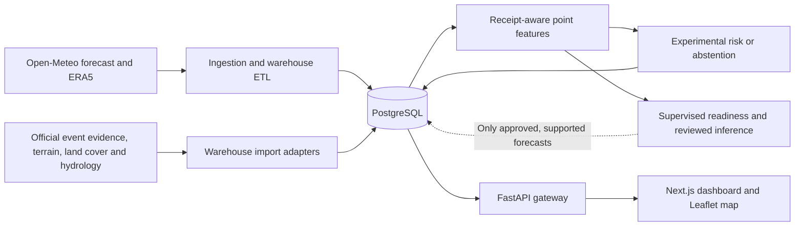

# FloodInsight Da Nang — Final verification and research report

**Verification date:** 25 November 2026, Vietnam time. **Research release decision:** experimental flood-risk assessment only. The retained evidence supports a reproducible risk workflow that can abstain. It does not support publication of a calibrated flood probability. The five monitoring points have no confirmed point-level wet or dry evidence, and their historical rainfall comes from one ERA5 grid cell.

## 1. Research objective

Assess and ultimately predict urban inundation around fixed monitoring points in Da Nang during the 24 hours after a decision. Keep rainfall ingestion, analytics, and legacy models available as separate weather capabilities. Verification used a cold PostgreSQL copy in the `floodinsight-phase6-qa` Compose project and isolated test databases. The retained upstream volume was mounted read-only for the copy.

## 2. System architecture



The warehouse owns migrations, historical ingestion, feature export and source coverage. The prediction service runs the separate risk and supervised paths. Analysis, classification and clustering keep their weather functions. The clustering service also exposes flood feature profiles with a coverage gate. Compose brought up all seven API services, PostgreSQL and the frontend with healthy status. The migration job exited successfully.

## 3. Sources and retained coverage

| Source | Retained coverage and verification |
| --- | --- |
| Open-Meteo historical weather | 125 raw receipts spanning 25 hourly valid-time stamps from 12 October 2023 17:00 UTC to 13 October 17:00 UTC. The 120 warehouse hour bins cover 13 October in Vietnam time. Each of the five points has 73.600 mm over that day from the same 0.25° ERA5 cell centred at 16.00° N, 108.25° E. No duplicate point/source/hour key or missing rain, temperature, humidity or wind value was found in these facts. There are no other retained weather dates. |
| Open-Meteo weather forecast | Zero retained snapshots at baseline. The QA collector inserted 125 raw records, comprising 120 hourly and five current snapshots, and an immediate repeat inserted zero. The flood extractor reads raw forecast snapshots directly. The hourly forecast fact table stayed empty and the historical ETL handles dated observations. Historical provider vintages were absent for both cases. |
| Copernicus GLO-30 and GLO-90 | Five elevation values per product and five GLO-30 slopes. GLO-30 values span 8.45–12.20 m and 0.22–6.56°. These are surface-model measurements at the points, with nominal spacings of about 30 and 90 m. |
| ESA WorldCover 2021 | Five 10 m centre classes and five built-up fractions from 11×11 windows. The fractions span 0.430–0.975 and serve as land-cover proxies. |
| ERA5 soil and Open-Meteo Marine | 120 shallow soil observations on 13 October 2023 UTC across five points sharing one grid cell, plus 24 modeled offshore sea-level values for 25 November 2026 UTC for one returned grid at about 16.2083° N, 108.2917° E. Soil is in m³/m³. Marine is metres relative to global mean sea level and has roughly 8 km spacing. |
| Vietnamese government reporting | One structured October 2022 region-level event. No qualifying point observations, observation coverage for dry periods, or systematic site gauge series. |

The five existing point codes are `cam-le`, `hai-chau`, `lien-chieu`, `ngu-hanh-son` and `thanh-khe`. Historical locality names are retained. The assessment geography is the point with a 50 m study radius for label matching. Administrative names identify locations without implying coverage of an entire district. River and drainage distances, river gauge series, local tides, imperviousness measurements, inundation polygons and drainage capacity have no verified rows for these points. The source inventory records acquisition, resolution, licensing, access and limitations for the sources considered, including SRTM, OSM, GloFAS, the Global Flood Database, and Sentinel. [Source inventory](FLOOD_DATA_SOURCES.md) · [Open-Meteo historical weather](https://open-meteo.com/en/docs/historical-weather-api) · [Copernicus DEM access](https://registry.opendata.aws/copernicus-dem/) · [ESA WorldCover access](https://esa-worldcover.org/en/data-access)

## 4. PostgreSQL design and baseline counts

PostgreSQL 16.16 was at Alembic revision `0008`. Revisions `0005` through `0008` add source assets, flood events and point observations, terrain and hydrology, dry-surveillance coverage, versioned risk assessments and task-constrained supervised outputs. Evidence references the existing point and source identities. Validity and receipt metadata support as-of reconstruction. Database constraints and deterministic keys support repeat imports and stable assessment replays.

| Baseline entities before QA writes | Count |
| --- | --- |
| Locations, date and time dimensions | 5, 1, 24 |
| Ingestion data sources and warehouse weather sources | 6, 1 |
| Historical raw, hourly and daily weather | 125, 120, 5 |
| Raw forecast and hourly forecast facts | 0, 0 |
| Historical batches, ingestion runs and warehouse runs | 5, 1, 2 |
| Flood provenance assets, regional events, terrain and hydrology | 10, 1, 25, 144 |
| Flood observation rows, including stored unknown rows | 0 |
| Stored risk assessments | 5, all Insufficient Data |
| Analysis results | 10 |
| Model versions, legacy prediction/classification/clustering results and flood probabilities | 0 in each table |

The ten provenance assets cover five ERA5 archive references, the two Copernicus products, WorldCover, the marine source and the government event report. The documented report event count is one. The number of independently linked target events is zero. Unknown candidates arise at dataset construction when no observation qualifies. There is no basis to label those candidates dry.

## 5. Feature engineering and issuance availability

`flood-point-v1` generates one row per point and UTC decision hour. Features include 1–72 h recent rain, max hourly and rolling 3 h rain, wet-hour intensity/count/longest spell, delayed antecedent rain and shallow soil wetness, next 6/12/24 h forecast rain, DEM elevation/slope, land-cover class and built-up fraction, offshore context and prior confirmed event counts. Missing bins keep the relevant feature null. A measured zero stays zero. Provenance carries constituent records, grid identities and time ranges.

Operational replay requires actual receipt by issuance, completed observation bins, a single complete forecast vintage, and a future forecast window. Missing model-init times are distinguished from known receipt times. Retrospective mode allows the documented 144-hour ERA5 delay assumption, suppresses future forecast and marine terms, and preserves actual receipt checks for static assets. The October 2023 retrospective sample reproduced its original row hash `b4c963d5806d0aeee29586f830bf4e391cf6c4133dd4ac90f55dd46a8c8d6f5e`. In its 40 rows, delayed soil was present in 40 and delayed 24 h rain in five. Every other feature was missing. The corresponding historical operational sample had zero available predictors. In the five-row November issuance sample, elevation, slope, cover, built-up fraction and offshore context were present everywhere. Rain and delayed-soil risk inputs were missing. Repeated observations at a shared weather grid do not increase the number of independent sites. [Feature schema, units and machine-readable quality exports](FLOOD_FEATURES.md)

## 6. Experimental risk index

`flood-risk-v1` normalizes factors to 0–1 with clipped ramps and combines them as a present-weight-adjusted 0–100 score. Nominal weights are 0.40 for next 24 h rain, 0.20 for recent 24 h rain, 0.15 for the recent hourly maximum, 0.15 for terrain and cover, and 0.10 for delayed soil wetness. Rain totals use 0–100 mm, hourly rain 0–50 mm, inverted elevation 0–20 m, built-up fraction 0–1, and soil 0.20–0.50 m³/m³. The terrain term averages the two terrain/cover inputs. Local heavy-rain guidance provides scale context for the 24 h anchor. Weights, ramps and risk bands remain experimental engineering choices.

Low is below 25, Moderate is 25–<50, High is 50–<75, and Very High is 75–100. Missing critical rain or terrain gives Insufficient Data and a null score. Soil alone may be absent in a limited assessment with at least 90% nominal weight. Factor values, point coordinates, grid context, input validity and receipt times, source references and method version are returned with the decision. The score has no probability interpretation. Illustrative sensitivity analysis showed a score of 49.175 ranging from 46.175 to 53.675 under the tested perturbations, crossing a display boundary. No local estimates of false alarms or detection support tightening these bands. [Risk methodology, sensitivity and thresholds](FLOOD_RISK_INDEX.md)

## 7. Supervised methodology and model lifecycle

The positive target is documented inundation within 50 m of a canonical point during `(issued_at, issued_at + 24h]`, with qualifying spatial/temporal evidence, medium/high confidence and an event link. A negative requires reviewed affirmative coverage across the full study unit and 24 h window. Unresolved, conflicting or late evidence stays unknown. The model procedure uses a fixed midnight-UTC decision per point-day, separate chronological fit/calibration/selection/test cohorts, disjoint point and transitive grid groups, and purging of overlapping targets and storm windows. The respective episode floors are 20/10/10/10 and dry-day floors 60/30/30/30, plus partition coverage screens. These are screening rules and do not establish statistical adequacy.

The implementation supports weighted Logistic Regression, Random Forest and histogram gradient boosting, and comparison against a 100 mm rain threshold and fit-cohort flood frequency. Selection uses validation data and a documented missed-episode versus false-alert cost. The final test cohort remains reserved. Publishing also requires recorded human review and supported-location evidence. Approved inference checks the flood-specific task, model version, artifact integrity, approval time, supported grids and feature ranges before loading and scoring. This route uses stored artifacts; it does not call training. The live blocked inference path was exercised. Stored-model flood behavior can only be verified with isolated test fixtures given the absence of approved real artifacts. [Model study, registry and procedures](FLOOD_MODEL_EVALUATION.md)

## 8. Actual evaluation results

| Measure | Result |
| --- | --- |
| Confirmed positive / dry targets | 0 / 0 |
| Independent linked flood events | 0 |
| Historical case replay | 480 unknown decisions and 480 abstentions across two windows |
| Current risk inspection | Five Insufficient Data outcomes. Each has null index and null flood probability. |
| Classified flood samples, published flood model versions and stored flood probabilities | 0 |
| Accuracy, balanced accuracy, precision, recall, F1, PR-AUC and ROC-AUC | Unavailable |
| Confusion matrix, false-alarm rate, event miss rate, per-location results and uncertainty intervals | Unavailable |
| Rainfall and historical-frequency baseline comparison on flood targets | Unavailable |

No detection, miss or false-alarm rate was inferred from unknown decisions. Class imbalance among known outcomes is undefined.

## 9. Probability calibration

The implementation fits sigmoid calibration on a dedicated cohort and considers isotonic only with enough rows, class support and score diversity. Selection compares Brier scores without opening the final test. There were zero eligible flood calibration and evaluation outcomes. Brier loss, calibration error and reliability curves are unavailable. All three legacy Joblib SHA-256 digests matched the benchmark manifest, and their versions remain assigned to rainfall totals, rain intensity and weather clustering. The QA database has no approved flood artifact to validate or publish. [Benchmark manifest](artifacts/ml-benchmark/manifest.json)

## 10. Historical Da Nang case studies

**14–15 October 2022, Đà Sơn and other affected areas.** Government reports document inundation and rescue in Đà Sơn, Hòa Khánh Nam, and other wards, including locations near the Cu Đê River. The national operations report records 637 mm in 24 hours at Đà Nẵng station. This station total is regional context and cannot be assigned to a project point. No coincident gauge time series, qualifying observations within the 50 m study units, or forecast vintages were retained. The five point DEM and land-cover assets were acquired in 2026, outside the issuance evidence window. The 48-hour operational replay yielded 240 unknown decisions and 240 abstentions. There were no scoreable detections, misses or false alarms. Rows SHA-256 `25dbcb566c701c7e72018db373f5a55d0dddbf3a3561dd4a94a98635e612818c`. [National operations report](https://phongchongthientai.mard.gov.vn/Pages/bao-cao-nhanh-cong-tac-truc-ban-pctt-ngay-14-10-2022.aspx) · [Government rescue report](https://baochinhphu.vn/trang-dem-ung-cuu-nguoi-dan-ngap-lu-tai-da-nang-102221015090757548.htm)

**13–15 October 2023, Khe Cạn, Mẹ Suốt and Nguyễn Nhàn.** Government reports document inundation and evacuations at locations in historical Thanh Khê, Liên Chiểu and Cẩm Lệ. An early report describes low Vu Gia and Cẩm Lệ river stages at reporting time. Later reports describe depths of about 1–1.3 m in parts of Mẹ Suốt. No continuous local gauge series or verified point-depth/observation match was available. The retained ERA5 grid reported 73.600 mm on 13 October Vietnam time. The accompanying modeled soil series and subsequently acquired terrain are descriptive; reanalysis receipts arrived in 2026 and no historical provider vintage existed. The case is externally documented and absent as a structured target in the warehouse. The separate 48-hour operational replay yielded 240 unknown decisions and 240 abstentions. Detection and false alarms are unscorable. Rows SHA-256 `64682f2d3317ac5e0492d0fa424b706cb6876d95e219aac50060c20ec5379f6f`. [Early official report](https://cms.baochinhphu.vn/da-nang-khan-truong-ung-pho-voi-mua-lon-ngap-lut-hoc-sinh-nghi-hoc-chieu-nay-10223101313054149.htm) · [Evacuation report](https://baochinhphu.vn/da-nang-so-tan-gan-5400-nguoi-khoi-vung-ngap-lut-102231014184023184.htm) · [Reported depths and aftermath](https://baochinhphu.vn/nguoi-dan-da-nang-don-dep-bun-dat-sau-mua-lu-102231015125121014.htm)

## 11. Dashboard

The dashboard exposes Flood Overview, Flood Risk Forecast, Rainfall Analytics, Machine Learning, Da Nang Flood Map and Data Management. Leaflet markers use green, yellow, orange, red and gray for the four score bands and missing data. Detail panels expose issue/validity times, resolution, inputs and evidence. The ML panel displays readiness and unavailable evaluation without invented metrics. The map supports point monitoring and has no verified inundation or district-wide forecast overlays. Rainfall charts and legacy analytics remain separately accessible. The UI labels the system an experimental research tool.

## 12. API contracts

All paths in the table are under `/api/v1` on the gateway. Success envelopes contain `data` and request metadata. The Next.js server proxy applies an explicit route allowlist.

| Method and path | Purpose |
| --- | --- |
| GET `/flood-risk/latest`, `/flood-risk/locations` | Latest point status, validity, and coordinate inventory |
| GET `/flood-risk/history`, `/flood-risk/{location}/details` | Stored assessments and per-point evidence |
| POST `/flood-risk/generate` | Optional location and issuance, deterministic replay of stored evidence |
| POST `/flood-predictions/train` | Readiness gate and review-required model training when eligible |
| POST `/flood-predictions/predict` | Requires a location. Approved-model inference or explicit blocked status |
| GET `/flood-predictions/results`, `/flood-predictions/metrics`, `/flood-predictions/readiness` | Persisted forecasts, evaluation and data gates |
| GET `/flood-data/coverage`, `/system/status` | Coverage and service health |
| GET `/clustering/flood-profiles` | Exploratory terrain profiles without confirmed flood classes |
| POST `/weather/ingestion/run`, `/weather/backfill`, `/weather/etl/run` | Existing live collection, historical ingestion and warehouse ETL |

See the gateway's `/docs` and the [dashboard contract report](FLOOD_DASHBOARD_REPORT.md).

## 13. Deployment and reproducible demonstration

Run from the repository root with Docker Compose v2 and PostgreSQL credentials in `.env`, as described in the [README](README.md). The project and ports below isolate the demo. To reproduce the exact counts, first restore the retained PostgreSQL snapshot into the QA project's own `postgres-data` volume. A fresh volume shows an empty evidence inventory. Any cold copy should be made with the origin stopped and mounted read-only. In Windows Docker Desktop environments with non-default contexts, use `docker -H npipe:////./pipe/dockerDesktopLinuxEngine` in place of `docker`.

```powershell
$qa = 'floodinsight-phase6-qa'
$env:API_PORT = '28000'
$env:FRONTEND_PORT = '23000'
$env:POSTGRES_PORT = '25432'
$env:INGESTION_PORT = '28001'
$env:WAREHOUSE_PORT = '28002'
$env:ANALYSIS_PORT = '28003'
$env:CLUSTERING_PORT = '28004'
$env:PREDICTION_PORT = '28005'
$env:CLASSIFICATION_PORT = '28006'
$env:FLOODINSIGHT_INGESTION_SCHEDULER_ENABLED = 'false'
docker compose -p $qa config --quiet
docker compose -p $qa up -d --build --wait
$api = 'http://127.0.0.1:28000/api/v1'
Invoke-RestMethod "$api/system/status"
Invoke-RestMethod "$api/flood-data/coverage"
Invoke-RestMethod "$api/weather/ingestion/run" -Method Post -ContentType application/json -Body '{}'
Invoke-RestMethod "$api/flood-risk/generate" -Method Post -ContentType application/json -Body '{}'
Invoke-RestMethod "$api/flood-predictions/readiness"
Invoke-RestMethod "$api/flood-predictions/predict" -Method Post -ContentType application/json -Body '{"location":"hai-chau"}'
Start-Process 'http://127.0.0.1:23000'
```

Replay the historical windows on the restored QA database. Keep the output as JSON and retain the row hash when comparing revisions.

```powershell
function Invoke-WarehouseModule {
    docker compose -p $qa run -T --rm --no-deps -v "${PWD}/services/ml-common:/opt/ml-common:ro" -e PYTHONPATH=/opt/ml-common:/app warehouse-service python -m @args
}
foreach ($window in @(
    @{Start = '2022-10-13T17:00:00Z'; End = '2022-10-15T16:00:00Z'}
    @{Start = '2023-10-12T17:00:00Z'; End = '2023-10-14T16:00:00Z'}
)) {
    $rows = Invoke-WarehouseModule floodinsight_warehouse.flood_dataset --mode operational --start $window.Start --end $window.End --as-of 2026-11-25T14:00:00Z
    $rows | docker compose -p $qa run -T --rm --no-deps -v "${PWD}/services/ml-common:/opt/ml-common:ro" -e PYTHONPATH=/opt/ml-common:/app warehouse-service python -m floodinsight_ml.flood_risk_validation -
}
```

For the connected backend suites below, use the QA snapshot. Keep legacy ML, ETL and downgrade tests on separately migrated scratch databases. Inside `frontend`, set `DASHBOARD_TEST_URL` to the QA UI URL, `FLOOD_TEST_GATEWAY` to the gateway origin, and `DASHBOARD_BROWSER_PATH` to the Chrome executable. Run `npm ci`, `npm run typecheck`, `npm run lint`, `npm run build`, `npm run test:flood-api` and `npm run test:dashboard`. At the end, `docker compose -p $qa stop` leaves the QA volume available for reuse.

```powershell
docker compose -p $qa run -T --rm --no-deps -v "${PWD}/services/ml-common:/opt/ml-common:ro" -v "${PWD}/services/warehouse-service/tests:/app/tests:ro" -e PYTHONPATH=/opt/ml-common:/app -e FLOODINSIGHT_RUN_RISK_DB_TESTS=1 warehouse-service python -m unittest discover -s tests -p 'test_flood*.py'
docker compose -p $qa run -T --rm --no-deps -v "${PWD}/services/prediction-service/tests:/app/tests:ro" -e FLOODINSIGHT_RUN_FLOOD_MODEL_INTEGRATION=1 prediction-service python -m unittest discover -s tests -p test_flood_prediction.py
```

## 14. Integration and test results

| Check | QA result |
| --- | --- |
| Compose configuration and health | Passed. Nine runtime services healthy, one migration job completed, and the gateway reported every backend healthy. |
| Database migrations | Five clean test databases migrated through `0008`. The `0008 → 0007 → 0008` round trip passed on a disposable database. |
| Ingestion, warehouse and gateway pytest | Ingestion 7 passed, warehouse 32 passed with 2 opt-in risk tests run separately, gateway 6 passed. |
| Legacy analysis pytest | 5 passed with live ERA5 seed data. |
| Live backfill and historical ETL | 11,050 raw and 11,040 fact rows across October 2022 and October–November 2023 in the separate analysis DB. Another 34,690 raw and 34,680 fact rows in the legacy ML test DB. These are QA-only counts. |
| Flood adapter replays | Two passes each for official event, elevation and soil collectors. Validated 1, 5 and 120 values/records per pass respectively. Zero duplicates inserted in all six passes on the populated copy. |
| Operational and retrospective exports | Both operational case windows and the retrospective replay reproduced. |
| Connected risk tests | 9 passed, including the two opt-in persistence/DB cases. |
| Prediction pytest | 9 passed, 1 opt-in case run separately. |
| Connected flood prediction tests | 7 passed, including gate and storage checks. The live gateway train and predict routes returned `insufficient_training_data` with null probability and zero flood registry/results rows. |
| Flood terrain profiles | Live API grouped five complete points into exploratory groups of four and one, with zero excluded points. |
| Frontend | Type checking, ESLint and optimized Next.js build passed. The live gateway/proxy contract and Chrome tests passed, including flood/rainfall views, generation, sorting, details, map, model coverage, theme, mobile layout and error states. |
| Legacy clustering pytest | 3 passed and 1 failed on both runs. The registry mock interprets the new final metadata-filter parameter as the requested version and returns no candidate. The fixture therefore fails before it exercises missing-artifact fallback. |
| Legacy classification pytest | 2 passed and 1 failed on the first run. The recreated Moderate Rain probability differed by about 8 × 10⁻¹⁷ and failed exact dictionary equality. All 3 passed on rerun. |

The verification exercises successful collection and storage, point features, risk persistence, abstention and model gating. The assessment replay retained five records after repeated identical requests. An operational warning or probability for a historical flood could not be verified. Both legacy test issues are recorded as observed. This phase changed only this report.

## 15. Scientific limitations

The project has one dated day of retained weather facts and one observed historical rainfall grid. Urban drainage, topography below the raster resolution, river conditions and localized rain may vary within that grid. DSM heights can contain buildings and vegetation, and built-up cover cannot determine hydraulic imperviousness. Offshore sea level describes regional conditions and does not resolve local tides or backwater effects. The lack of near-real-time observations leaves critical rain windows open. The stitched forecast feed uses receipt as the observable vintage boundary and snapshot deduplication can leave individual receipts incomplete.

The available cases demonstrate the hazard and the evidence gap. They cannot quantify skill. Fifty metres specifies the matching radius, and overlapping hourly windows around one storm do not provide independent positive episodes. Current readiness requires representative surveillance, enough independent storms and documented dry coverage, distinct grids and sites, usable issue-time measured and forecast inputs, disjoint historical evaluation and an approved calibration study.

## 16. Research priorities

1. Obtain licensed, exportable municipal site-level inundation and sensor history, including timestamps, spatial uncertainty, outages and known operating windows. The Smart City publisher describes 279 geocoded October 2022 peak points in the application. Their raw export and dry-time coverage remain unverified. [Municipal Smart City guide](https://binhdanhocvuso.danang.gov.vn/cach-theo-doi-tinh-hinh-mua-ngap-tai-da-nang-qua-ung-dung-danang-smart-city/)
2. Collect local gauge/radar rainfall and relevant river and tidal observations with receipt timestamps, source datums and station-to-point lineage. Archive full weather forecast vintages across multiple monsoon seasons.
3. Obtain authorized drainage and surveyed terrain data. Validate terrain, distance and drainage covariates at multiple sites and keep uncertainty explicit.
4. Pre-register independent storm groups and the surveillance sampling frame. Evaluate held-out probabilities and reliability with uncertainty derived from independent storm and dry blocks before considering release.
