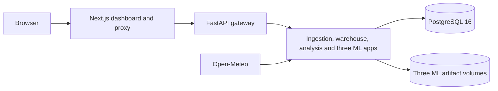
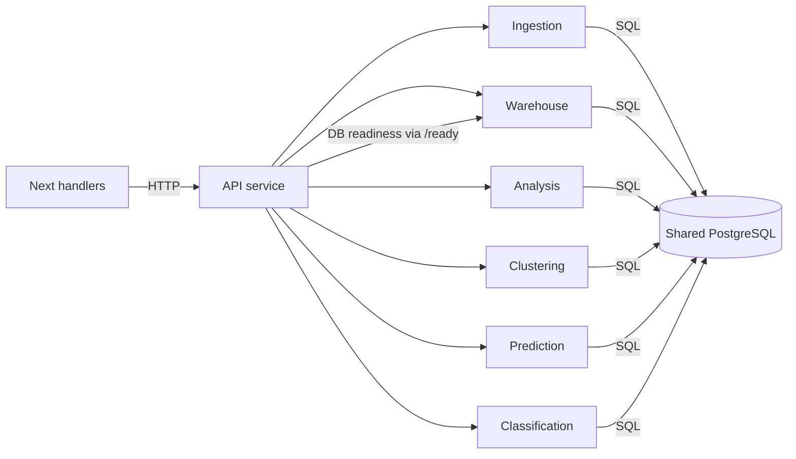
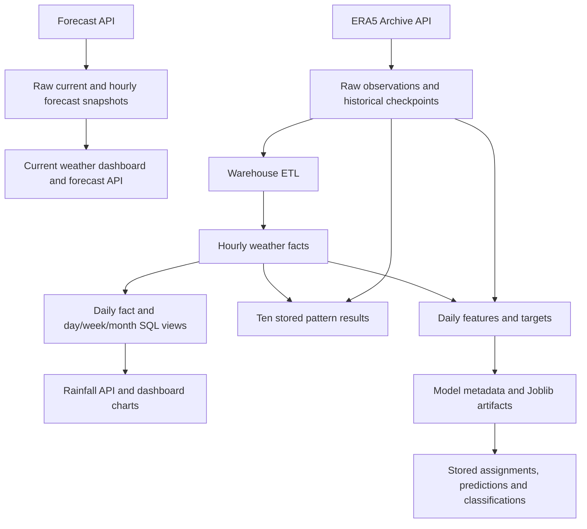
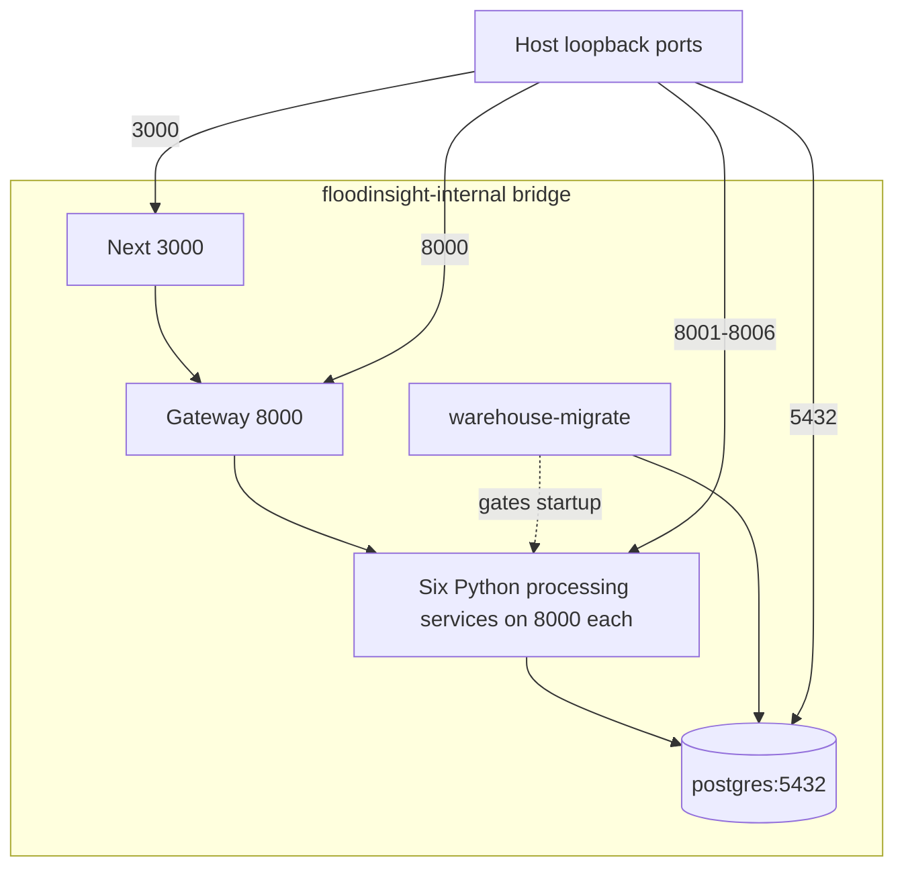

# FloodInsight Da Nang project context

## 1. Executive summary and current status

Snapshot: November 25, 2026, commit `2c7d2fd`. FloodInsight Da Nang is an academic weather-monitoring and data-mining system. It polls modeled weather for five Da Nang points, loads historical ERA5 separately, serves chart-ready rainfall and statistical patterns, and applies three ML workflows to historical weather. Its practical scope is monitoring, exploration, and demonstration. There are no flood-event labels, hydrological inputs, alert delivery, or validated flood-risk predictions. No separate academic assignment document was found among tracked files. Section 11 assesses the requirements supplied with this review.

**Reviewed evidence.** Read 143 tracked source/test files (`.py`, `.ts`, `.tsx`, `.mjs`, `.css`) and inspected supporting migrations, manifests, Docker configuration, fixtures and documentation. The count includes package marker files and tests. There are seven Python microservices and one Next.js frontend. Compose also defines PostgreSQL and one migration job. There are 72 custom HTTP method/path registrations across these applications. This includes aliases and health routes and excludes the dashboard page and framework-generated routes.

**What works in source.** Both collection paths, the historical warehouse, ten stored statistical patterns, model training and stored-model inference, and five dashboard sections are implemented. The README's future-phase framing understates the implemented functionality. Compose starts the scheduler but leaves historical backfill, ETL, analytics generation and training to explicit operations. Browser access is narrower than the gateway API surface. Services deploy separately and share the same relational database and credentials. `ml-common` is a build-time library, not a network service.

**Verified during this review.** All three local benchmark artifact file hashes match their manifest. Docker CLI could not access its configuration or reach the default Windows engine named pipe. TCP connections to default loopback ports 3000, 5432 and 8000 failed. No stack was started, no tests or mutating endpoints were invoked, and no Joblib object was deserialized. Live observations, results, model registration, health and browser state remain unverified. `docs/dashboard-recovery.md` records an earlier live run independently of this review.

## 2. Repository map and stack

```text
.
├── .env.example / .gitignore / README.md / docker-compose.yml
├── artifacts/ml-benchmark/   local manifest and three Joblib artifacts, outside git
├── config/python-logging.json
├── docs/                    gateway, dashboard, recovery, ingestion, historical ETL,
│                            machine learning, time-series analysis, warehouse schema
├── scripts/recover_dashboard.py
├── frontend/
│   ├── app/{page.tsx,layout.tsx,globals.css}
│   ├── app/api/{health,backend/[...path]}/route.ts
│   ├── app/dashboard/{dashboard,chart,weather-panels,operation-panels,station-map,ui}.tsx
│   ├── app/dashboard/{data,rainfall}.ts
│   ├── public/{da-nang-coastline.geojson,da-nang-night.jpg}
│   ├── tests/dashboard.mjs
│   └── Dockerfile, package manifests, Next/TypeScript/ESLint/PostCSS configs
└── services/
    ├── api-service/            gateway routes, public schemas, Upstreams client
    ├── ingestion-service/      forecast provider adapter, scheduler, ingest repository
    ├── warehouse-service/      historical and read routes, ORM, ETL and calendar
    │   ├── alembic.ini
    │   └── migrations/{env.py,script.py.mako,versions/0001…0004}
    ├── analysis-service/       pattern schemas, generators and persistent repository
    ├── clustering-service/     cluster routes, fitting and daily assignment repository
    ├── prediction-service/     next-day regression routes and model implementation
    ├── classification-service/ next-day label/probability routes and classifier
    └── ml-common/              pyproject.toml and floodinsight_ml/{api,daily,daily_results,schemas,storage}.py
```

Each Python app has a `Dockerfile`, requirements and development requirements, a `floodinsight_<name>` package with `main.py`, `config.py`, route/schema packages, and tests. `main.py:create_app` constructs each application. Package markers with no logic exist in several directories. `scripts/recover_dashboard.py` is an operator client, with separate data and output phases and checkpoints/reuse logic. The ingestion and warehouse tests include provider JSON fixtures. Analysis tests include regeneration; gateway tests cover proxy contracts/coverage; ML tests cover training and inference, including clustering registry integrity. Frontend `tests/dashboard.mjs` exercises browser behavior with Playwright Core and optional recovery/model expectations. DB tests are opt-in and should use their named disposable databases.

| Component | Declared stack |
| --- | --- |
| Containers | Python 3.11 slim, Node 22 Bookworm slim, PostgreSQL 16, Docker Compose v2 with additional build contexts |
| REST | FastAPI >=0.115,<1, Uvicorn >=0.34,<1, Pydantic >=2.10,<3, pydantic-settings >=2.7,<3 |
| IO and storage | HTTPX >=0.28,<1, psycopg >=3.2,<4, SQLAlchemy >=2.0,<3, Alembic >=1.14,<2, APScheduler >=3.11,<4, python-json-logger >=3.3,<5 |
| Analysis and ML | pandas >=2.2,<3, NumPy >=2,<3, scikit-learn >=1.6,<2, Joblib >=1.4,<2; benchmark manifest records scikit-learn 1.9.1 |
| Frontend | Next ^16.0.0, React/React DOM ^19.2.0, TanStack Query ^5.108.0, ECharts ^6.0.0, Leaflet ^1.9.4, React Leaflet ^5.0.0, Lucide ^1.75.0, Manrope ^5.3.0 |
| Frontend tooling | TypeScript ~5.9.0, Tailwind/PostCSS ^4.1.0, ESLint ^9.39.5, ESLint Next config ^16.4.6, Playwright Core ^1.65.1; package-lock.json fixes the npm resolution |

Selected npm lockfile resolutions are Next 16.4.6, React 19.3.1, TanStack Query 5.108.0, ECharts 6.1.0, Leaflet 1.9.4, React Leaflet 5.0.0, TypeScript 5.9.3, Tailwind 4.3.5 and ESLint 9.39.5. Python requirements express compatibility ranges; installed runtime versions were unavailable.

## 3. Architecture and deployment









| Compose unit | Entry point | Container → default loopback | Responsibility and dependencies | Startup/job status |
| --- | --- | --- | --- | --- |
| api-service | `floodinsight_api.main:app` | 8000 → 8000 | HTTP-only gateway, probes all six apps and warehouse DB readiness | FastAPI, no scheduler or direct SQL |
| ingestion-service | `floodinsight_ingestion.main:app` | 8000 → 8001 | Open-Meteo forecast and psycopg writes | Waits for migrations; APScheduler default 300 s |
| warehouse-service | `floodinsight_warehouse.main:app` | 8000 → 8002 | Archive API, SQLAlchemy reads and ETL, DB readiness | Waits for migrations; manual processing |
| analysis-service | `floodinsight_analysis.main:app` | 8000 → 8003 | psycopg historical inputs and stored patterns | Waits for migrations; manual generation |
| clustering-service | `floodinsight_clustering.main:app` | 8000 → 8004 | Shared ML package, DB and clustering volume | Waits for migrations; manual train/run |
| prediction-service | `floodinsight_prediction.main:app` | 8000 → 8005 | Shared ML package, DB and prediction volume | Waits for migrations; manual train/predict |
| classification-service | `floodinsight_classification.main:app` | 8000 → 8006 | Shared ML package, DB and classification volume | Waits for migrations; manual train/predict |
| frontend | Next development target | 3000 → 3000 | Dashboard and an HTTP allowlist proxy | Waits for gateway liveness |
| postgres | `postgres:16` default entrypoint | 5432 → 5432 | Shared default schema, `postgres-data` volume | SQL `SELECT 1` health check |
| warehouse-migrate | `alembic upgrade head` | None | One-shot warehouse image | Runs after PostgreSQL becomes healthy |

To start in a later authorized session, use `Copy-Item .env.example .env` if `.env` is absent, set `POSTGRES_USER` and `POSTGRES_PASSWORD` locally, then run `docker compose config --quiet` and `docker compose up -d --build --wait` from the repository root. This starts scheduled collection with default settings. Use `docker compose ps` for status. The UI is `http://127.0.0.1:3000`; each Python app has `/docs`, `/redoc` and `/openapi.json` on its listed port. Database settings inside Compose are `POSTGRES_HOST=postgres`, `POSTGRES_PORT=5432`, `POSTGRES_DB=floodinsight` by default, and the two required secret values from local environment configuration. The app-specific environment prefixes and defaults live in `docker-compose.yml`, `.env.example` and the service `config.py` files. Host overrides are `API_PORT`, `INGESTION_PORT`, `WAREHOUSE_PORT`, `ANALYSIS_PORT`, `CLUSTERING_PORT`, `PREDICTION_PORT`, `CLASSIFICATION_PORT`, `FRONTEND_PORT`, `POSTGRES_PORT`. Gateway overrides include six `FLOODINSIGHT_API_*_URL` values and `FLOODINSIGHT_API_CORS_ORIGINS`. The frontend server uses `FLOODINSIGHT_API_URL`, and Compose enables `WATCHPACK_POLLING`.

Python health probes use `/health` every five seconds and mostly indicate process liveness. Warehouse `/ready` checks DB access. Frontend container probes `/`, while its `/api/health` proxies gateway liveness. Compose rotates `json-file` output at 10 MB with three files and mounts `config/python-logging.json` for Uvicorn logs. Python source and Next app code have development bind mounts. The frontend also has a standalone production Docker stage. Loopback bindings and the bridge suit local development; the bridge permits external weather calls. Back up each `/models` volume (`clustering-models`, `prediction-models`, `classification-models`) together with PostgreSQL for model recovery.
## 4. Database and data warehouse

`services/warehouse-service/migrations/versions/0001_warehouse_star_schema.py` creates the baseline, `0002_forecast_snapshots.py` extends raw forecast and run tracking, `0003_historical_etl.py` creates checkpoints, quality, calendar function and views, and `0004_ml_metadata.py` adds the three ML JSON objects. `services/warehouse-service/floodinsight_warehouse/repositories/models.py` maps 18 application tables in the default PostgreSQL schema (typically `public`). Alembic also maintains `alembic_version.version_num` as revision bookkeeping. This is a dimensional weather warehouse with a shared set of dimensions, raw staging, and separate output tables. `dim_time` references `dim_date`, and source has an upstream registry, so parts of its dimension graph are normalized.

Column notation: `B` bigint, `I` integer, `S` smallint, `Vn` varchar(n), `T` timestamptz, `D` date, `J` JSONB, `N(p,s)` numeric, `X` text, `?` nullable. Unless otherwise indicated surrogate `id` columns are bigint identities. PK/unique constraints also create PostgreSQL indexes.

| Table (ORM line) | Columns, with shared column sets below | Keys, constraints and additional indexes |
| --- | --- | --- |
| `data_sources` (43) | id B, code V100, provider V200, dataset V200, reference_url X? | PK id, unique code |
| `ingestion_runs` (53) | id B, source_id B, run_key V200, status V16, started_at T, finished_at T?, trigger V16?, records_inserted I?, error_message X? | FK source; unique source/run key and id/source; status lifecycle, trigger and nonnegative count checks; source/id history index |
| `raw_weather_observations` (90) | Raw | PK id; composite FK run/source; unique source/point/valid; index run/source; finite valid time and JSON object |
| `raw_weather_forecasts` (103) | Raw + issued_at T?, snapshot_hash V64? | PK id; composite FK run/source; unique source/point/valid/issue and partial unique source/point/valid/hash; run/source index, partial current-snapshot index on source/point/valid/receipt; issue ≤ validity or valid SHA-256 hash, and JSON object |
| `dim_date` (137) | local_date D | PK local_date, finite date |
| `dim_time` (144) | hour_start_utc T, local_date D, local_hour S | PK hour; date FK; generated Vietnam date/hour; whole UTC hour check; date/hour index |
| `dim_location` (167) | id B, code V100, name V200, latitude N(9,6), longitude N(9,6) | PK id, unique code, coordinate ranges |
| `dim_weather_source` (181) | id B, data_source_id B, name V200 | PK id, unique FK data_source_id |
| `fact_weather_hourly` (223) | Hourly + measures | PK loc/source/hour; index hour; measure checks |
| `fact_weather_forecast_hourly` (232) | Hourly + measures + issued_at T | PK loc/source/hour/issue; index hour/issue; finite issuance ≤ hour; measure checks; current ingestion and forecast reads take the raw path |
| `fact_rainfall_daily` (244) | location_id B, weather_source_id B, local_date D, rainfall_total_mm N(14,3), hours_with_rainfall S | Composite PK and FKs to dimensions; date index; nonnegative rain and 1–26 valid hours |
| `model_versions` (260) | id B, kind V16, model_name V100, version V80, artifact_uri X?, training_metadata J, created_at T | PK id, unique kind/name/version and id/kind; allowed kinds and JSON object |
| `analysis_results` (304) | Windowed + analysis_key V200, result J | Unique key/loc/source/window; location/window-start index, finite ordered window and JSON object |
| `clustering_results` (323) | Windowed + Model + cluster_label I, details J | Unique model/loc/source/window; location/window-start index; finite ordered window, fixed kind and details object |
| `prediction_results` (345) | Target + Model + rainfall_mm N(12,3) | Unique model/loc/source/target/issue; location/target index; finite issue ≤ target, fixed kind and nonnegative rain |
| `classification_results` (362) | Target + Model + label V100, confidence N(7,6)?, probabilities J | Unique model/loc/source/target/issue; location/target index; finite issue, fixed kind, confidence range, probability object |
| `warehouse_runs` (382) | id B, operation V16, start_date D, end_date D, status V16, started_at T, finished_at T?, progress J, error_message X? | PK id, operation/dates/status lifecycle checks |
| `historical_batches` (406) | id B, source_id B, location_code V100, start_date D, end_date D, ingestion_run_id B, backfill_run_id B, etl_run_id B?, quality J? | PK id; source FK, composite run/source FK, two warehouse run FKs; unique source/point/start/end; start/end index, ETL and quality nullity match |

- Raw = id B, source_id B, ingestion_run_id B, source_location_key V200, valid_at T, payload J, received_at T. Code strings in raw and checkpoint rows preserve provider identity. Their dimension FKs appear in the curated layer.
- Hourly = location_id B, weather_source_id B, hour_start_utc T, each an FK to its dimension. Measures = rainfall_mm N(12,3)?, air_temperature_c N(6,2)?, relative_humidity_pct N(5,2)?, wind_speed_mps N(8,3)?. Checks enforce usable values, unit-specific ranges and at least one measurement.
- Result base = id B PK, location_id B FK, weather_source_id B FK, created_at T. Windowed adds window_start_utc T and window_end_utc T. Target adds target_hour_utc T FK and issued_at T. The next-day target uses the first local-day instant as its key. Model adds model_version_id B and model_kind V16, together an FK to `model_versions(id,kind)`.
- Time and source dimensions, `warehouse_local_day_start(date)`, and three `vw_weather_*` views support civil-day aggregation. Views expose location/source, period bounds, rain sum, non-null rain hours, loaded/expected hours, and hourly means for temperature/humidity/wind.

```mermaid
erDiagram
  DATA_SOURCES ||--o{ INGESTION_RUNS : registers
  INGESTION_RUNS ||--o{ RAW_WEATHER_OBSERVATIONS : records
  INGESTION_RUNS ||--o{ RAW_WEATHER_FORECASTS : records
  INGESTION_RUNS ||--o{ HISTORICAL_BATCHES : supplies
  DATA_SOURCES ||--o{ HISTORICAL_BATCHES : scopes
  WAREHOUSE_RUNS ||--o{ HISTORICAL_BATCHES : backfills
  WAREHOUSE_RUNS o|--o{ HISTORICAL_BATCHES : loads
  DATA_SOURCES ||--o| DIM_WEATHER_SOURCE : maps
  DIM_DATE ||--o{ DIM_TIME : groups
  DIM_TIME ||--o{ FACT_WEATHER_HOURLY : keys
  DIM_TIME ||--o{ FACT_WEATHER_FORECAST_HOURLY : keys
  DIM_DATE ||--o{ FACT_RAINFALL_DAILY : keys
  DIM_LOCATION ||--o{ FACT_WEATHER_HOURLY : scopes
  DIM_LOCATION ||--o{ FACT_WEATHER_FORECAST_HOURLY : scopes
  DIM_LOCATION ||--o{ FACT_RAINFALL_DAILY : scopes
  DIM_WEATHER_SOURCE ||--o{ FACT_WEATHER_HOURLY : scopes
  DIM_WEATHER_SOURCE ||--o{ FACT_WEATHER_FORECAST_HOURLY : scopes
  DIM_WEATHER_SOURCE ||--o{ FACT_RAINFALL_DAILY : scopes
  DIM_LOCATION ||--o{ ANALYSIS_RESULTS : scopes
  DIM_LOCATION ||--o{ CLUSTERING_RESULTS : scopes
  DIM_LOCATION ||--o{ PREDICTION_RESULTS : scopes
  DIM_LOCATION ||--o{ CLASSIFICATION_RESULTS : scopes
  DIM_WEATHER_SOURCE ||--o{ ANALYSIS_RESULTS : scopes
  DIM_WEATHER_SOURCE ||--o{ CLUSTERING_RESULTS : scopes
  DIM_WEATHER_SOURCE ||--o{ PREDICTION_RESULTS : scopes
  DIM_WEATHER_SOURCE ||--o{ CLASSIFICATION_RESULTS : scopes
  DIM_TIME ||--o{ PREDICTION_RESULTS : target
  DIM_TIME ||--o{ CLASSIFICATION_RESULTS : target
  MODEL_VERSIONS ||--o{ CLUSTERING_RESULTS : assigns
  MODEL_VERSIONS ||--o{ PREDICTION_RESULTS : predicts
  MODEL_VERSIONS ||--o{ CLASSIFICATION_RESULTS : classifies
```



### Historical runtime evidence and current limits

Repository recovery log dated November 18, 2026 reported five locations, one warehouse source, 250 raw forecast rows, 36,490 raw historical rows, 36,480 hourly facts, 1,520 daily facts, 55 historical batches, 110 analysis results, 3 versions, 1,520 clustering outputs and 5 rows each for regression and classification. It reports historical windows June 1, 2023 through February 29, 2024 and October 14 through November 12, 2026, with a gap, zero null rainfall in loaded hourly/daily records, zero duplicate raw observation keys and zero unvalidated FKs. These are reported values for that run. Current counts for all 18 tables, timestamp bounds, sources/locations, completeness, duplicates, integrity, result contents and registered versions could not be queried. The earlier record gives local coverage dates and does not give per-table timestamp bounds or counts for every table.

## 5. Collection and ETL

| Code / sample name | Latitude | Longitude |
| --- | ---: | ---: |
| `hai-chau` / Hải Châu | 16.076345 | 108.221783 |
| `thanh-khe` / Thanh Khê | 16.071259 | 108.191634 |
| `lien-chieu` / Liên Chiểu | 16.072720 | 108.158150 |
| `cam-le` / Cẩm Lệ | 16.015300 | 108.201300 |
| `ngu-hanh-son` / Ngũ Hành Sơn | 16.008333 | 108.252500 |

**Modeled current and future.** `services/ingestion-service/floodinsight_ingestion/services/open_meteo.py:OpenMeteoClient` calls `https://api.open-meteo.com/v1/forecast` with the point coordinates, `current` and `hourly` variable lists, `temperature_unit=celsius`, `wind_speed_unit=ms`, `precipitation_unit=mm`, `timeformat=unixtime`, `timezone=GMT`, and `forecast_hours` default 24. It requests `temperature_2m` °C, `relative_humidity_2m` %, `wind_speed_10m` m/s, `precipitation`, `rain`, `showers` in mm, `pressure_msl` hPa, and `weather_code` WMO code. Pydantic validates units, value ranges, array lengths, timestamps and forecast length. `to_snapshots` keeps requested and returned grid coordinates, interval length, current/hourly kind and values. Raw validity is provider time, receipt is local retrieval, and this feed leaves issuance NULL. Historical valid times from that feed still represent model output. [Open-Meteo Forecast API](https://open-meteo.com/en/docs)

`main.py:lifespan` schedules attempts every 300 seconds in UTC with coalescing and one instance. HTTPX defaults to 12 seconds per request and three attempts, retrying transient IO and HTTP 408/429/5xx with bounded backoff and Retry-After support. `services/ingestion.py:IngestionService` collects/validates all five responses before snapshot persistence. `repositories/ingestion.py:IngestionRepository` owns the advisory lock, run transitions and deduplication by source/location/valid time/content SHA-256. It saves under `open-meteo-forecast-api` to `raw_weather_forecasts`, preserves first receipt for repeated content, records failures, and marks interrupted runs failed after reacquiring the lock. `/ingestion/latest` reads modeled current. Warehouse forecasts deduplicate hourly revisions on read using issuance or receipt. Collector frequency is independent of provider model updates.

**ERA5 extraction.** `services/warehouse-service/floodinsight_warehouse/services/historical.py:ArchiveClient.fetch` calls `https://archive-api.open-meteo.com/v1/archive` with coordinates, UTC `start_date`/`end_date`, `models=era5`, GMT/epoch time, °C/m/s/mm, and hourly `temperature_2m`, `relative_humidity_2m`, `wind_speed_10m`, `rain`, `precipitation`. It requests the boundary hour needed for interval-ending rainfall. It validates response units and hourly series, retries transient failures (default three attempts, 30 s per request) and rejects unusable batches. Earliest allowed complete local day is January 2, 1940; the latest requested day must be at least five days before UTC today. Open-Meteo lists hourly ERA5 at 0.25° (roughly 25 km), with about five days of publication delay. Closely spaced districts can share grid inputs, so location-specific differences and effective sample size can be much smaller than row counts suggest. [Open-Meteo Historical Weather API](https://open-meteo.com/en/docs/historical-weather-api)

**Historical load.** `services/pipeline.py:HistoricalPipeline.run` divides an inclusive local window into point/month batches, and `repositories/historical.py:HistoricalRepository` locks the pipeline and records runs and progress. Backfill defaults to five batches per call, ETL to 20. `save_batch` commits checkpoint and raw rows together under `open-meteo-archive-era5`. The unique raw key retains the first payload/receipt for overlapping requests. `load_batch` selects fully contained checkpoints, transforms raw rows, creates source/location/time/date keys, replaces the affected hourly and daily facts and saves the quality JSON transactionally. Reprocessing supports `reprocess` and `after_batch_id`; use the original backfill bounds to include the expected checkpoints. A successful bounded call can leave `remaining_batches` positive. No scheduler loads the historical path.

`services/transform.py:transform_hours` assigns raw rain at `t+1h` to fact hour `t`; temperature, humidity and wind join `t`. The parser separates liquid rain from total precipitation. Values outside configured bounds or missing remain NULL and valid values are rounded to column scale. Wholly empty hours produce no fact. Quality tracks missing raw timestamps, missing/invalid values per variable, discarded and loaded hours, and rain coverage. `replace_daily` uses `SUM(rainfall_mm)` over non-null hours by Vietnam calendar date; true zero counts, and a day with zero measured hours has no daily fact. SQL views aggregate hourly facts dynamically by day, Monday-based week, or month and compute expected hours from local-day UTC boundaries. List queries return periods overlapping the request and can include observations outside its bounds in the boundary weeks/months. Analysis has its own window-first aggregation and explicitly inserts missing periods. Raw archive revisions, gaps between historical backfill windows, partial periods, and retry/checkpoint boundary changes can affect reproducibility or interpretation. Lineage is reconstructable through source/location/time and checkpoint/run rows. Hourly facts have no direct raw-record or ETL-run FK.
## 6. Analytics

`services/analysis-service/floodinsight_analysis/services/patterns.py:calculate_patterns` (line 182) builds ten Pandas/NumPy outputs. `repositories/patterns.py:resolve_scope` (31) resolves location and source code through dimensions. `read_inputs` (45) reads facts for the exact window and raw ERA5 precipitation aligned to the interval end. `regenerate` (97) calculates and replaces the scoped `timeseries:v1:` rows in one transaction. Results are keyed by pattern, location, source and UTC window. `retrieve` returns the exact saved window, optionally narrowed to one pattern. Direct `/analysis/generate` and gateway `/api/v1/analytics/generate` recreate deleted rows from existing inputs. Reads perform no generation. Refresh is manual (or scripted) and ETL does not automatically invalidate saved patterns.

| Result key suffix | Function and calculation | UI and output |
| --- | --- | --- |
| `rainfall_daily`, `rainfall_weekly`, `rainfall_monthly` | `rainfall_periods` and `rainfall_line` (23, 65); sum non-null hourly liquid rain within window, explicit missing periods, Monday weeks, coverage | Stored ECharts line options. Dashboard `RainfallPanel` instead builds line options from dynamic warehouse views via `/rainfall/{period}`. |
| `rainfall_vs_humidity`, `rainfall_vs_temperature` | `scatter` (80); pair same-hour valid values, deterministic sample up to 2,000, report complete-pair count | Stored scatter options; `Analytics` pattern panels |
| `rainfall_histogram` | `histogram` (91); bin non-null hourly rain, including measured zero | Stored bar option plus numeric bin edges/counts; `Analytics` |
| `monthly_trend` | `monthly_trend` (108); OLS over elapsed calendar months with gaps preserved, complete months only, at least two; slope and R² where defined | Stored fitted and observed series; `Analytics` |
| `monthly_seasonality` | `monthly_seasonality` (137); mean total by month of year over complete months with per-month contributors | Stored chart and metadata; `Analytics` |
| `correlation` | `correlation` (148); pairwise Pearson with sample counts, no coefficient for constants or fewer than two pairs | Stored heatmap and metadata; `Analytics` |
| `descriptive_statistics` | `descriptive` (168); count, min, max, mean, median and sample SD for each variable | ECharts dataset; API only |

All ten stored patterns include `name`, `status` (`ready` or `insufficient_data`), `option`, `metadata`, `generated_at`. Coverage metadata and nulls distinguish missing rain from measured zero. The trend and seasonality algorithms require complete months. A short default range can produce valid daily charts with insufficient trend or seasonality inputs.

## 7. Machine learning

**Clustering.** `services/clustering-service/floodinsight_clustering/repositories/clusters.py:daily_features` uses location-days with complete hourly rain. Features are total rainfall, mean positive-hour intensity (zero on completely observed dry days), wet-hour count, and mean humidity, temperature and wind. `services/clusters.py:train_clusters` (15) fits median imputation and scaling, runs K-Means with 20 initializations and random seed 42, and fits two-component PCA on scaled inputs for visualization. Caller selects `clusters` (2–12, default 3); there is no automated k search. It reports silhouette and sample size, PCA explained variance, cluster counts and original-unit means. `apply_clusters` uses the fitted preprocessing, centroids and PCA. `/clustering/run` saves assignments and projected features by version/location/day and returns an ECharts scatter option. `/results` reads rows and `/metrics` returns registry metadata.

**Next-day rainfall.** `services/ml-common/floodinsight_ml/daily.py:daily_rows`, `lag_features`, `training_partitions`, and `inference_input` are shared. Target is the next Vietnam local day's complete liquid-rain total. Inputs are lags 8/9/10, mean rain over lags 8–14, lag-8 temperature/humidity/wind, and annual sine/cosine. All seven days require full rain coverage and availability by issuance. Training scans 14 days before the requested window for history. Distinct target dates are split at 60% and 80% with all locations for a date in the same split. Embargo excludes train/validation labels unavailable before the next split's first issue. Minimum 45 eligible dates before the embargo and at least 15/3/3 rows after it. Recorded mode uses the later of day end and last required raw receipt. Retrospective mode assumes six days after day end and cannot reconstruct historical ERA5 vintages. Inference always applies recorded availability and limits locations to those represented in training. Issued time must be timezone-aware and within model creation through current time.

**Regression.** `services/prediction-service/floodinsight_prediction/services/regression.py:train_regressor` fits a training-only median imputer and 200-tree RandomForestRegressor (leaf minimum 3, seed 42, two jobs). Scores use MAE/RMSE against lag-8 persistence on validation/test. `/prediction/predict` ensures nonnegative rain and persists the value with issuance and local target date through `daily_results.py:save_next_day`.

**Classification.** `services/classification-service/floodinsight_classification/services/classifier.py:Thresholds`, `rainfall_labels`, and `train_classifier` apply configurable strictly increasing rain boundaries. Defaults are No Rain `<0.1 mm`, Light Rain `0.1–<10`, Moderate Rain `10–<25`, and Heavy Rain `≥25`. After training-only median imputation a 200-tree RandomForestClassifier uses balanced subsample class weights. Training needs all four labels. Metrics include macro and per-class precision, recall and F1, support and confusion matrix. `/classification/predict` persists label, confidence and a label-to-probability object. These are model estimates for project-defined rainfall categories.

**Lifecycle.** `/train` on each service (or gateway equivalent) fits synchronously and calls `services/ml-common/floodinsight_ml/storage.py:Models` to assign a UUID-hex version, write compressed Joblib through a temporary file and atomic rename, and register scope/metrics/hash/scikit-learn version in PostgreSQL. Load resolves the requested or newest usable model for the kind, checks filename/path and digest, then deserializes. Missing data maps to 422, missing usable model to 404 and DB errors to 503 via `api.py:warehouse_errors`. Keep DB registry and the matching service volume together. An explicit inference call creates results without retraining. Repeat clustering with the same version and source scope or repeat next-day inference with its original issuance/version/location to restore rows by upsert. No automatic retraining or model import runs at startup. Local benchmark files are separate from Compose volumes.

### Measured evidence

The byte-verified `artifacts/ml-benchmark/manifest.json` records an isolated Hải Châu benchmark for June 1, 2023–February 29, 2024. Training/validation/test sizes were 148/44/52 for supervised runs. Training class distribution was 8/107/18/15 in threshold order (`docs/machine-learning.md`). Clustering used 274 days, counts 44/133/97, silhouette 0.3514 and PCA variance 54.02% + 23.61%. Benchmark version IDs are `c8f4d3a249b04c4bae120f2287d105bd` (cluster), `b9acec0f9d9a45c4a2d5be1fbfc2a2cc` (regression), `4c2b0e16158741179517b07147842635` (classifier).

| Benchmark | Validation | Test |
| --- | --- | --- |
| Random forest MAE / RMSE (mm) | 9.80 / 14.10 | 8.65 / 10.15 |
| Lag-8 persistence MAE / RMSE (mm) | 15.36 / 20.77 | 6.76 / 12.35 |
| Classifier macro precision / recall / F1 | 0.1364 / 0.2500 / 0.1765 | 0.1538 / 0.2500 / 0.1905 |

Classifier test matrix with actual rows and predicted columns in threshold order was `[[0,15,0,0],[0,32,0,0],[0,4,0,0],[0,1,0,0]]`. All held-out predictions were Light Rain. The separate five-point recovery reported 740/220/260 supervised samples, clustering silhouette 0.3571, regression test MAE/RMSE 12.399/13.370 mm versus 6.762/12.345 mm persistence, and the same classifier macro F1 with supports multiplied by five. All five points returned 6.547 mm and Light Rain for November 19, 2026. That run recorded versions `b997ceaea48249ea852ed69383862844`, `b9c2b33ae5204ce29bcc2fa17ffb8683`, and `fc3d942117074bd988b2c1ad7c30e5a0` respectively. The current registry and model volume contents remain unverified. Geographic dependence, retrospective availability, single seasonal holdouts, and weak extreme-rain performance limit generalization. There is no evidence for a reliable operational flood prediction claim.
## 8. REST API inventory

Source-defined inventory. Reads use query parameters, POSTs use the indicated JSON body unless marked bodyless. There are no authentication dependencies on the Python routes. The Next proxy applies a path allowlist and a fetch-site/content-type guard to writes. Gateway success is `{data,meta}` and failure is `{error,meta}` with request ID, machine-readable code/message, optional upstream and validation details. Downstream apps return native lists/objects and FastAPI errors. Examples below are schema-derived fixtures and were not captured from a live instance. Gateway upstream calls use 10 s for reads, 180 s for processing and 4 s for probes, with shorter connect timeout. Gateway errors include 409 for overlap, 422 for validation or insufficient data, 502 for invalid/failed upstream replies, 503 for unavailable upstream, and 504 for timeout. Ingestion provider failure gets a specialized error containing its run ID.

**Query and body notation**

| Label | Fields |
| --- | --- |
| Page | `limit` default 100, 1–500 and `offset` default 0 through 1,000,000 on gateway warehouse and ML lists. Gateway history/quality default 20 and cap 99 to fetch one extra. Direct ML defaults 100, caps 1,000; direct histories default 20, cap 100. |
| Loc / Coverage | Page plus optional `location` code; Coverage adds `source` default `open-meteo-archive-era5`. |
| Weather | Loc plus required inclusive `start_date`, `end_date`, optional `source`. Calendar guard allows up to 3,660 days from 1900-01-01 through 2200-12-30. |
| Scope | Required `location`, `start_date`, `end_date`; optional `source` default ERA5; saved GET adds optional `pattern` from Section 6. |
| Batch / ETL | Required dates, optional `max_batches` 1–120; ETL adds `reprocess=false`, `after_batch_id=0`. Direct warehouse has ERA5 bounds; gateway adds its usual maximum span. |
| Model window | Required dates and optional location. Cluster train adds `clusters` default 3; cluster run adds optional `version`. Supervised train adds `availability` default `recorded`. Classification adds optional `thresholds` with `light_mm`, `moderate_mm`, `heavy_mm`. |
| Model page | Page plus optional `version`, `location`, `start_date`, `end_date`; metrics accepts optional version only. Versions are 32 lowercase hex digits. |
| Next day | Required `location`, optional `version`, optional timezone-aware `issued_at`; defaults to newest usable version and current time. |

### Direct application endpoints and liveness (35)

The seven Python services each register `GET /health` (7 routes), no query/body, `{status:"ok",service}`. The gateway calls six as liveness probes; Next `/api/health` calls the gateway. `GET /ready` below is additional. Database-backed endpoints have no direct HTTP dependency on their sibling services. The gateway is the consumer of each processing service. Browser feature consumers are mapped in the gateway table.

| Service and source under `routes/` | Method and path | Input | Output and dependencies |
| --- | --- | --- | --- |
| Ingestion `ingestion.py` | POST `/ingestion/run` | Bodyless | `RunSummary` (id, run key, trigger, status, times, insert count/error); DB and Forecast API |
| Ingestion | GET `/ingestion/status` | — | Enabled/interval/next run plus latest `RunSummary`; scheduler and DB |
| Ingestion | GET `/ingestion/latest` | — | `LatestSnapshot[]` (location code, valid/issued/receipt, payload); raw forecasts |
| Ingestion | GET `/ingestion/history` | History page | `RunSummary[]`; ingestion runs |
| Warehouse `health.py` | GET `/ready` | — | `{status,service}` from DB probe |
| Warehouse `read.py` | GET `/warehouse/locations` | Loc | Page `{items,has_more}`; code/name/coordinates from `dim_location` |
| Warehouse | GET `/warehouse/weather/observations` | Weather | Page of location/source/valid time/local date and four normalized weather values from hourly fact |
| Warehouse | GET `/warehouse/weather/forecasts` | Weather | Page of location/source/valid, issue and receipt times with raw JSON payload |
| Warehouse | GET `/warehouse/rainfall/coverage` | Coverage | Page of location/source/first and last local date/days with rain data from daily facts |
| Warehouse | GET `/warehouse/rainfall/{period}` | Weather; `daily`, `weekly`, `monthly` | Page of location/source/period bounds/rain total and rain, loaded and expected hours from SQL views |
| Warehouse `historical.py` | POST `/warehouse/backfill` | Batch | `RunResult` id/operation/dates/status/times/progress/error; Archive API, raw layers and checkpoints |
| Warehouse | POST `/warehouse/etl/run` | ETL | `RunResult`; checkpoint/curated writes |
| Warehouse | GET `/warehouse/status` | limit 1–100, default 20 | `{runs,downloaded_batches,loaded_batches}`; warehouse runs/checkpoints |
| Warehouse | GET `/warehouse/quality` | History page | `QualityReport[]`, id/location/date bounds/ETL run id/quality metrics |
| Analysis `patterns.py` | POST `/analysis/generate` | Scope | `StoredPattern[]` (Section 6); hourly facts and raw precip, scoped upsert |
| Analysis | GET `/analysis/patterns` | Scope with optional pattern | `StoredPattern[]`; stored DB rows |
| Clustering `ml.py` | POST `/clustering/train` | Cluster train window | Model registry row with id/version/name/kind/creation/training metadata |
| Clustering | POST `/clustering/run` | Cluster run window | `{version,stored_rows,option}`; DB, loaded artifact, assignment writes |
| Clustering | GET `/clustering/results` | Model page | Assignment rows with location/date/label/details; DB and artifact validation |
| Clustering | GET `/clustering/metrics` | Version | Version and flattened training metadata; DB and artifact validation |
| Prediction `ml.py` | POST `/prediction/train` | Supervised train | Model registry row; DB and artifact volume |
| Prediction | POST `/prediction/predict` | Next day | Version plus `{location,target_date,issued_at,rainfall_mm}`; DB, artifact and result write |
| Prediction | GET `/prediction/results` | Model page | Stored next-day rows without version in each row |
| Prediction | GET `/prediction/metrics` | Version | Version and flattened training metadata |
| Classification `ml.py` | POST `/classification/train` | Classification train | Model registry row; DB and artifact volume |
| Classification | POST `/classification/predict` | Next day | Version plus `{location,target_date,issued_at,label,confidence,probabilities}`; DB, artifact and result write |
| Classification | GET `/classification/results` | Model page | Stored next-day label/probability rows without version in each row |
| Classification | GET `/classification/metrics` | Version | Version and flattened training metadata |

The 28 routes in this table plus seven health routes give 35 registrations. The gateway adds 19 non-ML routes and 15 dynamically bound ML routes. The three Next handlers bring the total to 72.

### Gateway routes (`services/api-service/floodinsight_api/routes/gateway.py`)

Every suffix below has prefix `/api/v1`. Gateway validates typed warehouse rows and translates warehouse `{items,has_more}` into `data` and paginated metadata. Other collections are mostly lists of dictionaries, and processing responses are often `JsonValue`.

| Method and suffix | Upstream and input/output | Browser consumer |
| --- | --- | --- |
| GET `/locations` | Warehouse `/warehouse/locations`, Loc → LocationRow page | Shared filter and map |
| GET `/weather`, `/weather/observations` | Warehouse `/warehouse/weather/observations`, Weather → ObservationRow page, aliases | API only |
| GET `/weather/forecasts` | Warehouse `/warehouse/weather/forecasts`, Weather → ForecastRow page | API only |
| GET `/rainfall`, `/rainfall/daily` | Warehouse `/warehouse/rainfall/daily`, Weather → RainfallRow page, aliases | Daily charts, total, map (`/daily`) |
| GET `/rainfall/coverage` | Warehouse `/warehouse/rainfall/coverage`, Coverage → CoverageRow page | Default date/location and analytics guard |
| GET `/rainfall/{period}` | Warehouse `/warehouse/rainfall/{period}`, Weather → RainfallRow page | Weekly/monthly charts (explicit daily route precedes generic route) |
| GET `/analytics` | Analysis `/analysis/patterns`, Scope query with optional pattern → array | Analytics |
| POST `/analytics/generate` | Analysis `/analysis/generate`, Scope JSON → stored pattern array | Generate patterns |
| GET `/weather/latest` | Ingestion `/ingestion/latest`, optional local gateway `location` filter → snapshots | Weather cards and maps |
| POST `/weather/ingestion/run` | Ingestion `/ingestion/run`, bodyless at gateway → run | Data Management sends `{}` to Next |
| GET `/weather/ingestion/status` | Ingestion `/ingestion/status`, no input → status | API only |
| GET `/weather/ingestion/history` | Ingestion `/ingestion/history`, History page → run page | Data Management |
| POST `/weather/backfill` | Warehouse `/warehouse/backfill`, Batch JSON → run | API/CLI only |
| POST `/weather/etl/run` | Warehouse `/warehouse/etl/run`, ETL JSON → run | API/CLI only |
| GET `/weather/etl/status` | Warehouse `/warehouse/status`, optional `limit` → status | Data Management |
| GET `/weather/quality` | Warehouse `/warehouse/quality`, History page → quality page | Data Management |
| GET `/system/status` | Parallel upstream health and warehouse readiness, no query → `{status,services}` | Shared indicator and Overview |
| GET `/clustering`, `/clustering/results` | Direct cluster `/results`, Model page → array+page; alias | ML (`/results`) |
| GET `/clustering/metrics` | Direct cluster `/metrics`, version → metadata | ML |
| POST `/clustering/train`, `/clustering/run` | Direct matching paths, cluster train/run bodies → registry row or inference option | API/CLI only |
| GET `/predictions`, `/predictions/results` | Direct singular `/prediction/results`, Model page → array+page; alias | ML (`/results`) |
| GET `/predictions/metrics` | Direct `/prediction/metrics`, version → metadata | ML |
| POST `/predictions/train`, `/predictions/predict` | Direct singular equivalents, supervised train/Next day JSON → model row/result | API/CLI only |
| GET `/classifications`, `/classifications/results` | Direct singular `/classification/results`, Model page → array+page; alias | ML (`/results`) |
| GET `/classifications/metrics` | Direct `/classification/metrics`, version → metadata | ML |
| POST `/classifications/train`, `/classifications/predict` | Direct singular equivalents, classifier train/Next day JSON → model row/result | API/CLI only |

### Next handlers and examples

`frontend/app/api/backend/[...path]/route.ts` registers GET and POST (two handlers). It forwards the dashboard paths identified above with original query and status, or returns 404 for other paths, 403 for rejected POST, 503 for unreachable gateway and 504 for timeout. `frontend/app/api/health/route.ts` registers GET `/api/health` and forwards gateway `/health` or returns 503. These handlers have no direct DB access. The dashboard uses the gateway's REST contract through the Next proxy.

`POST /api/v1/analytics/generate` request and `GET /api/v1/rainfall/daily?location=hai-chau&source=open-meteo-archive-era5&start_date=2023-10-13&end_date=2023-10-13` example response shapes:

```json
{"location":"hai-chau","source":"open-meteo-archive-era5","start_date":"2023-10-13","end_date":"2023-10-13"}
```

```json
{"data":[{"location":"hai-chau","source":"open-meteo-archive-era5","period_start":"2023-10-13","period_end":"2023-10-14","rainfall_total_mm":0.0,"rainfall_hours":24,"loaded_hours":24,"expected_hours":24}],"meta":{"request_id":"example","kind":"observed_rainfall_daily","limit":100,"offset":0,"has_more":false}}
```

`POST /api/v1/classifications/train` example and direct `POST /prediction/predict` example request/response shapes:

```json
{"start_date":"2023-06-01","end_date":"2024-02-29","location":"hai-chau","availability":"retrospective","thresholds":{"light_mm":0.1,"moderate_mm":10,"heavy_mm":25}}
```

```json
{"location":"hai-chau","issued_at":"2026-11-18T12:00:00Z"}
```

```json
{"version":"b9c2b33ae5204ce29bcc2fa17ffb8683","location":"hai-chau","target_date":"2026-11-19","issued_at":"2026-11-18T12:00:00Z","rainfall_mm":6.547}
```

The manual train/infer, archive backfill, and ETL control routes exist at the gateway but have no browser controls. Gateway exact-window dates and direct archive date bounds differ, and increasing class-threshold ordering is checked downstream. Synchronous upstream work can outlive gateway/proxy timeouts. `RunResult.status="failed"` can arrive with HTTP 200 for warehouse work that recorded a processing failure. Analytics uses dimension existence and yields 404 for unknown canonical scope; a valid location with no data in the requested window is distinct. Result and metric reads resolve a usable artifact even though returned rows are in PostgreSQL.

## 9. Frontend

`frontend/app/page.tsx:Home` renders the only page route `/` and seeds a Vietnam-local 30-day calendar range. `layout.tsx` supplies metadata/styles; `dashboard/dashboard.tsx:DashboardBody` switches between five sections in React state. Section/navigation and date selection are not URL-addressable. Selected location is applied immediately and the date draft becomes active on submit. The location list merges warehouse codes with current-weather fallback points, then prefers an ERA5-covered point. Before explicit selection, `recentCoveredRange` uses the latest ERA5 date, capped to 30 calendar days and the first known date. Min/max coverage can conceal internal gaps. The header refresh invalidates TanStack queries. Theme is dark on the server, persisted in `localStorage`, synchronized across tabs and applied through CSS variables. CSS narrows grids and switches navigation labels at responsive breakpoints. `chart.tsx:Chart` owns ECharts instance lifecycle, responsive resize, access labels and data zoom on compatible charts. `station-map.tsx:StationMap` is client-only through dynamic import; it uses Leaflet, local coastline GeoJSON and `NEXT_PUBLIC_OSM_TILE_URL` or OpenStreetMap tiles. The bundled image is an attributed Da Nang photo.

`dashboard/data.ts:request` unwraps gateway JSON, sends AbortSignals and normalizes errors. `useData` uses `[path,params]` query keys, with 30 s staleness and one retry for server/network errors. `useCollection` walks 500-row pages until `meta.has_more` is false. Next's proxy sets no-store and uses 15 s read and 185 s POST timeouts. Modeled current polls every 60 s; status and some operations queries every 45 s. Saved charts and models refresh on normal query lifecycle or explicit invalidation. Shared `ui.tsx` provides `Panel`, `Resource`, `Loading`, `Empty`, `QueryError`, `Pager`, and `StatePill`.

| Section | Components, data and transformation | States and limitations |
| --- | --- | --- |
| Overview | `weather-panels.tsx:Overview`, `RainfallPanel`, compact map and status. `rainfall/daily` sums finite/non-null day totals for selection, `weather/latest` supplies temperature, humidity and receipt, `system/status` supplies checks. | Loading placeholders, unavailable caption on rainfall errors, em dash for absent values and explicit feed labels. Count includes partial days with some rain data. Compact map uses selected-point history. |
| Rainfall Analytics | `Analytics`, `RainfallPanel`, `rainfall.ts:rainfallOption`; day/week/month modes build date buckets and coverage from rainfall routes. Saved patterns fetched by exact scope. Generate button POSTs and updates the same cache key. | Retry, loading, missing historical input, no saved patterns, insufficient-data panel and partial-period notice. Visibility gate checks location has any coverage, not selected-range completeness. Six pattern panels; descriptive statistics and stored aggregate options are API-only. |
| Machine Learning | `operation-panels.tsx:MachineLearning` fetches three results lists and three metrics endpoints. Builds PCA scatter, regression table/metrics, classification list and confusion matrix. Next-day results apply archive date bounds only after explicit date selection. | `Resource` shows no registered model for 404, empty lists separately, failures with retry. Clusters display up to 500 rows and each supervised query up to eight. No model selection/training/inference controls. |
| Da Nang Map | `MapSection`, `StationMap` use locations, latest modeled weather and latest daily ERA5 value per point within selection; can show selected point only. | Empty points and error retry; markers encode missing, `<10`, `10–<25`, `≥25` mm using fixed thresholds. Points and buckets are weather summaries; latest available dates can differ by point, and the map has no district polygons or flood classes. |
| Data Management | `DataManagement` polls last 99 ingestion records and warehouse status, pages run/quality lists and allows explicit ingestion. Displays quality coverage and execution outcomes. | Loading, empty, retry, mutation progress/success; summary batch cards can show dashes on error. No archive/ETL trigger controls, and last success is limited to the recent 99 entries. |

Static map center, colors, chosen ERA5 source, date defaults, copy and page sizes are hardcoded. Measurements and results originate from API data. The dashboard does not use provider hourly forecasts or warehouse hourly observations directly. Polling, full pagination and redraw costs rise with data size. Map tiles require a reachable configured provider.

## 10. Reported problems and technical debt

| Reported symptom | Current assessment and evidence | Impact and proposed resolution |
| --- | --- | --- |
| A. Missing total rainfall | Source-level mitigation exists. `weather-panels.tsx:Overview` (65) uses `useCollection` for `rainfall/daily`, filters non-null totals, sums and counts them. Next → gateway `daily_rainfall` (68) → warehouse `read_page` (57) → `vw_weather_daily` → `fact_weather_hourly` → archive checkpoints. Current weather can succeed with no historical facts because it reads raw forecasts. Recovery log confirms empty historical layers in the previous deployment and reports a 30-day 304.3 mm example after loading; current behavior unverified. | High for overview. Check actual ERA5 coverage and history, explicitly backfill/ETL as authorized, and show measured versus complete day counts with browsable coverage. |
| B. Empty rainfall analytics | `RainfallPanel` (31) scopes queries by canonical location, source and dates. With no fact rows the views produce no rows; out-of-window days can leave the same empty state even after ETL. `DashboardBody` (41) and `recentCoveredRange` (136) mitigate uncovered defaults. Recovery showed initial absence of historical ETL and disjoint loaded windows; current behavior unverified. | High for charts. Compare requested ranges against checkpoint/coverage and surface gaps/partial bounds. Run ETL with windows that include the checkpoint boundaries. |
| C. Unknown warehouse location or source | `analysis-service/.../repositories/patterns.py:resolve_scope` (31) resolves `dim_location.code` and `data_sources.code` through `dim_weather_source`; route maps missing scope to 404. Matching point slugs exist in both collectors, but a modeled-current fallback does not populate ERA5 dimensions. `Analytics` (106) gates generation on ERA5 coverage of the selected location. No evidence of a current slug translation bug. Recovery documented the original dimension gap; live status unverified. | High for pattern generation. Confirm dimensions are populated by ETL and guard by selected dates and source, keeping the API validation. |
| D. No registered model | `operation-panels.tsx:MachineLearning` (49) asks metrics/results; `ui.tsx:Resource` translates 404 to a missing-model state. `storage.py:Models.lookup` requires matching DB metadata and readable, compatible and hash-valid artifacts. Previous registry was empty; recovery reported three usable versions and saved outputs. Fresh Compose has no training or registry seed, and the benchmark artifacts do not install into volumes. Current registration unverified. | High for ML demonstration. Verify registry and matched volumes, distinguish unavailable artifacts from no registry and no outputs, and use explicit recovery only when authorized. |

### Severity-ranked findings

| Severity | Evidence and consequence |
| --- | --- |
| Critical | No critical issue established in the default loopback deployment during static review. |
| High | `api-service/.../routes/gateway.py:bind_ml` and warehouse/ingestion POST routes expose resource-intensive writes without app authorization. `docker-compose.yml` binds loopback but uses a shared DB role. Any broader deployment needs authenticated writes, role separation and constrained resource use. |
| High | Classifier benchmark in `artifacts/ml-benchmark/manifest.json` missed all moderate/heavy test samples. Pooled locations are spatially dependent, and `daily.py:available_at` retrospective mode assumes rather than verifies availability. Regression also underperforms lag-8 persistence on at least one test error measure. |
| High | Backfill and train are synchronous, and `upstream.py:Upstreams.call` caps gateway waits. A timeout can leave work completing server-side and training retries can produce extra versions. Warehouse `HistoricalPipeline.run` catches processing errors into runs returned with HTTP 200. |
| Medium | `repositories/read.py:read_page` creates/disposes a new SQLAlchemy engine per request, dynamically groups through views, and uses offset pagination. `data.ts:useCollection` retrieves all pages, and forecast reads sort distinct revisions. These can scale poorly. |
| Medium | Frontend `recentCoveredRange` uses first/last dates only. `repositories/read.py` aggregates full overlapping week/month periods, while `patterns.py:rainfall_periods` limits to requested days. Partial-day totals and differing boundaries can make chart comparisons misleading. |
| Medium | `repositories/historical.py:save_batch` retains the first raw version and overlapping date windows can form multiple checkpoints. Reprocessing does not restore revised upstream data. Cached patterns can remain stale after an ETL replacement. |
| Medium | `storage.py:Models.save` spans the filesystem and DB; interrupted registration can leave unregistered files. Model reads hash artifacts and require exact scikit-learn versions while dependency ranges allow rebuild drift. Protect artifact volumes and metadata as a single trust boundary. |
| Medium | Default fresh install lacks end-to-end fixture state; `/health` can be green before historical data/results are usable. Data Management leaves backfill and ETL outside the browser. |
| Low | Sampling points are duplicated in ingestion `services/locations.py` and warehouse `services/historical.py`; source strings and gateway/direct schemas recur in multiple projects. `warehouse/services/ml_dataset.py` is a separate hourly split helper, while routed models use `ml-common/daily.py`. |
| Low | `operation-panels.tsx:MachineLearning` presents unversioned queries and caps plotted clusters at 500. Model changes between independent fetches or dates outside the selected window can yield mismatched context. |
| Low | Tests cover individual contracts and opt-in PostgreSQL suites. Routine test coverage should include a fixture-based cold start with no history, sparse coverage and unavailable artifacts plus the full Compose recovery path on disposable storage. |

## 11. Academic requirements checklist

`IMPLEMENTED AND VERIFIED` is reserved here for behavior checked during this review. `IMPLEMENTED BUT UNVERIFIED` means the implementation is present and current end-to-end behavior was not exercised. Earlier recovery evidence is cited where it exists.

| Requirement | Status | Evidence |
| --- | --- | --- |
| Independent microservices | PARTIALLY IMPLEMENTED | Seven separate images/processes and a gateway; persistence and deployment migration are shared. |
| Real-world time-series data | IMPLEMENTED BUT UNVERIFIED | Forecast and ERA5 adapters plus captured fixtures. They return modeled fields/reanalysis. Live collection unverified. |
| Automated ingestion every five minutes | IMPLEMENTED BUT UNVERIFIED | Ingestion `main.py:lifespan` configures a 300-second job by default. |
| Database and data warehouse | IMPLEMENTED BUT UNVERIFIED | PostgreSQL 16, Alembic 0001–0004, raw staging, dimensions, facts and views. |
| Daily, weekly and monthly line charts | IMPLEMENTED BUT UNVERIFIED | `RainfallPanel` and `rainfallOption` with `vw_weather_*`. |
| Scatter plots | IMPLEMENTED BUT UNVERIFIED | Hourly humidity/temperature pairs plus ML PCA view. |
| Histograms | IMPLEMENTED BUT UNVERIFIED | `histogram` and UI distribution panel. |
| Trend analysis | IMPLEMENTED BUT UNVERIFIED | `monthly_trend` and complete-month chart. |
| Seasonal analysis | IMPLEMENTED BUT UNVERIFIED | `monthly_seasonality` and month-of-year chart. |
| Correlation matrix | IMPLEMENTED BUT UNVERIFIED | Pairwise `correlation` and heatmap. |
| Clustering | IMPLEMENTED BUT UNVERIFIED | K-Means train/run routes; local benchmark artifacts match hashes, runtime inference unverified. |
| Next-day prediction | IMPLEMENTED BUT UNVERIFIED | Regression and persistence pipeline; recorded test performance is mixed. |
| Next-day classification | IMPLEMENTED BUT UNVERIFIED | Classifier and persisted probabilities; recorded benchmark predicts only Light Rain. |
| Backend-generated analytical results | IMPLEMENTED BUT UNVERIFIED | `calculate_patterns` and `regenerate` persist scoped results. |
| REST API integration | IMPLEMENTED BUT UNVERIFIED | Next proxy, typed gateway reads and downstream contracts. |
| Interactive charts with zoom and filters | IMPLEMENTED BUT UNVERIFIED | `chart.tsx`, date/location filters and period switch. |
| Docker deployment | IMPLEMENTED BUT UNVERIFIED | Compose config validation completed; runtime unavailable. |
| Model inference without retraining | IMPLEMENTED BUT UNVERIFIED | Registry loading in all three inference routes. Earlier recovery reported reuse. |
| Regenerate deleted analytical results via APIs | IMPLEMENTED BUT UNVERIFIED | Scoped POST regeneration and opt-in DB regression test; no deletions invoked in this review. |

## 12. Prioritized improvement roadmap

| Priority and group | Current problem and proposed work | Scope, complexity, dependencies and risk | Expected result |
| --- | --- | --- | --- |
| P0 Critical bug fixes | Empty history, missing dimensions and unregistered models are easy to misread as healthy or as application failures. Add explicit readiness for data and distinguish model row, artifact and result failures. | Warehouse read/ready, gateway, `weather-panels.tsx`, `operation-panels.tsx`, registry. Medium. Define readiness semantics first; sparse data can be legitimate. | Operators can diagnose A–D without rerunning mutating jobs. |
| P0 Backend | Protect costly operations before broadening access. Add authorization and role-scoped writes, then move long operations to bounded jobs with run IDs and idempotency. | Gateway/Next, ingestion, warehouse, analytics and ML routes. High. Depends on identity model and job storage; preserve existing clients during transition. | Predictable execution and fewer ambiguous retries. |
| P1 Data pipeline | Load historical coverage explicitly; record gaps, source-grid identity and archive revisions with reproducible snapshots. Define incremental checkpoints and freshness/invalidation semantics. | Archive client and historical repository, analysis cache, recovery script. High. Provider delay and storage budget; revision backfill can change historical outputs. | Traceable and reproducible datasets and charts. |
| P1 Database | Reuse app-lifetime pooling, profile scan/sort workload, and evaluate covering indexes or refreshed aggregate storage based on observed query plans. | Warehouse `read.py`, migration revisions, gateway pages. Medium. Needs representative read-only measurement first; indexes or materializations have maintenance cost. | Lower connection and aggregate latency. |
| P1 Machine learning | Train on more years and independent rain sources or grid cells, run rolling-origin and spatially blocked evaluation, retain issuance-vintage provenance, compare seasonal/majority and persistence baselines, report rare-class recall and uncertainty. | `ml-common/daily.py`, three ML services and fixtures. High. Requires independent and temporally observable data. Changed thresholds or source alter comparability. | Defensible out-of-sample rainfall metrics and clearer model limits. |
| P1 Frontend | Show actual availability intervals and coverage, align aggregate date semantics, add descriptive statistics, distinguish newest from selected model version and date. | `dashboard/data.ts`, weather/operation panels, API contract. Medium. Needs coverage and version support; avoid reinterpreting historical sums silently. | Clearer data selection and consistent displays. |
| P1 Docker/deployment | Use production targets, immutable dependency locks, least-privilege roles and coordinated PostgreSQL/artifact backups; verify restore against disposable storage. | Compose, Dockerfiles, Python requirements, model volumes. Medium–high. Rebuilds need a scikit-learn compatibility plan; existing model files can become unreadable. | Repeatable deployments and recoverable model registry. |
| P2 Academic demonstration | Offer an explicit documented fixture/recovery procedure, one read-only verification command set, and end-to-end checks for empty start, loaded history, scoped regeneration and stored inference. | `scripts/recover_dashboard.py`, docs, Playwright and opt-in DB tests. Medium. Requires isolated fixture DB and volume storage; live provider requests may be delayed or rate-limited. | Reproducible evidence against each requirement. |

## 13. Source reference index and handover

| Need | Start here |
| --- | --- |
| Composition and public ports | `docker-compose.yml`; `frontend/Dockerfile`; `services/*/Dockerfile`; `config/python-logging.json` |
| HTTP schema and routing | `services/api-service/floodinsight_api/schemas/gateway.py:17`; `routes/gateway.py:51,105`; `services/upstream.py:25` (relative to the API package) |
| Live poll path | `services/ingestion-service/floodinsight_ingestion/main.py:16`; `services/open_meteo.py:34,95`; `repositories/ingestion.py:21` (relative to ingestion package) |
| History and data grain | `services/warehouse-service/floodinsight_warehouse/services/historical.py:34,60,109`; `services/transform.py:15`; `repositories/historical.py:92,118,211`; `repositories/read.py:57`; `repositories/models.py:43` (relative to warehouse package) |
| Patterns | `services/analysis-service/floodinsight_analysis/services/patterns.py:182`; `services/analysis-service/floodinsight_analysis/repositories/patterns.py:31,45,97` |
| Model features and lifecycle | `services/ml-common/floodinsight_ml/daily.py:30,67,86,133`; `storage.py:48`; `daily_results.py:6,37` (same shared package). Algorithm code is in the respective service under `services/clusters.py`, `services/regression.py` and `services/classifier.py`. |
| Dashboard | `frontend/app/dashboard/dashboard.tsx:41,147`; `data.ts:65,81,90,136`; `weather-panels.tsx:31,65,106,140`; `operation-panels.tsx:49,134` (same dashboard directory) |
| Prior evidence | `docs/dashboard-recovery.md`, `docs/machine-learning.md`, `artifacts/ml-benchmark/manifest.json`; compare benchmark version IDs with live recovery IDs before drawing conclusions. |

**Handover.** Trace weather snapshots and archive records separately. Live polling makes modeled current available. Historical backfill saves raw ERA5 and checkpoint records; ETL creates canonical dimensions and facts. Those facts feed read-time rainfall views and stored analytics and ML. The UI combines these domains through the Next allowlist and gateway. Inspect the scope, dates and source before diagnosing an empty chart. Inspect both model metadata and the matching artifact volume before diagnosing an unavailable model. In a later authorized runtime review, start with existing container status and read-only DB checks and compare coverage, model registration and artifact versions with the dated recovery evidence. Verify analytics regeneration and training only in an explicitly authorized isolated environment.

**Limitations.** Static source, schema, Compose parsing and artifact hashes were available. Database state, current provider responses, live container logs/health, browser behavior, elapsed processing times and current model inference could not be inspected. The report makes no claim that the earlier recovery data persists today. No source, settings, database records, training state, or ingestion state were changed by this review.
