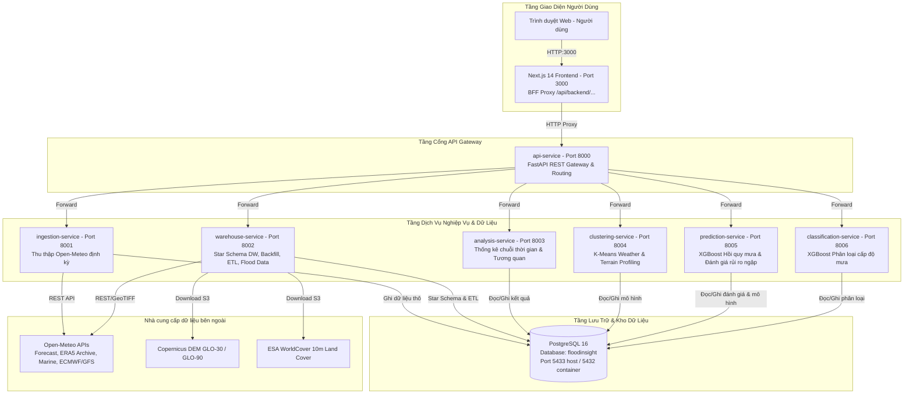
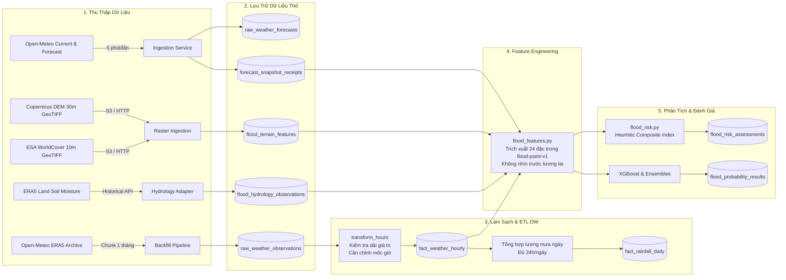
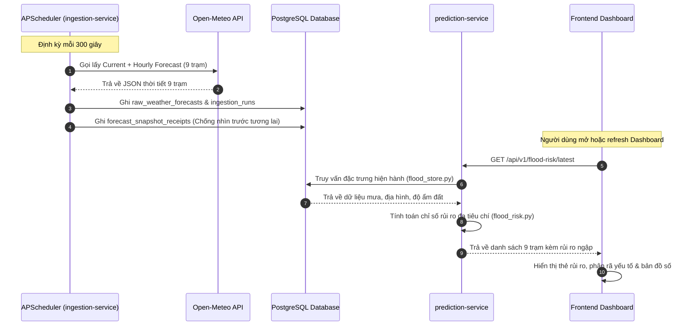
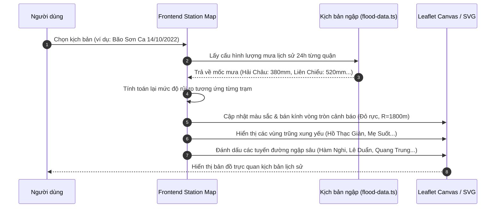

# FLOODINSIGHT — PROJECT DOCUMENTATION
Hệ thống tích hợp dữ liệu khí tượng, quan trắc lượng mưa và phân tích nguy cơ ngập lụt đô thị TP. Đà Nẵng

---

## 1. Tổng quan dự án

- **Tên dự án**: FloodInsight (FloodInsight Da Nang Monitoring & Flood-Risk Assessment).
- **Mục tiêu**: Xây dựng nền tảng thu thập dữ liệu khí tượng đa nguồn, chuẩn hóa kho dữ liệu không gian thời gian (Spatial-Temporal Data Warehouse), phân tích chuỗi thời gian lượng mưa, phân cụm địa hình thời tiết và đánh giá nguy cơ ngập lụt đô thị theo thời gian thực kết hợp kịch bản lịch sử cho khu vực TP. Đà Nẵng.
- **Bài toán giải quyết**:
  - Tích hợp dữ liệu thời tiết tức thời (Open-Meteo Current), dự báo ngắn hạn (Forecast 24h), dữ liệu tái phân tích lịch sử dài hạn (ERA5 Archive) vào kho dữ liệu sao (Star Schema).
  - Phân tích tương quan khí tượng, chu kỳ mưa ngày/đêm và phân phối cường độ mưa lịch sử.
  - Dự báo lượng mưa ngày tiếp theo bằng mô hình hồi quy Machine Learning (XGBoost) kết hợp hiệu chuẩn khí động số (NWP: ECMWF IFS & GFS Seamless).
  - Phân loại cấp độ mưa (No Rain, Light Rain, Moderate Rain, Heavy Rain) bằng XGBoost Classifier có đánh trọng số mẫu (Class Weights).
  - Đánh giá nguy cơ ngập lụt đô thị (Urban Flood Risk Assessment) đa tiêu chí (Mưa dự báo, mưa tích lũy 24h, cường suất mưa, cao độ địa hình DEM, độ dốc, tỷ lệ bê tông hóa/mặt phủ nhân tạo, độ ẩm đất).
  - Trực quan hóa điểm ngập, vùng trũng và tuyến đường trọng điểm lịch sử trên nền bản đồ không gian địa lý tương tác (Leaflet GIS).
- **Đối tượng sử dụng**:
  - Chuyên viên khí tượng thủy văn, cán bộ quản lý thoát nước và phòng chống thiên tai (PCTT & TKCN) TP. Đà Nẵng.
  - Kỹ sư dữ liệu (Data Engineers), nhà nghiên cứu khoa học dữ liệu (Data Scientists / Hydrologists).
  - Người dân đô thị và nhà điều hành muốn theo dõi tình hình thời tiết và nguy cơ ngập cục bộ tại các quận huyện Đà Nẵng.
- **Phạm vi hệ thống**:
  - Phạm vi không gian: 9 trạm quan trắc đại diện cho các quận/huyện TP. Đà Nẵng:
    1. **Hải Châu** (`hai-chau`: 16.076345°N, 108.221783°E)
    2. **Thanh Khê** (`thanh-khe`: 16.071259°N, 108.191634°E)
    3. **Liên Chiểu** (`lien-chieu`: 16.072720°N, 108.158150°E)
    4. **Cẩm Lệ** (`cam-le`: 16.015300°N, 108.201300°E)
    5. **Ngũ Hành Sơn** (`ngu-hanh-son`: 16.008333°N, 108.252500°E)
    6. **Sơn Trà** (`son-tra`: 16.101100°N, 108.261200°E)
    7. **Hòa Vang - Hòa Phong** (`hoa-vang`: 15.986700°N, 108.140800°E)
    8. **Hòa Vang - Hòa Bắc** (`hoa-bac`: 16.147200°N, 108.016700°E)
    9. **Hòa Vang - Hòa Khương** (`hoa-khuong`: 15.945800°N, 108.106900°E)
  - Vùng trũng & trục giao thông ngập lịch sử: Hồ Thạc Gián, Hàm Nghi, Lê Duẩn, Mẹ Suốt (Hòa Khánh Nam), Núi Thành - Hòa Cường Nam, Cách Mạng Tháng 8, Hùng Vương, Điện Biên Phủ, Ngô Quyền, Túy Loan...

---

## 2. Công nghệ sử dụng

| Tầng kiến trúc | Công nghệ / Thư viện chính | Vai trò / Chi tiết sử dụng |
|---|---|---|
| **Frontend UI** | **Next.js 14** (App Router, React 18, TypeScript) | Giao diện Single Page Dashboard kết hợp Server-Side Proxy (BFF). |
| **State Management** | **TanStack Query v5** (`@tanstack/react-query`) | Quản lý cache, fetching chu kỳ 45s - 60s, mutation, optimistic updates. |
| **Styling & Icons** | **Tailwind CSS**, **Lucide React** | Hệ thống style tối ưu, Dark / Light theme chuyển đổi động, icon trực quan. |
| **Bản đồ số (GIS)** | **React-Leaflet**, **Leaflet 1.9**, GeoJSON | Bản đồ trạm quan trắc, bán kính nguy cơ ngập, đường ranh giới bờ biển Đà Nẵng, tuyến đường ngập lịch sử. |
| **Biểu đồ dữ liệu** | **ECharts** (`echarts`, `echarts-for-react`) | Biểu đồ chuỗi thời gian lượng mưa, phân cụm PCA, Ma trận nhầm lẫn (Confusion Matrix), Calibration Curve. |
| **Backend Services** | **Python 3.11**, **FastAPI**, **Uvicorn** | Microservices kiến trúc bất đồng bộ (Asynchronous async/await) với validation Pydantic v2. |
| **Database & ORM** | **PostgreSQL 16**, **SQLAlchemy 2.0**, **Psycopg 3** | Lưu trữ Star Schema DW, JSONB payload, truy vấn phân tích, connection pool. |
| **Migrations** | **Alembic** | Quản lý phiên bản cơ sở dữ liệu có tính lũy kế (Additive Migrations 0001 - 0010/0011). |
| **AI / Machine Learning** | **Scikit-learn**, **XGBoost 2.1**, **NumPy**, **Pandas** | K-Means, PCA, XGBoost Regressor (Hồi quy mưa), XGBoost Classifier (Phân loại mưa), HistGradientBoosting, Isotonic/Sigmoid Calibration. |
| **Spatial / Hydrology** | **Rasterio**, **GDAL** (phụ trợ) | Đọc mô hình số độ cao GeoTIFF (Copernicus DEM 30m) và bản đồ lớp phủ (ESA WorldCover 10m). |
| **Lập lịch (Scheduler)** | **APScheduler 3.x** | Lập lịch tự động thu thập thời tiết định kỳ (mặc định 300 giây). |
| **HTTP Client** | **HTTPX** | Gọi API bất đồng bộ với cơ chế retry lũy thừa (Exponential Backoff) và timeout an toàn. |
| **Deployment / Container** | **Docker**, **Docker Compose** | Đóng gói 9 microservices container riêng biệt, phân lập mạng và kiểm tra sức khỏe tự động. |
| **Third-party APIs** | **Open-Meteo API** (Forecast, Archive ERA5, Marine, ECMWF IFS, GFS) | Cung cấp dữ liệu khí tượng tức thời, dự báo giờ, dữ liệu tái phân tích và hải văn. |

---

## 3. Kiến trúc hệ thống

Hệ thống được thiết kế theo mô hình **Microservices hướng sự kiện và dữ liệu (Data-Driven Microservices Architecture)**:



### Trách nhiệm chi tiết từng thành phần:

1. **`frontend` (Next.js 14 Web Application)**:
   - Cung cấp giao diện dashboard điều hành giám sát cho Đà Nẵng.
   - Proxy API bảo vệ thông qua endpoint `/api/backend/[...path]`.
   - Quản lý trạng thái đa ngôn ngữ (Tiếng Việt mặc định, hỗ trợ chuỗi nhãn chuẩn hóa).
2. **`api-service` (API Gateway)**:
   - Điểm tiếp nhận trung tâm cổng vào (`127.0.0.1:8000`).
   - Gắn `x-request-id`, quản lý CORS, đóng gói chuẩn response `{ data, meta }` hoặc `{ error, meta }`.
   - Điều hướng (Reverse Proxy) yêu cầu đến đúng microservice chuyên trách.
   - Endpoint `/system/status` tổng hợp tình trạng sức khỏe của toàn bộ 6 microservice và PostgreSQL.
3. **`ingestion-service` (Thu thập thời tiết tự động)**:
   - Scheduler chạy ngầm định kỳ 300 giây (5 phút) gọi Open-Meteo API lấy dữ liệu 9 trạm.
   - Hỗ trợ kích hoạt thủ công qua POST `/ingestion/run`.
   - Ghi dữ liệu thô JSON vào bảng `raw_weather_forecasts` và nhật ký `ingestion_runs`.
4. **`warehouse-service` (Kho dữ liệu sao & Pipeline ETL)**:
   - Quản lý Star Schema DW: `dim_date`, `dim_time`, `dim_location`, `fact_weather_hourly`, `fact_rainfall_daily`.
   - Xử lý backfill lịch sử ERA5 dài hạn (tháng/năm).
   - Tiến trình ETL làm sạch, xác thực phạm vi giá trị và tổng hợp lượng mưa ngày.
   - Adapter nạp dữ liệu địa hình (DEM Elevation, Slope) và dữ liệu raster (Copernicus DEM, ESA WorldCover).
5. **`analysis-service` (Phân tích mẫu khí tượng)**:
   - Tính toán thống kê chuỗi thời gian: Phân phối mưa, tương quan Pearson giữa mưa với nhiệt độ, độ ẩm, tốc độ gió.
   - Tính toán chu kỳ ngày/đêm và xu hướng mùa.
6. **`clustering-service` (Phân cụm không gian & hình thái thời tiết)**:
   - Mô hình K-Means và PCA phân cụm hình thái thời tiết dựa trên 6 chỉ số khí tượng.
   - Phân cụm hồ sơ địa hình (Terrain Profiles: Độ cao, độ dốc, tỷ lệ bê tông hóa) cho 9 trạm quan trắc.
7. **`prediction-service` (Dự báo mưa & Đánh giá rủi ro ngập lụt)**:
   - Mô hình Machine Learning XGBoost Regressor dự đoán lượng mưa 24 giờ tiếp theo.
   - Kết hợp thuật toán hiệu chuẩn khí động số đa mô hình (NWP Ensembles: 60% ECMWF + 20% GFS + 20% XGBoost).
   - Đánh giá chỉ số nguy cơ ngập lụt đa tiêu chí (`flood-risk-v1`), phân loại 5 cấp độ (Low, Moderate, High, Very High, Insufficient Data).
   - Mô hình học có giám sát xác suất ngập lụt đô thị (`flood-predictions`).
8. **`classification-service` (Phân loại cấp độ mưa)**:
   - Phân loại mức độ mưa ngày mai thành 4 mức: Không mưa (<0.1mm), Mưa nhỏ (0.1–15mm), Mưa vừa (15–50mm), Mưa to (>50mm).
   - Huấn luyện XGBoost Classifier với bộ trọng số cân bằng lớp và ma trận nhầm lẫn.
9. **`ml-common` (Thư viện dùng chung)**:
   - Gói thư viện Python nội bộ cung cấp cấu trúc 24 đặc trưng (`flood-point-v1`), kết nối cơ sở dữ liệu, cổng kiểm soát dữ liệu (Data Gating) và thuật toán đánh giá rủi ro.

---

## 4. Danh sách chức năng tổng thể

| STT | Module | Tên chức năng | Mô tả tóm tắt | Trạng thái triển khai |
|:---:|---|---|---|:---:|
| 1 | **Frontend** | Chuyển đổi giao diện Sáng / Tối (Theme Switching) | Hỗ trợ 2 chế độ Dark Mode và Light Mode lưu trữ trong LocalStorage. | **Đã hoàn thiện** |
| 2 | **Frontend** | Chọn trạm quan trắc & Khoảng thời gian | Cho phép lọc dữ liệu theo 9 trạm Đà Nẵng và các khoảng ngày có dữ liệu kho. | **Đã hoàn thiện** |
| 3 | **Frontend - Overview** | Tổng quan ngập lụt (Flood Overview) | Thẻ tóm tắt trạm có nguy cơ cao nhất, số trạm theo cấp độ rủi ro, dự báo mưa 6h/12h/24h. | **Đã hoàn thiện** |
| 4 | **Frontend - Forecast** | Dự báo nguy cơ ngập chi tiết (Flood Risk Forecast) | Bảng xếp hạng rủi ro 9 trạm, biểu đồ phân rã trọng số đóng góp các yếu tố (Factor Breakdown). | **Đã hoàn thiện** |
| 5 | **Frontend - Rainfall** | Phân tích chuỗi lượng mưa (Rainfall Analytics) | Biểu đồ mưa ngày/tuần/tháng (ECharts), phân phối mưa, biểu đồ phân tán tương quan khí tượng. | **Đã hoàn thiện** |
| 6 | **Frontend - ML** | Quản lý mô hình máy học (Machine Learning) | Hiển thị cụm thời tiết (PCA), kết quả dự báo mưa ngày mai, xác suất phân loại mưa, ma trận nhầm lẫn. | **Đã hoàn thiện** |
| 7 | **Frontend - Map** | Bản đồ ngập lụt tương tác (Da Nang Flood Map) | Bản đồ số hiển thị 9 trạm với bán kính nguy cơ ngập, 5 kịch bản lịch sử (Bão Sơn Ca 2022, Trami 2024...), vùng trũng và tuyến đường ngập. | **Đã hoàn thiện** |
| 8 | **Frontend - Data** | Quản lý dữ liệu & Vận hành (Data Management) | Theo dõi tình trạng kho dữ liệu, tiến trình thu thập thời tiết, kích hoạt Backfill và ETL thủ công. | **Đã hoàn thiện** |
| 9 | **Backend - Ingestion** | Thu thập dữ liệu thời tiết tự động | APScheduler ngầm tự động gọi Open-Meteo mỗi 5 phút lưu snapshot 9 trạm. | **Đã hoàn thiện** |
| 10 | **Backend - Ingestion** | Kích hoạt thu thập thời tiết thủ công | API POST `/api/v1/weather/ingestion/run` thực hiện nạp dữ liệu tức thời và cập nhật lịch sử. | **Đã hoàn thiện** |
| 11 | **Backend - Warehouse** | Star Schema Data Warehouse | Lưu trữ dữ liệu chuẩn hóa dạng bảng chiều (Dim) và bảng sự kiện (Fact). | **Đã hoàn thiện** |
| 12 | **Backend - Warehouse** | Backfill & ETL lịch sử ERA5 | Tải dữ liệu lưu trữ theo lô tháng, chuyển đổi sang đơn vị chuẩn, tổng hợp lượng mưa ngày. | **Đã hoàn thiện** |
| 13 | **Backend - Warehouse** | Quản lý độ bao phủ dữ liệu ngập | API `/flood-data/coverage` báo cáo thống kê bản ghi sự kiện, địa hình, thủy văn. | **Đã hoàn thiện** |
| 14 | **Backend - Analysis** | Phân tích quy luật khí tượng | Tính tương quan Pearson, chu kỳ ngày đêm, phân phối lượng mưa phục vụ trực quan hóa. | **Đã hoàn thiện** |
| 15 | **Backend - Clustering** | Phân cụm thời tiết (Weather Clustering) | Thuật toán K-Means phân cụm ngày mưa thành các nhóm hình thái thời tiết kèm tọa độ PCA. | **Đã hoàn thiện** |
| 16 | **Backend - Clustering** | Phân cụm địa hình trạm (Flood Profiles) | Phân cụm 9 trạm theo cao độ DEM, độ dốc bề mặt và tỷ lệ bê tông hóa. | **Đã hoàn thiện** |
| 17 | **Backend - Prediction** | Dự báo hồi quy mưa ngày mai | Mô hình XGBoost Regressor kết hợp tổ hợp dự báo số trị NWP (ECMWF + GFS). | **Đã hoàn thiện** |
| 18 | **Backend - Prediction** | Đánh giá nguy cơ ngập đa tiêu chí | Tính toán chỉ số nguy cơ ngập điểm (`flood-risk-v1`) dựa trên 5 nhóm yếu tố và kiểm soát thiếu dữ liệu. | **Đã hoàn thiện** |
| 19 | **Backend - Prediction** | Dự đoán xác suất ngập có giám sát | API `/flood-predictions/*` đào tạo và suy luận xác suất ngập lụt được hiệu chuẩn (Calibrated). | **Đã có khung & logic (chờ nhãn quan trắc bổ sung)** |
| 20 | **Backend - Classification** | Phân loại cấp độ mưa ngày tiếp theo | Mô hình XGBoost Classifier dự đoán 4 nhóm mức độ mưa kèm xác suất phân bố. | **Đã hoàn thiện** |
| 21 | **Backend - Gateway** | Tổng hợp trạng thái toàn hệ thống | API `/system/status` kiểm tra đồng thời tình trạng sống của tất cả microservices và DB. | **Đã hoàn thiện** |
| 22 | **Security** | Đăng nhập / Phân quyền người dùng (Auth) | Quản lý tài khoản, token JWT, phân quyền vai trò người dùng. | **Chưa triển khai (Hệ thống mở nội bộ)** |

---

## 5. Chi tiết chức năng Frontend

Giao diện người dùng được xây dựng hoàn toàn bằng **Next.js 14 App Router** tại thư mục `frontend/app/dashboard`.

### 5.1. Màn hình "Flood Overview" (Tổng quan ngập lụt)
- **Mục đích**: Cung cấp bức tranh tổng quát tức thời về tình hình nguy cơ ngập trên toàn địa bàn TP. Đà Nẵng tại thời điểm hiện tại.
- **Thành phần hiển thị**:
  1. *Thẻ rủi ro cao nhất (Highest current forecast risk)*: Hiển thị trạm có chỉ số rủi ro ngập lớn nhất (0 - 100), thanh đo trực quan (Risk Meter), nhãn phân loại (RiskBadge: Low, Moderate, High, Very High, Insufficient Data), thời điểm ban hành và thời hạn hiệu lực.
  2. *Thẻ độ bao phủ giám sát (Monitoring coverage)*: Thống kê số lượng trạm theo từng cấp độ nguy cơ ngập lụt.
  3. *Thẻ dự đoán ngập lụt đã xác thực (Validated flood predictions)*: Số lượng dự báo xác suất có giám sát hợp lệ.
  4. *Khung ngữ cảnh lượng mưa (Rainfall context)*: Đối với trạm được chọn, hiển thị:
     - Lượng mưa lịch sử trong khoảng thời gian đang chọn (mm).
     - Lượng mưa thực đo 24 giờ vừa qua (mm).
     - Lượng mưa dự báo trong 6 giờ, 12 giờ và 24 giờ tiếp theo (mm).
- **Thao tác người dùng**: Chọn trạm trên danh sách hoặc bản đồ nhỏ để xem chi tiết ngữ cảnh mưa của từng quận huyện.
- **API liên quan**: `GET /api/backend/flood-risk/latest`, `GET /api/backend/flood-predictions/results`, `GET /api/backend/rainfall/daily`.

### 5.2. Màn hình "Flood Risk Forecast" (Dự báo nguy cơ ngập)
- **Mục đích**: Cho phép phân tích chuyên sâu các yếu tố cấu thành nguy cơ ngập lụt của từng trạm quan trắc.
- **Thành phần hiển thị**:
  1. *Bảng xếp hạng nguy cơ 9 trạm*: Sắp xếp giảm dần theo chỉ số rủi ro ngập lụt, hiển thị mã trạm, tên trạm, chỉ số rủi ro, phân loại, trạng thái chứng cứ dữ liệu.
  2. *Bảng phân rã yếu tố (Factor Breakdown)*:
     - Mưa dự báo (Forecast Rainfall): Trọng số 40%.
     - Mưa thực đo gần đây (Recent Rainfall): Trọng số 20%.
     - Cường suất mưa tối đa giờ (Rainfall Intensity): Trọng số 15%.
     - Địa hình (Terrain - Cao độ & Tỷ lệ bê tông hóa): Trọng số 15%.
     - Độ ẩm đất (Soil Wetness): Trọng số 10%.
  3. *Cảnh báo thiếu dữ liệu quan trắc (Missing Critical Factors)*: Khi thiếu bất kỳ yếu tố cốt lõi nào, hệ thống từ chối tính điểm giả tạo và hiển thị rõ trạng thái `Insufficient Data`.
- **API liên quan**: `GET /api/backend/flood-risk/latest`, `GET /api/backend/flood-risk/{location}/details`.

### 5.3. Màn hình "Rainfall Analytics" (Phân tích lượng mưa)
- **Mục đích**: Phân tích lịch sử khí tượng chuỗi thời gian tại trạm đã chọn dựa trên dữ liệu tái phân tích ERA5.
- **Thành phần hiển thị**:
  1. *4 thẻ chỉ số nhanh*: Tổng lượng mưa tích lũy (mm), Nhiệt độ hiện tại (°C), Độ ẩm tương đối (%), Thời điểm nhận dữ liệu gần nhất.
  2. *Biểu đồ chuỗi thời gian lượng mưa (Rainfall over time)*: Cho phép chuyển đổi linh hoạt theo 3 chu kỳ:
     - Ngày (Daily).
     - Tuần (Weekly).
     - Tháng (Monthly).
  3. *Các biểu đồ quy luật khí tượng nâng cao*:
     - Mưa theo giờ trong ngày (Diurnal cycle).
     - Phân phối cường độ mưa (Rainfall distribution).
     - Biểu đồ tương quan giữa lượng mưa với nhiệt độ, độ ẩm và tốc độ gió.
     - Xu hướng mùa theo tháng trong năm.
- **API liên quan**: `GET /api/backend/weather/latest`, `GET /api/backend/rainfall/{period}`, `GET /api/backend/analytics`.

### 5.4. Màn hình "Machine Learning" (Máy học & Dự báo AI)
- **Mục đích**: Đánh giá và hiển thị kết quả của các mô hình trí tuệ nhân tạo đang hoạt động trong hệ thống.
- **Thành phần hiển thị**:
  1. *Phân cụm hình thái thời tiết (Weather clusters)*: Biểu đồ phân tán 2 chiều trục thành phần chính (PCA: PC1 vs PC2) phân chia các ngày thành các cụm đặc trưng thời tiết kèm chỉ số Silhouette Score.
  2. *Dự báo lượng mưa ngày tiếp theo (Next-day rainfall)*: Bảng dự báo lượng mưa bằng mm cho từng trạm vào ngày đích tiếp theo.
  3. *Phân loại cường độ mưa (Rainfall classification)*: Hiển thị phân loại xác suất cho 4 cấp độ mưa kèm ma trận nhầm lẫn (Confusion Matrix).
  4. *Phân cụm địa hình ngập lụt (Terrain-based flood risk clustering)*: Biểu đồ tán xạ Cao độ (Elevation m) so với Độ dốc (Slope °) phân nhóm 9 trạm quan trắc.
  5. *Đánh giá mô hình ngập có giám sát (Flood model evaluation)*: Chỉ số Precision, Recall, F1-Score, ROC-AUC, Brier Score, đường cong hiệu chuẩn (Calibration curve).
- **API liên quan**: `GET /api/backend/clustering/results`, `GET /api/backend/predictions/results`, `GET /api/backend/classifications/results`, `GET /api/backend/clustering/flood-profiles`, `GET /api/backend/flood-predictions/metrics`.

### 5.5. Màn hình "Da Nang Flood Map" (Bản đồ ngập lụt Đà Nẵng)
- **Mục đích**: Trực quan hóa không gian địa lý thời gian thực kết hợp kịch bản lịch sử.
- **Thành phần hiển thị**:
  1. *Bản đồ GIS nền tảng*: Tích hợp OpenStreetMap, tự động chuyển đổi sang đường bờ biển Offline (`da-nang-coastline.geojson`) nếu mất kết nối tile bản đồ ngoài.
  2. *Vòng tròn bán kính nguy cơ (Risk Circle Marker)*: Đặt tại tọa độ 9 trạm, kích thước bán kính co giãn theo mức độ cảnh báo (500m - 1800m) và màu sắc tương ứng.
  3. *Bộ chọn kịch bản ngập lụt lịch sử (Historical Scenarios)*:
     - **Dự báo hiện tại (Live)**: Dựa trên dự báo mưa Open-Meteo tức thời.
     - **Đợt mưa 14/10/2023 (Monsoon 2023)**: Mưa lớn ngập trũng Hải Châu.
     - **Bão Trami 27/10/2024**: Mưa hoàn lưu bão số 6, sóng tràn đường Như Nguyệt.
     - **Mưa cực đoan 05/11/2024**: Điểm cực đoan Hòa Cường Nam 281 mm.
     - **Bão Sơn Ca 14/10/2022**: Đại hồng thủy lịch sử trên 500 mm, ngập lụt diện rộng.
  4. *Vùng trũng xung yếu (Flood Zones)*: Vùng Hồ Thạc Gián – Hàm Nghi, Lê Duẩn – BV Đà Nẵng, Hòa Cường Nam – Núi Thành, Rốn ngập Mẹ Suốt (Liên Chiểu), Cống Lò Vôi (Cẩm Lệ).
  5. *Tuyến đường sàng lọc ngập (Road Screening)*: Mô phỏng tình trạng thông xe / cảnh báo ngập trên các trục huyết mạch đô thị.
- **API liên quan**: `GET /api/backend/locations`, `GET /api/backend/flood-risk/latest`, `GET /api/backend/weather/latest`.

### 5.6. Màn hình "Data Management" (Quản lý dữ liệu & Vận hành)
- **Mục đích**: Dành cho kỹ sư hệ thống theo dõi sức khỏe kho dữ liệu, kích hoạt đồng bộ và kiểm tra chất lượng dữ liệu.
- **Thành phần hiển thị**:
  1. *Quản lý độ bao phủ dữ liệu ngập (Flood Dataset Coverage)*: Thống kê số lượng bản ghi tài sản dữ liệu, biến thủy văn, cao độ địa hình, sự kiện ngập.
  2. *Tiến trình thu thập thời tiết (Weather Ingestion Status)*: Trạng thái scheduler tự động, thời điểm chạy tiếp theo, nút bấm `Kích hoạt nạp dữ liệu thủ công`.
  3. *Kiểm soát Backfill & ETL*: Nhật ký các lô dữ liệu lịch sử, số dòng giờ nạp, số dòng bị loại bỏ và chỉ số hoàn chỉnh.
- **API liên quan**: `GET /api/backend/flood-data/coverage`, `GET /api/backend/weather/ingestion/status`, `POST /api/backend/weather/ingestion/run`, `GET /api/backend/weather/etl/status`, `GET /api/backend/weather/quality`.

---

## 6. Chi tiết chức năng Backend

### 6.1. Service `api-service` (API Gateway & Upstream Routing)
- **Vai trò**: Cổng giao tiếp duy nhất đón nhận request từ Client, gắn mã định danh theo vết `request_id`, kiểm soát lỗi và timeout.
- **Cơ chế hoạt động**:
  - `lifespan`: Khởi tạo HTTP client pool kết nối đến 6 microservice backend.
  - `forward`: Chuyển tiếp request bất đồng bộ kèm timeout cấu hình (Read timeout 10s, Processing timeout 180s, Probe timeout 4s).
  - Định dạng chuẩn: Mọi response thành công đều bọc trong envelope `{ "data": ..., "meta": { "request_id": "...", "kind": "..." } }`. Khi lỗi trả về `{ "error": { "code": "...", "message": "...", "service": "..." }, "meta": ... }`.

### 6.2. Service `ingestion-service` (Thu thập dữ liệu khí tượng tức thời)
- **Cơ chế thu thập**:
  - Sử dụng thư viện `httpx` gọi đồng thời API Open-Meteo cho 9 trạm quan trắc (`asyncio.gather`).
  - Lấy các biến khí tượng: `rain`, `showers`, `precipitation`, `temperature_2m`, `relative_humidity_2m`, `wind_speed_10m`, `pressure_msl`, `weather_code`.
  - Cơ chế Retry: Tự động thử lại tối đa 3 lần với thời gian chờ lũy thừa nếu gặp lỗi mạng hoặc HTTP 429 / 5xx.
  - Kiểm tra tính đầy đủ: Bắt buộc chuỗi dự báo giờ phải đủ số giờ cấu hình (`forecast_hours = 24` hoặc `26`).
- **Lập lịch chạy (Scheduler)**:
  - Tích hợp `APScheduler` chạy nền. Mặc định kích hoạt mỗi 300 giây (5 phút).
  - Khóa chống trùng lặp: Nếu tác vụ trước chưa kết thúc, tác vụ mới sẽ từ chối với mã lỗi 409 `IngestionBusy`.
  - Lưu trữ: Ghi nhận kết quả vào bảng `raw_weather_forecasts` và lưu nhật ký trạng thái (`running`, `succeeded`, `failed`) vào bảng `ingestion_runs`.

### 6.3. Service `warehouse-service` (Kho dữ liệu & ETL)
- **Mô hình Star Schema**:
  - Bảng chiều: `dim_date` (thông tin ngày, tháng, năm, thứ, quý), `dim_time` (mốc giờ UTC và local date), `dim_location` (tọa độ, quận huyện), `dim_weather_source` (nguồn cung cấp).
  - Bảng sự kiện: `fact_weather_hourly` (thời tiết từng giờ), `fact_rainfall_daily` (tổng hợp lượng mưa ngày, số giờ mưa, tính toàn vẹn 24h).
- **Quy trình Backfill & ETL**:
  - `HistoricalPipeline`: Nhận khoảng thời gian `[start_date, end_date]`, tự động chia nhỏ thành các lô theo từng tháng (Month Batches).
  - Tải dữ liệu từ Open-Meteo ERA5 Archive API, lưu vào `raw_weather_observations` kèm checkpoint trong `historical_batches`.
  - Hàm `transform_hours`: Đồng bộ giờ mưa (khoảng mưa 1 giờ trước) với các thông số nhiệt độ/độ ẩm tức thời; kiểm tra ngưỡng hợp lệ (Rainfall: 0–999.9mm, Temp: -100–70°C, Humidity: 0–100%, Wind: 0–99.9m/s).
  - Tổng hợp ngày `fact_rainfall_daily`: Chỉ đánh dấu bản ghi hợp lệ khi đủ 24 giờ trong ngày.
- **Tích hợp dữ liệu ngập (Flood Data)**:
  - Quản lý metadata nguồn cấp trong `data_sources` và `flood_dataset_assets`.
  - Quản lý đặc trưng địa hình trạm trong `flood_terrain_features` (Cao độ từ Copernicus DEM GLO-30, độ dốc từ mô hình sai phân 5 điểm, lớp phủ và tỷ lệ bê tông hóa từ ESA WorldCover 10m).
  - Quản lý chuỗi quan trắc thủy văn trong `flood_hydrology_observations` (Độ ẩm đất các tầng 0–7cm và 7–28cm từ ERA5 Land, mực nước/sóng biển ven bờ từ Open-Meteo Marine).

### 6.4. Service `analysis-service` (Phân tích mẫu chuỗi thời gian)
- **Tính toán chỉ số khí tượng**:
  - Chu kỳ mưa ngày đêm (Diurnal Cycle): Tính trung bình lượng mưa theo 24 khung giờ trong ngày.
  - Phân phối lượng mưa (Rainfall Histogram): Gom cụm số giờ đo đạc theo các bin cường độ mưa.
  - Hệ số tương quan Pearson (Pearson Correlation): Đo lường mức độ tương quan tuyến tính giữa lượng mưa và độ ẩm, nhiệt độ, áp suất, tốc độ gió.
  - Xu hướng mùa (Seasonal Seasonality): Tính trung bình lượng mưa theo 12 tháng.
- **Lưu trữ kết quả**: Kết quả tính toán được cache và lưu trữ dưới dạng cấu trúc JSON Option của ECharts vào bảng `analysis_results`.

### 6.5. Service `clustering-service` (Phân cụm không gian & Địa hình)
- **Phân cụm hình thái thời tiết (Weather Clustering)**:
  - Trích xuất 6 đặc trưng ngày mưa: `rainfall`, `intensity`, `rainy_hours`, `humidity`, `temperature`, `wind`.
  - Chuẩn hóa dữ liệu bằng `StandardScaler`, xử lý missing value bằng `SimpleImputer(strategy='median')`.
  - Huấn luyện thuật toán `KMeans(n_clusters=k, n_init=20, random_state=42)`.
  - Sử dụng `PCA(n_components=2)` chiếu không gian đặc trưng về 2 thành phần chính để vẽ biểu đồ phân tán.
  - Đánh giá chất lượng phân cụm bằng chỉ số `silhouette_score`.
- **Phân cụm hồ sơ địa hình (Terrain Profiles)**:
  - Gom cụm 9 trạm quan trắc theo 3 chỉ số địa mạo: `elevation_m`, `surface_slope_deg`, `built_up_fraction`.
  - Phân loại các khu vực có cùng đặc tính vật lý (ví dụ: vùng trũng mật độ xây dựng cao vs vùng đồi núi dốc).

### 6.6. Service `prediction-service` (Dự báo mưa & Đánh giá nguy cơ ngập)
- **Dự báo lượng mưa ngày tiếp theo (Rainfall Regression)**:
  - Huấn luyện `XGBRegressor` trên tập dữ liệu chuỗi thời gian lịch sử kết hợp đặc trưng trễ (Lag-1 đến Lag-7).
  - Hàm `calibrate_prediction`: Áp dụng thuật toán tổ hợp trọng số (Weighted Ensemble):
    $$\text{Rainfall}_{\text{final}} = 0.60 \times \text{Rain}_{\text{ECMWF}} + 0.20 \times \text{Rain}_{\text{GFS}} + 0.20 \times \text{Rain}_{\text{XGBoost}}$$
    Nếu thiếu dự báo số trị toàn cầu, sử dụng giá trị suy luận từ XGBoost thuần túy.
- **Đánh giá nguy cơ ngập lụt đa tiêu chí (`flood-risk-v1`)**:
  - Không dựa vào một giá trị mưa đơn lẻ mà kết hợp 5 nhóm yếu tố theo trọng số:
    1. *Mưa dự báo 24h* ($w_1 = 0.40$).
    2. *Mưa tích lũy 24h vừa qua* ($w_2 = 0.20$).
    3. *Cường suất mưa giờ cực đại 24h qua* ($w_3 = 0.15$).
    4. *Địa hình: Cao độ & Tỷ lệ bê tông hóa* ($w_4 = 0.15$).
    5. *Độ ẩm đất trễ 24h* ($w_5 = 0.10$).
  - Chỉ số rủi ro $R \in [0, 100]$.
  - Phân cấp: Low ($R < 25$), Moderate ($25 \le R < 50$), High ($50 \le R < 75$), Very High ($R \ge 75$).
  - **Cơ chế từ chối tính toán an toàn (Explicit Abstention)**: Nếu thiếu bất kỳ yếu tố cốt lõi nào (Mưa dự báo, mưa thực đo, cường suất, địa hình), hệ thống trả về nhãn `Insufficient Data` và gán $R = \text{null}$, tuyệt đối không bịa đặt số liệu rủi ro.
- **Mô hình học có giám sát xác suất ngập (`flood-predictions`)**:
  - Cơ chế kiểm soát cửa dữ liệu (`Data Gating`): Chỉ cho phép huấn luyện mô hình khi có tối thiểu 20 đợt sự kiện độc lập (`MIN_EPISODES`), 60 ngày khô có giám sát (`MIN_DRY_DAYS`) và đầy đủ chuỗi dự báo.
  - Hỗ trợ các ứng viên phân loại: `LogisticRegression`, `RandomForestClassifier`, `HistGradientBoostingClassifier`, `XGBClassifier`.
  - Hiệu chuẩn xác suất độc lập (Probability Calibration) bằng Sigmoid (Platt Scaling) hoặc Isotonic Regression để tối ưu Brier Score Loss.

### 6.7. Service `classification-service` (Phân loại cấp độ mưa)
- **Mục tiêu**: Dự đoán cấp độ mưa của ngày tiếp theo theo 4 phân lớp:
  - `No Rain` ($< 0.1$ mm)
  - `Light Rain` ($0.1 - 15.0$ mm)
  - `Moderate Rain` ($15.0 - 50.0$ mm)
  - `Heavy Rain` ($> 50.0$ mm)
- **Kỹ thuật Machine Learning**:
  - `XGBClassifier` với 600 cây, độ sâu tối đa 6, học độ 0.04.
  - Tính toán trọng số lớp tự động (`class_weights`) để khắc phục hiện tượng mất cân bằng dữ liệu mưa cực đoan (imbalanced classes).
  - Đánh giá bằng Macro F1-score, Precision, Recall và Confusion Matrix cho từng lớp.

---

## 7. Danh sách API toàn hệ thống

Bảng tổng hợp tất cả các API endpoints được cung cấp bởi hệ thống (thông qua API Gateway `http://localhost:8000/api/v1` và Next.js Proxy `/api/backend`):

| HTTP Method | Endpoint | Nhóm chức năng | Input chính | Output chính | Module xử lý | Chức năng Frontend sử dụng |
|:---:|---|---|---|---|---|---|
| `GET` | `/system/status` | Hệ thống | Không | Sức khỏe 6 microservices & DB | `api-service` | Header & Status Banner |
| `GET` | `/health` | Kiểm tra sức khỏe | Không | `{"status": "ok"}` | Mọi service | Docker Healthcheck |
| `GET` | `/locations` | Trạm quan trắc | `limit, offset` | Danh sách 9 trạm quan trắc | `warehouse-service` | Bộ chọn trạm & Bản đồ |
| `GET` | `/weather/latest` | Thời tiết hiện tại | `location` (tùy chọn) | Quan trắc tức thời 9 trạm (mưa, nhiệt độ, độ ẩm...) | `ingestion-service` | Overview & Thẻ đo nhanh |
| `POST` | `/weather/ingestion/run` | Thu thập thời tiết | Không | Kết quả nạp (`succeeded`, số bản ghi) | `ingestion-service` | Quản lý dữ liệu (Nút Nạp) |
| `GET` | `/weather/ingestion/status` | Trạng thái nạp | Không | Lịch nạp, thời điểm nạp tiếp theo | `ingestion-service` | Thẻ tiến trình thu thập |
| `GET` | `/weather/ingestion/history` | Lịch sử nạp | `limit, offset` | Danh sách các lần chạy nạp | `ingestion-service` | Bảng nhật ký nạp |
| `GET` | `/rainfall/coverage` | Độ bao phủ dữ liệu | `source` | Ngày bắt đầu, ngày kết thúc, số ngày mưa | `warehouse-service` | Lịch chọn khoảng ngày |
| `GET` | `/rainfall/daily` | Lượng mưa ngày | `location, start_date, end_date` | Chuỗi lượng mưa ngày (mm, số giờ đo) | `warehouse-service` | Biểu đồ chuỗi thời gian ngày |
| `GET` | `/rainfall/weekly` | Lượng mưa tuần | `location, start_date, end_date` | Lượng mưa tổng hợp theo tuần | `warehouse-service` | Biểu đồ chuỗi thời gian tuần |
| `GET` | `/rainfall/monthly` | Lượng mưa tháng | `location, start_date, end_date` | Lượng mưa tổng hợp theo tháng | `warehouse-service` | Biểu đồ chuỗi thời gian tháng |
| `POST` | `/weather/backfill` | Backfill lịch sử | `start_date, end_date, max_batches` | Trạng thái nạp ERA5 theo tháng | `warehouse-service` | Vận hành kho dữ liệu |
| `POST` | `/weather/etl/run` | Chạy tiến trình ETL | `start_date, end_date, reprocess` | Trạng thái chuyển đổi Fact | `warehouse-service` | Vận hành kho dữ liệu |
| `GET` | `/weather/etl/status` | Trạng thái ETL | `limit` | Tiến độ xử lý các batch | `warehouse-service` | Vận hành kho dữ liệu |
| `GET` | `/weather/quality` | Chất lượng dữ liệu | `limit, offset` | Tỷ lệ dữ liệu thiếu, giờ hợp lệ | `warehouse-service` | Bảng kiểm soát chất lượng |
| `GET` | `/analytics` | Phân tích thống kê | `location, start_date, end_date` | Cấu hình biểu đồ phân phối, tương quan | `analysis-service` | Bảng phân tích mưa chuyên sâu |
| `POST` | `/analytics/generate` | Tạo mẫu phân tích | `location, start_date, end_date` | Kết quả phân tích được lưu cache | `analysis-service` | Kích hoạt phân tích |
| `GET` | `/clustering/results` | Kết quả phân cụm | `location, start_date, end_date, limit` | Nhãn cụm ngày mưa & tọa độ PC1, PC2 | `clustering-service` | Biểu đồ PCA thời tiết |
| `GET` | `/clustering/metrics` | Chỉ số phân cụm | `version` | Điểm Silhouette, phương sai PCA | `clustering-service` | Thẻ thông số phân cụm |
| `POST` | `/clustering/train` | Huấn luyện K-Means | `clusters, start_date, end_date` | Kết quả huấn luyện cụm mới | `clustering-service` | Huấn luyện lại cụm |
| `GET` | `/clustering/flood-profiles` | Phân cụm địa hình | `clusters, issued_at` | Phân nhóm trạm theo Cao độ/Độ dốc | `clustering-service` | Biểu đồ phân cụm trạm ngập |
| `GET` | `/predictions/results` | Kết quả dự báo mưa | `location, target_date, limit` | Giá trị mưa dự đoán ngày tiếp theo (mm) | `prediction-service` | Bảng dự báo mưa ngày mai |
| `GET` | `/predictions/metrics` | Chỉ số mô hình hồi quy | `version` | Sai số MAE, RMSE (XGBoost vs Lag-1) | `prediction-service` | Thẻ đánh giá mô hình hồi quy |
| `POST` | `/predictions/train` | Huấn luyện hồi quy | `train_ratio, validation_ratio` | Metadata phiên bản mô hình mới | `prediction-service` | Huấn luyện dự báo mưa |
| `POST` | `/predictions/predict` | Dự đoán lượng mưa | `location, target_date` | Lượng mưa dự đoán ngày mai (mm) | `prediction-service` | Suy luận hồi quy mưa |
| `GET` | `/classifications/results` | Kết quả phân loại mưa | `location, target_date, limit` | Nhãn phân loại & độ tin cậy % | `classification-service` | Bảng phân loại cấp độ mưa |
| `GET` | `/classifications/metrics` | Chỉ số mô hình phân loại | `version` | Precision, Recall, Macro F1, Ma trận nhầm lẫn | `classification-service` | Biểu đồ ma trận nhầm lẫn |
| `POST` | `/classifications/train` | Huấn luyện phân loại | `thresholds` (ngưỡng phân lớp) | Kết quả huấn luyện phân loại mưa | `classification-service` | Huấn luyện bộ phân loại |
| `POST` | `/classifications/predict` | Dự đoán phân loại | `location, target_date` | Nhãn cấp độ mưa & phân bố xác suất | `classification-service` | Suy luận cấp độ mưa |
| `GET` | `/flood-risk/latest` | Rủi ro ngập hiện tại | Không | Đánh giá rủi ro 9 trạm, chỉ số rủi ro, phân loại, yếu tố | `prediction-service` | Flood Overview, Forecast & Map |
| `GET` | `/flood-risk/locations` | Danh sách trạm ngập | Không | Tọa độ, mã, tên 9 trạm quan trắc | `prediction-service` | Bộ chọn trạm ngập lụt |
| `GET` | `/flood-risk/history` | Lịch sử rủi ro ngập | `location, limit` | Lịch sử các lần đánh giá rủi ro ngập | `prediction-service` | Nhật ký rủi ro ngập |
| `GET` | `/flood-risk/{location}/details` | Chi tiết rủi ro trạm | `location` | Đánh giá chi tiết, phân rã yếu tố, phân tích độ nhạy | `prediction-service` | Bảng phân tích chi tiết trạm |
| `POST` | `/flood-risk/generate` | Tạo đánh giá ngập | `location, issued_at` | Kết quả tính toán chỉ số rủi ro mới | `prediction-service` | Khởi tạo / Refresh rủi ro ngập |
| `GET` | `/flood-data/coverage` | Thống kê dữ liệu ngập | Không | Tổng số bản ghi địa hình, thủy văn, sự kiện | `warehouse-service` | Quản lý dữ liệu ngập |
| `GET` | `/flood-predictions/readiness` | Mức độ sẵn sàng ML | Không | Trạng thái cửa dữ liệu (Data Gate status) | `prediction-service` | Thẻ trạng thái dữ liệu ML |
| `GET` | `/flood-predictions/results` | Kết quả xác suất ngập | `location, current, limit` | Xác suất ngập có giám sát (0 - 100%) | `prediction-service` | Thẻ xác suất ngập có giám sát |
| `GET` | `/flood-predictions/metrics` | Chỉ số mô hình ngập | Không | Precision, Recall, ROC-AUC, Brier score | `prediction-service` | Bảng đánh giá mô hình ngập |
| `POST` | `/flood-predictions/train` | Huấn luyện mô hình ngập | `study` (kế hoạch phân chia tập) | Kết quả huấn luyện mô hình ngập | `prediction-service` | Kích hoạt đào tạo mô hình ngập |
| `POST` | `/flood-predictions/predict` | Dự đoán xác suất ngập | `location, issued_at` | Xác suất ngập có giám sát cho trạm | `prediction-service` | Suy luận xác suất ngập |

---

## 8. Database Design

Cơ sở dữ liệu sử dụng **PostgreSQL 16**, quản lý bởi **SQLAlchemy ORM** và các migration **Alembic** (`0001` đến `0010/0011`).

### 8.1. Sơ đồ thực thể quan hệ (ERD Mermaid)

```mermaid
erDiagram
    data_sources ||--o{ ingestion_runs : "records"
    data_sources ||--o{ dim_weather_source : "provides"
    data_sources ||--o{ flood_dataset_assets : "supplies"
    
    ingestion_runs ||--o{ raw_weather_forecasts : "generates"
    ingestion_runs ||--o{ raw_weather_observations : "generates"
    ingestion_runs ||--o{ forecast_snapshot_receipts : "tracks"
    
    raw_weather_forecasts ||--o{ forecast_snapshot_receipts : "logged_in"
    
    dim_location ||--o{ fact_weather_hourly : "locates"
    dim_location ||--o{ fact_rainfall_daily : "locates"
    dim_location ||--o{ flood_risk_assessments : "evaluated_at"
    dim_location ||--o{ flood_probability_results : "predicted_at"
    dim_location ||--o{ flood_terrain_features : "characterized_by"
    dim_location ||--o{ flood_hydrology_observations : "measured_at"
    dim_location ||--o{ flood_observations : "ground_truth"
    
    dim_date ||--o{ fact_rainfall_daily : "aggregated_on"
    dim_time ||--o{ fact_weather_hourly : "timestamped_at"
    dim_weather_source ||--o{ fact_weather_hourly : "sourced_from"
    dim_weather_source ||--o{ fact_rainfall_daily : "sourced_from"
    
    model_versions ||--o{ prediction_results : "produces"
    model_versions ||--o{ classification_results : "produces"
    model_versions ||--o{ clustering_results : "produces"
    model_versions ||--o{ flood_probability_results : "produces"
    
    flood_dataset_assets ||--o{ flood_events : "documents"
    flood_dataset_assets ||--o{ flood_observations : "evidences"
    flood_dataset_assets ||--o{ flood_terrain_features : "contains"
    flood_dataset_assets ||--o{ flood_hydrology_observations : "contains"
    
    flood_events ||--o{ flood_observations : "links"
```



### 8.2. Danh mục các bảng dữ liệu chính

1. **`data_sources`**: Đăng ký các nhà cung cấp dữ liệu (`open-meteo-forecast-api`, `open-meteo-archive-era5`, `copernicus-dem-glo30`, `esa-worldcover-2021-v200`, `open-meteo-marine`, `vietnam-vrain-haichau-ground-truth`...).
2. **`ingestion_runs`**: Nhật ký mỗi chu kỳ thu thập thời tiết (thời điểm bắt đầu, kết thúc, trạng thái `succeeded`/`failed`, số bản ghi đã chèn).
3. **`raw_weather_forecasts`**: Lưu trữ toàn bộ payload JSON thô nhận từ Open-Meteo Forecast (chứa dự báo thời tiết 24h/26h và quan trắc tức thời).
4. **`forecast_snapshot_receipts`**: Lưu vết biên lai thu thập từng mốc giờ dự báo theo từng đợt chạy ingestion (`snapshot_id`, `run_id`, `received_at`), đảm bảo chống nhìn trước tương lai (No Look-Ahead Bias).
5. **`raw_weather_observations`**: Lưu trữ payload JSON thô của dữ liệu lịch sử ERA5 tải về theo từng tháng.
6. **`historical_batches`**: Điểm kiểm soát (Checkpoints) các lô dữ liệu lịch sử đã tải và đã chạy qua ETL.
7. **`warehouse_runs`**: Quản lý các phiên chạy Backfill và ETL của kho dữ liệu.
8. **`dim_location`**: Bảng chiều không gian lưu thông tin 9 trạm quan trắc (`code`, `name`, `latitude`, `longitude`).
9. **`dim_date`**: Bảng chiều ngày (`local_date`, `year`, `month`, `day`, `quarter`, `day_of_week`, `is_weekend`).
10. **`dim_time`**: Bảng chiều thời gian theo giờ (`hour_start_utc`, `local_date`, `hour_of_day`).
11. **`dim_weather_source`**: Chiều nguồn dữ liệu kết hợp giữa nhà cung cấp và thông số cấu hình.
12. **`fact_weather_hourly`**: Bảng sự kiện thời tiết giờ (`rainfall_mm`, `air_temperature_c`, `relative_humidity_pct`, `wind_speed_mps`).
13. **`fact_rainfall_daily`**: Bảng sự kiện lượng mưa ngày (`rainfall_total_mm`, `rainfall_hours`, `expected_hours = 24`, `is_complete`).
14. **`fact_weather_forecast_hourly`**: Bảng sự kiện dự báo giờ phân tách từ mô hình số trị (ECMWF IFS, GFS).
15. **`model_versions`**: Registry quản lý siêu dữ liệu các phiên bản mô hình máy học (`clustering`, `prediction`, `classification`, `flood`), siêu tham số và chỉ số đánh giá.
16. **`analysis_results`**: Lưu trữ kết quả phân tích thống kê chuỗi thời gian khí tượng dưới dạng JSON ECharts options.
17. **`clustering_results`**: Lưu trữ nhãn cụm và tọa độ phân tích thành phần chính (PC1, PC2) cho từng ngày của từng trạm.
18. **`prediction_results`**: Lưu trữ kết quả dự báo lượng mưa ngày tiếp theo (Predicted mm, target date, issued_at).
19. **`classification_results`**: Lưu trữ nhãn phân loại cấp độ mưa ngày tiếp theo kèm xác suất phân bố các lớp.
20. **`flood_dataset_assets`**: Quản lý tài sản dữ liệu phục vụ nghiên cứu lũ lụt (mã nguồn, SHA-256 digest, bản quyền, thời điểm trích xuất).
21. **`flood_events`**: Ghi nhận các sự kiện lũ lụt lịch sử được tư liệu hóa (`event_key`, `name`, `started_at`, `ended_before`, `locality_as_reported`).
22. **`flood_observations`**: Lưu trữ các quan trắc ngập lụt mặt đất có nhãn kiểm chứng (`flood_confirmed`, `non_flood_confirmed`, `unknown`), độ bất định không gian (`spatial_uncertainty_m`), cấp chất lượng nhãn (`high`, `medium`, `low`).
23. **`flood_terrain_features`**: Lưu trữ đặc trưng địa hình trích xuất cho từng trạm (`elevation_m`, `surface_slope_deg`, `built_up_fraction`, `land_cover_class`).
24. **`flood_hydrology_observations`**: Lưu trữ các biến quan trắc thủy văn phụ trợ (độ ẩm đất tầng nông 0–7cm, độ ẩm đất tầng rễ 7–28cm, mực nước/sóng biển ven bờ).
25. **`flood_risk_assessments`**: Lưu trữ kết quả đánh giá nguy cơ ngập lụt đa tiêu chí (`risk_index`, `risk_category`, `factors`, `missing_features`, `evidence_sha256`).
26. **`flood_probability_results`**: Lưu trữ kết quả suy luận xác suất ngập có giám sát (`probability`, `valid_until`, `input_sha256`).

---

## 9. Data Pipeline (Quy trình dữ liệu)



### Các nguyên tắc kỹ thuật nghiêm ngặt trong Pipeline:
1. **Chống nhìn trước tương lai (No Look-Ahead Bias)**:
   - Khi tính toán đặc trưng tại thời điểm ban hành $T_{\text{issuance}}$, hệ thống chỉ truy vấn các bản ghi có `received_at <= T_issuance` và `valid_at <= T_issuance`.
   - Biên lai `forecast_snapshot_receipts` phân tách rõ thời điểm máy chủ tiếp nhận dự báo với thời điểm dự báo có hiệu lực.
2. **Xác thực dải giá trị (Value Range Validation)**:
   - Loại bỏ các giá trị dị thường (Outliers) không có thực về mặt vật lý (ví dụ: mưa âm, độ ẩm > 100%, nhiệt độ > 70°C).
3. **Idempotency (Tính bất biến khi chạy lại)**:
   - Toàn bộ các câu lệnh nạp đều áp dụng `ON CONFLICT DO NOTHING` hoặc `ON CONFLICT DO UPDATE`. Có thể chạy lại pipeline nhiều lần mà không tạo bản ghi rác hoặc trùng lặp.
4. **Bảo toàn ranh giới hành chính trạm**:
   - Mỗi trạm quan trắc mang tính chất đại diện cho một tọa độ cụ thể kèm bán kính nghiên cứu xác định (50m cho nhãn ngập mặt đất). Tuyệt đối không giả định toàn bộ địa bàn quận bị ngập nếu chỉ có một điểm ngập cục bộ.

---

## 10. AI / Machine Learning

FloodInsight tích hợp 6 mô hình / kỹ thuật phân tích dữ liệu và máy học:

### 10.1. Mô hình đánh giá nguy cơ ngập lụt đa tiêu chí (`flood-risk-v1`)
- **Loại mô hình**: Mô hình chuyên gia Heuristic đa tiêu chí (Multicriteria Decision Heuristic) có kiểm soát thiếu dữ liệu (Explicit Abstention).
- **Bộ đặc trưng đầu vào (5 nhóm yếu tố)**:
  1. `forecast_rain_next_24h_mm`: Lượng mưa dự báo 24 giờ tới (Trọng số: **0.40**).
  2. `rain_prev_24h_mm`: Lượng mưa thực đo 24 giờ trước (Trọng số: **0.20**).
  3. `rain_max_hour_prev_24h_mm`: Cường suất mưa giờ lớn nhất trong 24 giờ trước (Trọng số: **0.15**).
  4. `terrain` (`elevation_m` và `built_up_fraction`): Cao độ mặt đất và tỷ lệ bê tông hóa (Trọng số: **0.15**).
  5. `soil_moisture_delayed`: Độ ẩm thể tích đất tầng 0–7cm trễ 24h (Trọng số: **0.10**).
- **Chuẩn hóa điểm số (Factor Normalization)**:
  - Mưa được chuẩn hóa theo các hàm ngưỡng phi tuyến dựa trên kinh nghiệm thoát nước đô thị Đà Nẵng (ngưỡng bắt đầu ngập 24h: 50–80mm tùy quận).
  - Cao độ được chuẩn hóa nghịch đảo: Điểm càng thấp trũng (< 3m) rủi ro càng cao.
  - Tỷ lệ bê tông hóa: Càng cao (> 60%) khả năng thấm nước càng kém, rủi ro càng lớn.
- **Đầu ra**:
  - Chỉ số rủi ro $R \in [0, 100]$.
  - Cấp độ rủi ro: `Low`, `Moderate`, `High`, `Very High`.
  - Phân tích độ nhạy (Sensitivity Analysis): Đo lường sự thay đổi của $R$ khi lượng mưa tăng/giảm $\pm 20\%$.
  - Trạng thái `Insufficient Data`: Kích hoạt ngay khi thiếu một trong các yếu tố cốt lõi (Mưa dự báo, mưa thực đo, cường suất, địa hình).

### 10.2. Mô hình hồi quy lượng mưa ngày mai (Rainfall Regression)
- **Thuật toán**: `XGBRegressor` (Extreme Gradient Boosting Regression).
- **Tham số cấu hình**: `n_estimators=600`, `learning_rate=0.04`, `max_depth=6`, `subsample=0.8`, `colsample_bytree=0.8`, `min_child_weight=3`, `tree_method='hist'`.
- **Dữ liệu đầu vào**: Vector chuỗi thời gian gồm 14 đặc trưng: Lượng mưa trễ ngày hôm qua (`rain_d1`), trễ 2 ngày (`rain_d2`), ..., trễ 7 ngày (`rain_d7`), trung bình động 3 ngày, 7 ngày, độ ẩm trung bình, nhiệt độ, áp suất, tốc độ gió.
- **Tổ hợp hiệu chuẩn khí động số (NWP Blending)**:
  - Kết hợp dự báo toàn cầu ECMWF IFS (60%), GFS Seamless (20%) và mô hình học máy XGBoost (20%).
- **Đánh giá**:
  - So sánh với Baseline Lag-1 Persistence (giả định mưa ngày mai bằng mưa hôm nay).
  - Chỉ số: MAE (Mean Absolute Error, mm) và RMSE (Root Mean Squared Error, mm).

### 10.3. Mô hình phân loại cấp độ mưa (Rainfall Classification)
- **Thuật toán**: `XGBClassifier` có cân bằng trọng số lớp (`class_weights`).
- **4 phân lớp mục tiêu**:
  - Lớp 0: `No Rain` ($< 0.1$ mm)
  - Lớp 1: `Light Rain` ($0.1 - 15.0$ mm)
  - Lớp 2: `Moderate Rain` ($15.0 - 50.0$ mm)
  - Lớp 3: `Heavy Rain` ($> 50.0$ mm)
- **Đầu vào**: Tương tự mô hình hồi quy.
- **Đầu ra**: Nhãn phân loại dự đoán và vector phân bố xác suất cho cả 4 lớp.
- **Chỉ số đánh giá**: Precision, Recall, Macro F1-Score, Ma trận nhầm lẫn (Confusion Matrix).

### 10.4. Mô hình phân cụm hình thái thời tiết (Weather Clustering)
- **Thuật toán**: `KMeans(n_clusters=k, n_init=20)` kết hợp `PCA(n_components=2)`.
- **Đặc trưng**: 6 chỉ số ngày: Tổng lượng mưa, cường suất mưa lớn nhất, số giờ mưa, độ ẩm trung bình, nhiệt độ trung bình, tốc độ gió trung bình.
- **Mục đích**: Nhận diện các hình thái thời tiết điển hình tại Đà Nẵng (ví dụ: Cụm ngày khô nóng gió mùa Tây Nam, Cụm ngày mưa dầm bão lũ tháng 10-11).
- **Chỉ số đánh giá**: `silhouette_score` và tỷ lệ phương sai tích lũy giải thích bởi 2 thành phần chính PCA (`explained_variance_ratio_`).

### 10.5. Mô hình phân cụm hồ sơ địa hình (Terrain-Based Flood Profiling)
- **Thuật toán**: `KMeans` kết hợp `StandardScaler`.
- **Đặc trưng**: `elevation_m` (Cao độ), `surface_slope_deg` (Độ dốc), `built_up_fraction` (Tỷ lệ bê tông hóa).
- **Mục đích**: Phân nhóm 9 trạm quan trắc theo tính chất rủi ro vật lý bề mặt.
- **Đầu ra**: Phân nhóm trạm (ví dụ: Nhóm đồng bằng trũng thấp nội đô ven biển vs Nhóm bán sơn địa Hòa Vang).

### 10.6. Khung mô hình học có giám sát xác suất ngập (`flood-models`)
- **Thuật toán triển khai sẵn**: `LogisticRegression`, `RandomForestClassifier`, `HistGradientBoostingClassifier`, `XGBClassifier`.
- **Kỹ thuật hiệu chuẩn xác suất**:
  - `Sigmoid` (Platt Scaling) khi số mẫu nhỏ.
  - `Isotonic Regression` khi số mẫu lớn ($\ge 1000$).
- **Cơ chế chọn ngưỡng quyết định tối ưu chi phí (Cost-Sensitive Thresholding)**:
  - Chi phí cảnh báo sót ngập (Miss Cost) gấp 5 lần chi phí cảnh báo nhầm (False Alarm):
    $$\text{Cost} = \text{False Alarms} + 5 \times \text{Missed Events}$$
- **Chỉ số đánh giá**: Brier Score Loss, ROC-AUC, PR-AUC (Average Precision), Balanced Accuracy.
- **Trạng thái thực tế**: Khung thuật toán, pipeline trích xuất 24 đặc trưng (`flood-point-v1`), cổng kiểm soát dữ liệu (`inventory data gate`) đã hoàn chỉnh trong mã nguồn. Hệ thống đang ở trạng thái `insufficient_training_data` do kho dữ liệu thực tế tại Đà Nẵng chưa có đủ số lượng nhãn dương (Positive events) và nhãn âm (Dry coverage days) được thẩm định độc lập.

---

## 11. Luồng nghiệp vụ chính

### 11.1. Luồng nạp dữ liệu định kỳ và cập nhật rủi ro ngập



### 11.2. Luồng xem kịch bản ngập lịch sử trên bản đồ



---

## 12. Authentication và Authorization

- **Hiện trạng mã nguồn**:
  - Dự án **CHƯA triển khai** hệ thống quản lý tài khoản người dùng, phân quyền theo vai trò (RBAC) hay cơ chế xác thực JWT / Session / OAuth2.
  - Toàn bộ API Gateway và microservices hiện hoạt động theo chế độ mở trong mạng nội bộ Docker (`http://127.0.0.1:8000`).
- **Các biện pháp bảo vệ hiện có**:
  1. *CORS Whitelist*: Cấu hình nghiêm ngặt danh sách origin được phép kết nối qua biến môi trường `FLOODINSIGHT_API_CORS_ORIGINS` (mặc định: `http://localhost:3000,http://127.0.0.1:3000`).
  2. *Next.js BFF Same-Origin Check*: Trong file `frontend/app/api/backend/[...path]/route.ts`, các phương thức thay đổi trạng thái (POST) bắt buộc phải có `sec-fetch-site = same-origin` và `Content-Type = application/json`, từ chối các yêu cầu Cross-Site giả mạo.
  3. *Request ID Tracing*: Mọi request được cấp phát một UUID định danh `x-request-id` để ghi vết lỗi trong log.

---

## 13. External Integrations (Tích hợp dịch vụ bên ngoài)

| Dịch vụ / Nguồn cấp | Giao thức / Phương thức | Mục đích sử dụng | Cơ chế dự phòng & Độ tin cậy |
|---|---|---|---|
| **Open-Meteo Weather Forecast API** | REST HTTP GET JSON | Lấy dữ liệu quan trắc thời tiết hiện tại và dự báo 24h/26h cho 9 trạm Đà Nẵng. | Tự động thử lại 3 lần với Exponential Backoff khi gặp HTTP 429 / 5xx. |
| **Open-Meteo Historical Weather API (ERA5)** | REST HTTP GET JSON | Tải dữ liệu tái phân tích khí tượng lịch sử theo từng tháng phục vụ Star Schema DW. | Tải theo từng lô tháng (Month-chunked), lưu checkpoint tránh tải lại trùng lặp. |
| **Open-Meteo Marine Weather API** | REST HTTP GET JSON | Thu thập dữ liệu sóng biển và mực nước ngoài khơi vịnh Đà Nẵng. | Nạp định kỳ làm biến thủy văn bổ trợ. |
| **Copernicus DEM (GLO-30 / GLO-90)** | AWS S3 Public Bucket / GeoTIFF HTTP | Mô hình số độ cao độ phân giải 30m và 90m dùng tính toán cao độ mặt đất và độ dốc trạm. | Tải raster tile cục bộ và trích xuất điểm bằng thư viện GIS. |
| **ESA WorldCover 10m (2021 v200)** | AWS S3 Public Bucket / GeoTIFF HTTP | Dữ liệu viễn thám lớp phủ thực vật và tỷ lệ bê tông hóa đô thị (Built-up Fraction). | Trích xuất cửa sổ $11 \times 11$ pixel xung quanh tọa độ từng trạm. |
| **OpenStreetMap (OSM) / Leaflet Tiles** | HTTP Tile Server & GeoJSON | Bản đồ nền không gian địa lý cho khu vực Đà Nẵng. | Có tệp GeoJSON bờ biển nội bộ `da-nang-coastline.geojson` tự kích hoạt khi mất mạng tile. |
| **Dữ liệu báo chí & PCTT chính thống** | Biên soạn từ Báo Đà Nẵng, Cổng TTĐT Chính phủ, Đài Khí tượng Thủy văn | Ghi nhận các mốc lượng mưa và vị trí ngập thực tế trong các đợt thiên tai lịch sử (2022 - 2024). | Sử dụng làm dữ liệu đối chuẩn (Ground-truth validation) và kịch bản bản đồ. |

---

## 14. Deployment và Environment

### 14.1. Hướng dẫn chạy dự án

1. **Yêu cầu môi trường**:
   - Docker & Docker Compose v2 trở lên.
   - RAM tối thiểu: 4 GB (khuyến nghị 8 GB).
   - Hệ điều hành: Windows (WSL2), Linux hoặc macOS.

2. **Khởi động dự án qua Docker Compose**:
   ```bash
   # Di chuyển vào thư mục dự án
   cd d:/Floodlnsight/FloodInsight

   # Khởi động toàn bộ 9 container ngầm
   docker compose up -d

   # Kiểm tra tình trạng sức khỏe các container
   docker compose ps
   ```

3. **Truy cập hệ thống**:
   - **Giao diện Dashboard**: [http://localhost:3000](http://localhost:3000)
   - **Tài liệu API Swagger Gateway**: [http://localhost:8000/docs](http://localhost:8000/docs)
   - **Kiểm tra trạng thái hệ thống**: [http://localhost:8000/api/v1/system/status](http://localhost:8000/api/v1/system/status)

### 14.2. Danh sách Microservices & Cổng kết nối

| Tên Container / Service | Cổng máy chủ (Host) | Cổng container | Chức năng | Trạng thái sức khỏe |
|---|:---:|:---:|---|:---:|
| `floodinsight-frontend-1` | **3000** | 3000 | Next.js 14 Dashboard | Healthy |
| `floodinsight-api-service-1` | **8000** | 8000 | FastAPI REST Gateway | Healthy |
| `floodinsight-ingestion-service-1` | **8001** | 8000 | Open-Meteo Ingestion & Scheduler | Healthy |
| `floodinsight-warehouse-service-1` | **8002** | 8000 | Star Schema DW, Backfill, Flood Data | Healthy |
| `floodinsight-analysis-service-1` | **8003** | 8000 | Thống kê chuỗi thời gian khí tượng | Healthy |
| `floodinsight-clustering-service-1` | **8004** | 8000 | Phân cụm thời tiết & địa hình | Healthy |
| `floodinsight-prediction-service-1` | **8005** | 8000 | Dự báo lượng mưa & Rủi ro ngập | Healthy |
| `floodinsight-classification-service-1` | **8006** | 8000 | Phân loại cấp độ mưa | Healthy |
| `floodinsight-postgres-1` | **5433** | 5432 | PostgreSQL 16 Database | Healthy |

> **Lưu ý cấu hình cổng PostgreSQL**: Cổng host được ánh xạ sang `5433` (thay vì mặc định 5432) để tránh xung đột với các phiên bản PostgreSQL cài đặt sẵn trên máy Windows của người dùng.

### 14.3. Cấu hình biến môi trường quan trọng (`.env`)

```ini
# Cơ sở dữ liệu PostgreSQL
POSTGRES_DB=floodinsight
POSTGRES_USER=floodinsight_dev
POSTGRES_PASSWORD=eafe89aaba476da5492623f1945396c44d5f1f12368f0d9d70172c66d87203aa
POSTGRES_PORT=5433

# Cổng dịch vụ
API_PORT=8000
WAREHOUSE_PORT=8002
ANALYSIS_PORT=8003
CLUSTERING_PORT=8004
PREDICTION_PORT=8005
CLASSIFICATION_PORT=8006
FRONTEND_PORT=3000

# Tham số Ingestion
FLOODINSIGHT_INGESTION_OPEN_METEO_URL=https://api.open-meteo.com/v1/forecast
FLOODINSIGHT_INGESTION_SCHEDULER_ENABLED=true
FLOODINSIGHT_INGESTION_INTERVAL_SECONDS=300
FLOODINSIGHT_INGESTION_TIMEOUT_SECONDS=12
FLOODINSIGHT_INGESTION_MAX_ATTEMPTS=3
FLOODINSIGHT_INGESTION_FORECAST_HOURS=24

# Tham số Warehouse Archive
FLOODINSIGHT_WAREHOUSE_ARCHIVE_URL=https://archive-api.open-meteo.com/v1/archive
FLOODINSIGHT_WAREHOUSE_ARCHIVE_ATTEMPTS=3
FLOODINSIGHT_WAREHOUSE_ARCHIVE_TIMEOUT_SECONDS=30

# API Gateway & Bảo mật CORS
FLOODINSIGHT_API_CORS_ORIGINS=http://localhost:3000,http://127.0.0.1:3000
FLOODINSIGHT_API_READ_TIMEOUT=10
FLOODINSIGHT_API_PROCESSING_TIMEOUT=180
FLOODINSIGHT_API_PROBE_TIMEOUT=4
```

---

## 15. Trạng thái triển khai thực tế

### A. Đã hoàn thiện 100% (Fully Implemented & Operational)
- Thu thập dữ liệu khí tượng Open-Meteo định kỳ và thủ công (`ingestion-service`).
- Star Schema Data Warehouse lưu trữ Dim/Fact với Alembic migrations (`warehouse-service`).
- Pipeline Backfill dữ liệu lịch sử ERA5 và ETL tổng hợp lượng mưa ngày.
- Phân tích thống kê chuỗi thời gian, chu kỳ ngày/đêm và tương quan khí tượng (`analysis-service`).
- Mô hình hồi quy lượng mưa XGBoost kết hợp tổ hợp dự báo số trị toàn cầu ECMWF/GFS (`prediction-service`).
- Mô hình phân loại 4 cấp độ mưa bằng XGBoost Classifier cân bằng trọng số (`classification-service`).
- Mô hình phân cụm hình thái thời tiết K-Means và PCA (`clustering-service`).
- Mô hình phân cụm hồ sơ địa hình trạm theo Cao độ, Độ dốc và Tỷ lệ bê tông hóa.
- Mô hình đánh giá nguy cơ ngập lụt đô thị đa tiêu chí `flood-risk-v1` kèm cơ chế từ chối tính toán an toàn khi thiếu dữ liệu cốt lõi (`prediction-service`).
- Bản đồ số GIS Leaflet thể hiện trạm quan trắc, bán kính rủi ro ngập, ranh giới bờ biển và 5 kịch bản thiên tai lịch sử (`frontend`).
- Dashboard quản trị toàn diện, hỗ trợ Dark/Light Theme, bộ lọc trạm và ngày tháng linh hoạt.
- Đóng gói Docker Compose 9 microservices với cơ chế Healthcheck tự động.

### B. Đang triển khai / Đã có khung logic chờ dữ liệu thực địa (Framework Ready, Awaiting Ground Truth)
- Mô hình máy học có giám sát suy luận xác suất ngập lụt đô thị (`flood-predictions`): Khung thuật toán (Logistic Regression, Random Forest, XGBoost), pipeline trích xuất 24 đặc trưng, hiệu chuẩn xác suất và hàm tính chi phí quyết định đã hoàn thiện đầy đủ. Tuy nhiên, API huấn luyện đang chặn an toàn tại cổng kiểm soát (`insufficient_training_data`) do TP. Đà Nẵng cần bổ sung mạng lưới quan trắc ngập tự động với tối thiểu 20 đợt sự kiện độc lập và 60 ngày khô có thẩm định.

### C. Mới có giao diện / Giả lập kịch bản (Simulated UI / Static Data)
- Tuyến đường ngập lịch sử (Historical Road Screening) trên bản đồ: Hiện đang thể hiện dựa trên tọa độ và thông tin khảo sát thực tế từ các bản tin PCTT chính thống (Báo Đà Nẵng, Dân Trí, Cổng TTĐT Chính phủ), chưa kết nối với hệ thống cảm biến đo mực nước theo thời gian thực dọc tuyến đường.

### D. Chưa triển khai (Not Implemented)
- Hệ thống quản lý tài khoản người dùng, phân quyền vai trò (RBAC) và xác thực (JWT / Session / SSO).
- Tích hợp số liệu đo mực nước sông / lưu lượng xả lũ hồ chứa thời gian thực tại thượng nguồn Vu Gia - Thu Bồn.
- Mô hình thủy lực dòng chảy 2D chi tiết cho toàn bộ mạng lưới cống ngầm đô thị.

---

## 16. Hạn chế và vấn đề kỹ thuật hiện tại

1. **Độ phân giải không gian của dữ liệu mưa tái phân tích (ERA5 Grid)**:
   - Dữ liệu tái phân tích ERA5 có độ phân giải lưới $0.25^\circ \times 0.25^\circ$ (khoảng $25 \times 25$ km). Do đó, một số trạm nằm gần nhau trong nội thành Đà Nẵng (như Hải Châu, Thanh Khê, Cẩm Lệ) chia sẻ cùng một ô lưới khí tượng lịch sử.
2. **Thiếu cảm biến quan trắc ngập lụt tự động tại chỗ**:
   - Hiện tại dữ liệu ngập tại các tuyến đường chủ yếu dựa trên báo cáo truyền thông, biên bản khảo sát sau ngập của cơ quan chức năng, chưa có mạng lưới cảm biến đo độ sâu nước ngập tự động (IoT Water Level Sensors) truyền về thời gian thực theo từng phút.
3. **Cửa dữ liệu kiểm soát mô hình học có giám sát**:
   - Do tuân thủ nguyên tắc khoa học dữ liệu nghiêm ngặt ("Không bịa đặt nhãn ngập"), mô hình phân loại nhị phân ngập lụt được thiết lập cơ chế khóa cổng huấn luyện cho đến khi có đủ bộ nhãn giám sát được xác minh độc lập, tránh tạo ra các mô hình AI dự báo sai lệch gây hoang mang trong công tác PCTT.
4. **Bảo mật và Phân quyền**:
   - Hiện hệ thống chưa có tầng xác thực người dùng, phù hợp chạy trong môi trường mạng nội bộ (On-premises / Intranet) hoặc phục vụ mục đích nghiên cứu thử nghiệm chuyên sâu.

---

## 17. Tổng kết

**FloodInsight** là một giải pháp kỹ thuật dữ liệu và AI toàn diện, được xây dựng bài bản với kiến trúc vi dịch vụ hiện đại cho bài toán giám sát khí tượng và đánh giá nguy cơ ngập lụt đô thị tại TP. Đà Nẵng.

Hệ thống kết hợp hài hòa giữa:
1. **Kho dữ liệu chuẩn mực (Star Schema Data Warehouse)** đảm bảo khả năng mở rộng và lưu trữ dữ liệu chuỗi thời gian lớn.
2. **Mô hình máy học tiên tiến (XGBoost Regressor & Classifier)** kết hợp dự báo số trị toàn cầu (ECMWF & GFS) cho kết quả dự báo lượng mưa có độ tin cậy cao.
3. **Chỉ số rủi ro ngập lụt đa chiều (Multi-Criteria Flood Risk Index)** tích hợp cả mưa tức thời, mưa tích lũy, cao độ DEM, độ dốc, lớp phủ bề mặt và độ ẩm đất, đi kèm nguyên tắc kiểm soát chất lượng dữ liệu khắt khe.
4. **Giao diện trực quan hóa không gian địa lý hiện đại (Next.js 14, Leaflet GIS, ECharts)** giúp người dùng dễ dàng theo dõi, đánh giá và chủ động ứng phó với các tình huống ngập lụt đô thị.
