# FLOODINSIGHT — HIGH-LEVEL SYSTEM ARCHITECTURE (HLD)
### Hệ thống tích hợp dữ liệu lượng mưa và phân tích nguy cơ lũ lụt TP. Đà Nẵng
**Phiên bản:** 1.0 (Production Architecture) | **Bố cục:** One-Page Architecture | **Ngày cập nhật:** 26/11/2026

---

## 1. Sơ đồ kiến trúc tổng thể (System Architecture Diagram)

```mermaid
flowchart TB
    %% ==========================================
    %% ĐỊNH NGHĨA STYLES & MÀU SẮC CHO TỪNG LAYER
    %% ==========================================
    classDef l1 fill:#e0f2fe,stroke:#0284c7,stroke-width:2px,color:#0369a1;
    classDef l2 fill:#fef3c7,stroke:#d97706,stroke-width:2px,color:#92400e;
    classDef l3 fill:#ecfdf5,stroke:#059669,stroke-width:2px,color:#065f46;
    classDef l4 fill:#f5f3ff,stroke:#7c3aed,stroke-width:2px,color:#5b21b6;
    classDef l5 fill:#fff1f2,stroke:#e11d48,stroke-width:2px,color:#9f1239;
    classDef l6 fill:#f1f5f9,stroke:#475569,stroke-width:2px,color:#1e293b;
    classDef ext fill:#fafafa,stroke:#71717a,stroke-width:1.5px,stroke-dasharray: 4 4,color:#27272a;

    %% ==========================================
    %% LAYER 1: USER / PRESENTATION LAYER
    %% ==========================================
    subgraph LAYER_1 [" LAYER 1: PRESENTATION & USER EXPERIENCE LAYER (Next.js 14 / TypeScript / Tailwind CSS / Port 3000) "]
        User(("👤 Người dùng / Chuyên viên PCTT"))
        subgraph FE_App [" Next.js 14 Frontend Application (App Router / TanStack Query v5) "]
            BFF["BFF API Proxy\n/api/backend/[...path]\n(Same-Origin & Whitelist)"]
            UI_Overview["Flood Overview\n(Rủi ro cao nhất, đo nhanh, ngữ cảnh mưa)"]
            UI_Forecast["Risk Forecast\n(Xếp hạng 9 trạm, phân rã 5 trọng số)"]
            UI_Rainfall["Rainfall Analytics\n(Biểu đồ chuỗi ECharts ngày/tuần/tháng)"]
            UI_Map["Da Nang Flood Map\n(Leaflet GIS, 9 trạm, 5 kịch bản lịch sử)"]
            UI_ML["Machine Learning UI\n(PCA cụm thời tiết, ma trận nhầm lẫn)"]
            UI_DataOps["Data Operations\n(Kích hoạt nạp, Backfill, kiểm soát ETL)"]
        end
    end
    class User,BFF,UI_Overview,UI_Forecast,UI_Rainfall,UI_Map,UI_ML,UI_DataOps l1;

    %% ==========================================
    %% LAYER 2: BACKEND & API GATEWAY LAYER
    %% ==========================================
    subgraph LAYER_2 [" LAYER 2: BACKEND APPLICATION & API GATEWAY LAYER (FastAPI / Asynchronous / Port 8000) "]
        subgraph APIGW [" api-service (REST API Gateway & Upstream Router) "]
            GW_Core["FastAPI Router & Lifespan Pool\n(x-request-id Tracing, CORS Whitelist)"]
            GW_Forward["Asynchronous Upstream Forwarding\n(Read: 10s, Process: 180s, Probe: 4s)"]
            GW_Status["System Health Aggregator\nGET /api/v1/system/status"]
        end
    end
    class GW_Core,GW_Forward,GW_Status l2;

    %% ==========================================
    %% LAYER 3: DATA INTEGRATION & PROCESSING LAYER
    %% ==========================================
    subgraph LAYER_3 [" LAYER 3: DATA INTEGRATION, INGESTION & PROCESSING LAYER "]
        subgraph IngestSvc [" ingestion-service (Port 8001) "]
            Sched["APScheduler (300s)\nLập lịch nạp ngầm"]
            OM_Client["OpenMeteoClient (httpx)\nLấy 9 trạm, retry 3 lần"]
            Ingest_Repo["Ingestion Repository\nGhi raw_weather_forecasts"]
        end
        subgraph WhSvc [" warehouse-service (Port 8002) "]
            Backfill["Historical Pipeline\nBackfill ERA5 theo tháng"]
            ETL["Transform Engine (transform_hours)\nLàm sạch, căn chỉnh mốc giờ"]
            StarETL["Star Schema Loader\nfact_weather_hourly & fact_rainfall_daily"]
            RasterLoader["Flood Data & Raster Loader\nCopernicus DEM & ESA WorldCover"]
        end
        subgraph AnalysisSvc [" analysis-service (Port 8003) "]
            PatternEngine["Time-Series Pattern Engine\nChu kỳ ngày/đêm, phân phối mưa, Pearson"]
        end
    end
    class Sched,OM_Client,Ingest_Repo,Backfill,ETL,StarETL,RasterLoader,PatternEngine l3;

    %% ==========================================
    %% LAYER 4: AI & MACHINE LEARNING LAYER
    %% ==========================================
    subgraph LAYER_4 [" LAYER 4: AI & MACHINE LEARNING ANALYTICS LAYER "]
        subgraph PredictionSvc [" prediction-service (Port 8005) "]
            RiskEngine["Heuristic Risk Engine (flood-risk-v1)\n5 nhóm yếu tố, cơ chế từ chối an toàn"]
            RegXGB["Rainfall Regressor (XGBRegressor)\nDự báo mưa ngày mai"]
            NWP_Blend["NWP Blending Calibration\n60% ECMWF + 20% GFS + 20% XGBoost"]
            SupervisedFlood["Supervised Flood Probability\nCalibrated Logistic/RF/XGB & Data Gate"]
        end
        subgraph ClassSvc [" classification-service (Port 8006) "]
            ClassXGB["Rainfall Classifier (XGBClassifier)\n4 cấp: No/Light/Moderate/Heavy Rain"]
        end
        subgraph ClusterSvc [" clustering-service (Port 8004) "]
            KMeansWeather["Weather Clustering (K-Means + PCA)\nPhân cụm hình thái ngày mưa"]
            TerrainProfile["Terrain Flood Profiling\nPhân nhóm trạm theo Cao độ/Độ dốc/Bê tông"]
        end
        subgraph MLCommon [" ml-common Shared Library "]
            FE["Feature Engineering (flood-point-v1)\n24 đặc trưng không gian & chuỗi thời gian"]
            Gate["Evidence Data Gate\nChặn huấn luyện khi thiếu nhãn ngập thực địa"]
        end
    end
    class RiskEngine,RegXGB,NWP_Blend,SupervisedFlood,ClassXGB,KMeansWeather,TerrainProfile,FE,Gate l4;

    %% ==========================================
    %% LAYER 5: DATA STORAGE LAYER
    %% ==========================================
    subgraph LAYER_5 [" LAYER 5: ENTERPRISE DATA STORAGE LAYER (PostgreSQL 16 / Port 5433 host / 5432 container) "]
        subgraph PG_DW [" PostgreSQL 16 Data Warehouse (Database: floodinsight) "]
            subgraph Star_Schema [" Star Schema Data Marts "]
                DimTables[("dim_location (9 trạm)\ndim_date (Lịch ngày)\ndim_time (Mốc giờ UTC)\ndim_weather_source")]
                FactTables[("fact_weather_hourly\nfact_rainfall_daily\nfact_weather_forecast_hourly")]
            end
            subgraph Raw_Store [" Raw Data & Receipts "]
                RawData[("raw_weather_forecasts\nraw_weather_observations\nforecast_snapshot_receipts")]
                Logs[("ingestion_runs\nwarehouse_runs\nhistorical_batches")]
            end
            subgraph Flood_Store [" Flood Evidence & Topography "]
                FloodEvidence[("flood_dataset_assets\nflood_events\nflood_observations")]
                FloodFeatures[("flood_terrain_features\nflood_hydrology_observations")]
            end
            subgraph Model_Store [" Model Registries & Results "]
                ModelMeta[("model_versions\nanalysis_results\nclustering_results")]
                ModelOutputs[("prediction_results\nclassification_results\nflood_risk_assessments\nflood_probability_results")]
            end
        end
    end
    class DimTables,FactTables,RawData,Logs,FloodEvidence,FloodFeatures,ModelMeta,ModelOutputs l5;

    %% ==========================================
    %% LAYER 6: INFRASTRUCTURE & DEPLOYMENT LAYER
    %% ==========================================
    subgraph LAYER_6 [" LAYER 6: INFRASTRUCTURE & DEPLOYMENT LAYER (Docker & Docker Compose Stack) "]
        DockerEngine["Docker Engine 24+ & Docker Compose v2 (Mạng nội bộ: floodinsight_default)"]
        Volumes[("Named Persistent Volumes: postgres-data | prediction-models | classification-models | clustering-models")]
        HealthChecks["Tự động kiểm tra sức khỏe (Healthchecks: uvicorn /health, node health, pg_isready)"]
    end
    class DockerEngine,Volumes,HealthChecks l6;

    %% ==========================================
    %% EXTERNAL DATA SOURCES
    %% ==========================================
    subgraph EXTERNAL_SOURCES [" NGUỒN DỮ LIỆU BÊN NGOÀI (External Data Providers) "]
        Ext_OM_Forecast["Open-Meteo Forecast API\n(Thời tiết tức thời & Dự báo 24h)"]
        Ext_OM_Archive["Open-Meteo ERA5 Archive\n(Dữ liệu khí tượng lịch sử 1940-nay)"]
        Ext_Copernicus["Copernicus DEM (GLO-30/90)\n(Mô hình số độ cao 30m)"]
        Ext_WorldCover["ESA WorldCover 10m (2021)\n(Bản đồ mặt phủ & bê tông hóa)"]
        Ext_Marine["Open-Meteo Marine API\n(Sóng & mực nước biển ven bờ)"]
        Ext_NWP["NWP Models (ECMWF IFS & GFS)\n(Dự báo số trị toàn cầu)"]
    end
    class Ext_OM_Forecast,Ext_OM_Archive,Ext_Copernicus,Ext_WorldCover,Ext_Marine,Ext_NWP ext;

    %% ==========================================
    %% LUỒNG KẾT NỐI & DỮ LIỆU
    %% ==========================================
    %% Flow 1: Client to Gateway
    User ==>|Tương tác Web| FE_App
    FE_App -->|HTTP REST Proxy| BFF
    BFF ==>|HTTP REST:8000| GW_Core
    GW_Core --> GW_Forward

    %% Flow 2: Gateway to Microservices
    GW_Forward -->|Forward /weather/latest, /ingestion/*| IngestSvc
    GW_Forward -->|Forward /locations, /rainfall/*, /weather/etl/*| WhSvc
    GW_Forward -->|Forward /analytics/*| AnalysisSvc
    GW_Forward -->|Forward /clustering/*| ClusterSvc
    GW_Forward -->|Forward /predictions/*, /flood-risk/*| PredictionSvc
    GW_Forward -->|Forward /classifications/*| ClassSvc

    %% Flow 3: External Data Fetch
    Sched --> OM_Client
    OM_Client -.->|REST HTTPS| Ext_OM_Forecast
    Backfill -.->|REST HTTPS| Ext_OM_Archive
    RasterLoader -.->|S3 GeoTIFF| Ext_Copernicus
    RasterLoader -.->|S3 GeoTIFF| Ext_WorldCover
    WhSvc -.->|REST HTTPS| Ext_Marine
    NWP_Blend -.->|Forecast Grids| Ext_NWP

    %% Flow 4: Data Ingestion & Storage
    OM_Client -->|Ghi nhận JSON thô| Ingest_Repo
    Ingest_Repo ==>|SQL Insert/Update| RawData
    Ingest_Repo -->|Ghi nhật ký đợt nạp| Logs
    Backfill ==>|Lưu lô lịch sử| RawData
    RawData --> ETL
    ETL --> StarETL
    StarETL ==>|Nạp Star Schema DW| FactTables
    RasterLoader ==>|Nạp dữ liệu địa hình trạm| FloodFeatures

    %% Flow 5: Feature Extraction & ML
    FactTables --> FE
    FloodFeatures --> FE
    RawData --> FE
    FE --> RiskEngine
    FE --> RegXGB
    FE --> ClassXGB
    FE --> KMeansWeather
    FE --> TerrainProfile
    FE --> SupervisedFlood
    Gate -.->|Kiểm tra điều kiện nhãn| SupervisedFlood

    %% Flow 6: Prediction & Output Storage
    RiskEngine ==>|Lưu đánh giá ngập| ModelOutputs
    RegXGB ==>|Lưu dự báo lượng mưa| ModelOutputs
    ClassXGB ==>|Lưu phân loại cấp mưa| ModelOutputs
    KMeansWeather ==>|Lưu tọa độ cụm PCA| ModelOutputs
    TerrainProfile ==>|Lưu hồ sơ cụm trạm| ModelOutputs

    %% Flow 7: Serving Results back to UI
    ModelOutputs -.->|Truy vấn kết quả| GW_Forward
    FactTables -.->|Truy vấn chuỗi thời gian| GW_Forward
    DimTables -.->|Truy vấn danh sách trạm| GW_Forward
    PatternEngine -.->|Tính toán & Cache| ModelMeta
```

---

## 2. Mô tả các tầng kiến trúc (Architectural Layers Description)

### Layer 1: Presentation & User Experience Layer
- **Công nghệ**: Next.js 14 (App Router), React 18, TypeScript, Tailwind CSS, Lucide React, ECharts, Leaflet GIS.
- **Thành phần**:
  - `BFF Proxy`: Định tuyến an toàn tại `/api/backend/[...path]`, kiểm tra cùng nguồn gốc (`Same-Origin`), áp dụng Whitelist bảo vệ hạ tầng phía sau.
  - `Flood Overview`: Dashboard trung tâm giám sát rủi ro ngập cao nhất, thống kê cấp độ rủi ro, dự báo mưa 6h/12h/24h.
  - `Risk Forecast`: Bảng xếp hạng rủi ro 9 trạm quan trắc, phân rã 5 nhóm yếu tố cấu thành (Forecast Rain, Recent Rain, Intensity, Terrain, Soil).
  - `Rainfall Analytics`: Biểu đồ ECharts chuỗi thời gian lượng mưa theo ngày, tuần, tháng; chu kỳ ngày/đêm và tương quan khí tượng.
  - `Da Nang Flood Map`: Bản đồ số GIS tích hợp OpenStreetMap và GeoJSON bờ biển nội bộ, hiển thị 9 trạm với bán kính rủi ro co giãn, 5 kịch bản lịch sử (Bão Sơn Ca, Trami, 05/11/2024...) và các vùng trũng xung yếu.
  - `Machine Learning UI`: Trực quan hóa phân cụm thời tiết 2D PCA, ma trận nhầm lẫn phân loại mưa, phân cụm địa hình trạm.
  - `Data Operations`: Giao diện vận hành kho dữ liệu, theo dõi lịch nạp ngầm, kích hoạt nạp tức thời và giám sát tiến trình Backfill/ETL.

### Layer 2: Backend Application & API Gateway Layer
- **Công nghệ**: Python 3.11, FastAPI, Uvicorn, HTTPX Asynchronous Client, Pydantic v2.
- **Thành phần**:
  - `api-service`: Đóng vai trò Reverse Proxy và API Gateway duy nhất mở ra ngoài (`Port 8000`).
  - Gắn mã định danh phân tán `x-request-id` trên mọi request để phục vụ truy vết lỗi (Distributed Tracing).
  - Cấu hình CORS chặt chẽ cho phép gọi từ Frontend (`http://localhost:3000`).
  - Đóng gói phản hồi chuẩn dạng phong bì (Envelope Standard): `{ data, meta }` cho trường hợp thành công hoặc `{ error, meta }` cho trường hợp thất bại.
  - Định tuyến thông minh theo nhóm chức năng tới 6 microservices backend chuyên trách.
  - Cung cấp API giám sát trạng thái toàn hệ thống `GET /api/v1/system/status`.

### Layer 3: Data Integration, Ingestion & Processing Layer
- **Công nghệ**: APScheduler, HTTPX, Rasterio/GDAL (phụ trợ), SQLAlchemy, psycopg 3.
- **Thành phần**:
  - `ingestion-service (Port 8001)`: Bộ lập lịch ngầm tự động kích hoạt mỗi 300 giây (5 phút), gọi đồng thời API Open-Meteo lấy dữ liệu tức thời và dự báo giờ cho 9 trạm Đà Nẵng, áp dụng cơ chế thử lại lũy thừa (Exponential Backoff) tối đa 3 lần.
  - `warehouse-service (Port 8002)`: Điều phối pipeline Backfill dữ liệu lịch sử ERA5 theo từng khối tháng (Month Batches) kèm cơ chế Checkpoint; động cơ chuyển đổi `transform_hours` làm sạch dữ liệu, kiểm tra ngưỡng vật lý và tổng hợp lượng mưa ngày hợp lệ vào Star Schema DW; bộ nạp dữ liệu raster địa hình (Copernicus DEM 30m, ESA WorldCover 10m).
  - `analysis-service (Port 8003)`: Động cơ phân tích thống kê chuỗi thời gian khí tượng, tính toán chu kỳ ngày đêm, phân phối lượng mưa và hệ số tương quan Pearson.

### Layer 4: AI & Machine Learning Analytics Layer
- **Công nghệ**: Scikit-Learn, XGBoost 2.1, NumPy, Pandas, Scipy.
- **Thành phần**:
  - `prediction-service (Port 8005)`:
    - *Động cơ rủi ro ngập đa tiêu chí (`flood-risk-v1`)*: Kết hợp 5 nhóm yếu tố trọng số (Mưa dự báo 40%, Mưa thực đo 20%, Cường suất 15%, Cao độ & Bê tông hóa 15%, Độ ẩm đất 10%) kèm cơ chế từ chối an toàn khi thiếu dữ liệu cốt lõi (`Insufficient Data`).
    - *Mô hình hồi quy mưa (XGBRegressor)*: Dự báo lượng mưa ngày tiếp theo từ chuỗi trễ 7 ngày và biến khí tượng.
    - *Tổ hợp hiệu chuẩn khí động số (NWP Blending)*: Tích hợp 60% ECMWF IFS + 20% GFS + 20% XGBoost.
    - *Mô hình học có giám sát xác suất ngập*: Hỗ trợ 4 thuật toán phân loại (Logistic Regression, Random Forest, HistGradientBoosting, XGBoost) kèm hiệu chuẩn Sigmoid/Isotonic và hàm chi phí quyết định (Cost-Sensitive: phạt sót gấp 5 lần báo nhầm).
  - `classification-service (Port 8006)`: Mô hình phân loại 4 cấp độ mưa (`XGBClassifier`) có đánh trọng số mẫu cân bằng lớp (`class_weights`).
  - `clustering-service (Port 8004)`: Phân cụm hình thái thời tiết bằng K-Means kết hợp giảm chiều dữ liệu PCA; phân cụm hồ sơ địa hình trạm theo Cao độ, Độ dốc và Tỷ lệ bê tông hóa.
  - `ml-common`: Thư viện lõi trích xuất 24 đặc trưng không gian - thời gian chuẩn hóa (`flood-point-v1`) và cổng kiểm soát dữ liệu (`Evidence Data Gate`).

### Layer 5: Enterprise Data Storage Layer
- **Công nghệ**: PostgreSQL 16 (Port 5433 host / 5432 container), Star Schema DW, JSONB Storage.
- **Thành phần**:
  - *Star Schema Data Marts*: Các bảng chiều `dim_location` (9 trạm), `dim_date`, `dim_time`, `dim_weather_source` và các bảng sự kiện `fact_weather_hourly`, `fact_rainfall_daily`, `fact_weather_forecast_hourly`.
  - *Raw Data & Biên lai*: `raw_weather_forecasts`, `raw_weather_observations`, `forecast_snapshot_receipts` (ngăn chặn rò rỉ thông tin tương lai).
  - *Nhật ký vận hành*: `ingestion_runs`, `warehouse_runs`, `historical_batches`.
  - *Dữ liệu ngập & Địa hình*: `flood_dataset_assets`, `flood_events`, `flood_observations`, `flood_terrain_features`, `flood_hydrology_observations`.
  - *Kết quả mô hình & Đánh giá*: `model_versions`, `analysis_results`, `clustering_results`, `prediction_results`, `classification_results`, `flood_risk_assessments`, `flood_probability_results`.

### Layer 6: Infrastructure & Deployment Layer
- **Công nghệ**: Docker Engine, Docker Compose v2, Linux Alpine/Debian Slim.
- **Thành phần**:
  - Quản lý đồng bộ 9 container microservices qua file `docker-compose.yml`.
  - Mạng bridge nội bộ phân lập `floodinsight_default`.
  - Cơ chế kiểm tra sức khỏe tự động (`Healthchecks`) đảm bảo thứ tự phụ thuộc chính xác (`depends_on: condition: service_healthy`).
  - Lưu trữ bền vững với 4 named volumes: `postgres-data`, `prediction-models`, `classification-models`, `clustering-models`.

---

## 3. Hai luồng xử lý nghiệp vụ trọng tâm (Core System Flows)

### Luồng A: Thu thập dữ liệu, ETL và Huấn luyện mô hình (Data Ingestion & Pipeline Flow)
$$\text{External Sources} \xrightarrow{\text{HTTPS/S3}} \text{Ingestion/Warehouse} \xrightarrow{\text{Clean/Validate}} \text{Raw Tables} \xrightarrow{\text{ETL Transform}} \text{Star Schema DW} \xrightarrow{\text{Feature Engineering}} \text{ML Models Training} \xrightarrow{\text{Register}} \text{Model Versions}$$
1. Scheduler định kỳ hoặc lệnh thủ công gọi Open-Meteo và tải các tệp Raster địa hình từ AWS S3.
2. Dữ liệu được xác thực định dạng và dải giá trị vật lý trước khi lưu vào các bảng dữ liệu thô.
3. Tiến trình ETL căn chỉnh mốc giờ mưa, kiểm tra tính đầy đủ 24 giờ của ngày và nạp vào các bảng `fact_weather_hourly`, `fact_rainfall_daily`.
4. Thư viện `ml-common` trích xuất 24 đặc trưng không gian và thời gian theo cơ chế điểm kiểm soát quá khứ.
5. Các mô hình ML (XGBoost, K-Means) được huấn luyện, đánh giá và lưu trữ trọng số kèm siêu dữ liệu vào bảng `model_versions`.

### Luồng B: Yêu cầu người dùng, Đánh giá rủi ro ngập và Trực quan hóa (Risk Assessment & Serving Flow)
$$\text{User} \xrightarrow{\text{Browser}} \text{Next.js UI} \xrightarrow{\text{BFF Proxy}} \text{API Gateway} \xrightarrow{\text{Forward}} \text{prediction-service} \xrightarrow{\text{Read Features}} \text{Risk Engine} \xrightarrow{\text{Compute } R} \text{PostgreSQL} \xrightarrow{\text{Response}} \text{Dashboard/Map}$$
1. Người dùng mở giao diện Dashboard tại [http://localhost:3000](http://localhost:3000).
2. Frontend thông qua BFF Proxy gửi yêu cầu `GET /api/v1/flood-risk/latest` đến API Gateway.
3. Gateway chuyển tiếp yêu cầu đến `prediction-service`.
4. `prediction-service` đọc các đặc trưng thời tiết hiện hành, cao độ địa hình, độ dốc và độ ẩm đất từ PostgreSQL.
5. Động cơ `flood-risk-v1` tính toán chỉ số rủi ro $R \in [0, 100]$ và phân cấp nguy cơ (hoặc trả về `Insufficient Data` nếu thiếu dữ liệu).
6. Kết quả được lưu vết vào bảng `flood_risk_assessments` và trả về Frontend.
7. Frontend hiển thị trực quan lên thẻ cảnh báo, bảng phân rã yếu tố và vòng tròn bán kính nguy cơ trên bản đồ số Đà Nẵng.

---

## 4. Chú thích ký hiệu kết nối (Connection Legend)

| Ký hiệu đường nối | Loại giao tiếp / Giao thức | Ý nghĩa |
|:---:|---|---|
| `==>` | **HTTP REST / JSON (Đồng bộ)** | Luồng yêu cầu & phản hồi chính giữa Client, Gateway và Microservices. |
| `-->` | **Nội bộ Microservice / Chuyển tiếp** | Lời gọi hàm nội bộ hoặc luồng xử lý tiếp diễn trong dịch vụ. |
| `-.->` | **External API / HTTPS / S3** | Giao tiếp ra ngoài Internet để thu thập dữ liệu từ Open-Meteo, Copernicus, ESA. |
| `==>` *(tới DB)* | **TCP:5432 / PostgreSQL Driver (SQL)** | Thao tác ghi dữ liệu (INSERT / UPDATE) có kiểm soát toàn vẹn giao dịch. |
| `-.->` *(từ DB)* | **SQL SELECT Query (Đọc dữ liệu)** | Đọc dữ liệu lịch sử, đặc trưng và kết quả mô hình phục vụ suy luận và hiển thị. |
