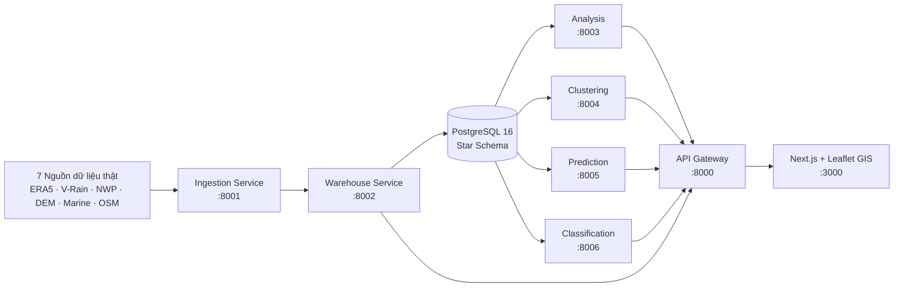

# BỘ NỘI DUNG CHI TIẾT 15 SLIDE THUYẾT TRÌNH — DỰ ÁN FLOODINSIGHT

> **Cách dùng file này để làm slide (PowerPoint / Canva / Google Slides)**:
> - Mỗi slide gồm **4 phần cố định**:
>   1. **Bố cục (Layout)** gợi ý để slide đẹp, ít chữ, nhiều hình.
>   2. **Chữ đưa lên Slide** (ngắn gọn — chỉ cần copy-paste thẳng vào khung chữ).
>   3. **Hướng dẫn chụp ảnh (CAP MÀN HÌNH)** chi tiết từng bước: mở tab nào trên `http://localhost:3000`, bấm nút nào, cắt đúng vùng nào để dán vào slide.
>   4. **Lời thuyết trình (Speaker Notes)** để nói tự nhiên khi trình bày.
> - **Mẹo chụp ảnh đẹp**: Mở trình duyệt `http://localhost:3000` ở chế độ **Zoom 90–100%**, bật **Theme tối (Dark)** hoặc **Theme sáng (Light)** thống nhất với màu nền slide của bạn; dùng `Win + Shift + S` để cắt gọn đúng khung biểu đồ/bản đồ.

---

## SLIDE 1: TRANG BÌA (TITLE SLIDE)

**Bố cục gợi ý**: Nền tối hoặc xanh navy đậm, bên trái chữ tiêu đề lớn (55%), bên phải ảnh bản đồ ngập Hải Châu bo góc có đổ bóng (45%).

### Chữ đưa lên Slide
- **Tiêu đề lớn**: **FLOODINSIGHT**
- **Tiêu đề phụ**: Hệ thống Khai phá Dữ liệu & Dự báo Nguy cơ Ngập lụt Đô thị TP. Đà Nẵng *(Trọng tâm Quận Hải Châu)*
- **Tag nổi bật**: `Khai phá dữ liệu (Data Mining)` · `Dữ liệu thực tế 2020–2026` · `XGBoost & K-Means` · `GIS Hải Châu`
- **Thông tin nhóm**:
  - Học phần: Khai phá dữ liệu
  - Giảng viên hướng dẫn: *(Điền tên GV)*
  - Nhóm thực hiện: *(Điền tên thành viên)*

### Hướng dẫn CAP ẢNH điền vào Slide
- **[ẢNH 1 — Ảnh bìa bản đồ Hải Châu]**:
  1. Mở `http://localhost:3000` → chọn tab **Bản đồ ngập lụt**.
  2. Bấm nút **Mưa cực đoan 05/11/2024** (hoặc **Đợt mưa 14/10/2023**) trên thanh phía trên bản đồ.
  3. Bấm **Mở rộng toàn bản đồ**, phóng to vừa khít khu vực trung tâm **Quận Hải Châu** sao cho thấy rõ các tuyến màu Đỏ/Cam/Vàng/Xanh lá + vòng tròn vùng trũng.
  4. Dùng `Win + Shift + S` cắt riêng **khung bản đồ** dán sang bên phải Slide 1.

### Lời thuyết trình gợi ý
> "Xin chào thầy/cô và các bạn. Hôm nay nhóm xin trình bày đề tài **FloodInsight** — hệ thống khai phá dữ liệu lịch sử thực tế giai đoạn 2020–2026 để dự báo lượng mưa, khung giờ ngập và tuyến đường ngập/né ngập tại TP. Đà Nẵng, trọng tâm là Quận Hải Châu."

---

## SLIDE 2: ĐẶT VẤN ĐỀ — THỰC TRẠNG NGẬP ĐÔ THỊ TẠI ĐÀ NẴNG & HẢI CHÂU

**Bố cục gợi ý**: Trên cùng 3 thẻ số liệu (KPI Cards); phía dưới chia đôi: Trái = 4 mốc lịch sử, Phải = 2 ảnh ghép (ảnh thực tế ngập Đà Nẵng + ảnh biểu đồ mưa lịch sử từ web).

### Chữ đưa lên Slide
- **3 Thẻ số liệu nổi bật**:
  - **`68,6%`**: Tỷ lệ bề mặt bê tông hóa Quận Hải Châu *(ESA WorldCover 10m)*
  - **`281 mm/ngày`**: Đỉnh mưa Hòa Cường Nam ngày `05/11/2024` *(ngập sâu 0,5–1,0 m)*
  - **`> 500 mm`**: Đỉnh mưa lịch sử Bão Sơn Ca `14/10/2022` *(ngập toàn nội đô)*
- **4 đợt ngập lịch sử điển hình (2020–2024)**:
  - `14/10/2022` (Bão Sơn Ca) — ngập sâu kỷ lục toàn trung tâm.
  - `14/10/2023` — ngập 0,3–0,6 m khu Lê Duẩn, Hàm Nghi, Hùng Vương.
  - `27/10/2024` (Bão Trami) — mưa lớn kết hợp triều cường sông Hàn.
  - `05/11/2024` — mưa cực đoan nội đô Hải Châu.
- **Vấn đề đặt ra**: Dự báo thời tiết thông thường chỉ báo mưa chung toàn thành phố → **Chưa trả lời được**: *Đường nào ngập? Ngập mấy giờ đến mấy giờ? Đi đường nào để né?*

### Hướng dẫn CAP ẢNH điền vào Slide
- **[ẢNH 2A — Ảnh thực tế ngập Hải Châu]**: Lấy 1 ảnh báo chí chính thống (Báo Đà Nẵng / VnExpress / Dân Trí) chụp cảnh ngập đường Lê Duẩn hoặc Hàm Nghi ngày 05/11/2024 *(ghi chú nguồn ảnh nhỏ bên dưới)*.
- **[ẢNH 2B — Biểu đồ mưa lịch sử Hải Châu từ Web]**:
  1. Mở `http://localhost:3000` → tab **Tổng quan** (hoặc **Lịch sử mưa**).
  2. Chọn địa điểm **Quận Hải Châu**, chọn khoảng ngày có đợt mưa lớn (ví dụ `2024-10-01` đến `2024-11-30`).
  3. Cap khung biểu đồ **Diễn biến lượng mưa (Rainfall over time)** có các cột mưa cao đột biến.

### Lời thuyết trình gợi ý
> "Quận Hải Châu có tới 68,6% diện tích bị bê tông hóa và nhiều điểm trũng thấp. Liên tiếp từ 2022 đến 2024, các trận mưa cường suất lớn như Sơn Ca hay 05/11/2024 đã gây ngập nặng nội đô. Bài toán nhóm giải quyết là biến dữ liệu lịch sử thành cảnh báo cụ thể đến từng tuyến đường và khung giờ."

---

## SLIDE 3: MỤC TIÊU, PHẠM VI & CAM KẾT DỮ LIỆU THẬT

**Bố cục gợi ý**: 2 cột lớn — Trái: 3 mục tiêu cốt lõi (dạng 3 box có icon); Phải: Bảng phạm vi thời gian dự báo + Khung cam kết khoa học.

### Chữ đưa lên Slide
- **3 Mục tiêu cốt lõi**:
  1. **Kho dữ liệu 7 năm (2020–2026)**: Tích hợp 7 nguồn dữ liệu thực tế cho **9 điểm quan trắc** Đà Nẵng.
  2. **Khai phá dữ liệu đa kỹ thuật**: Thống kê mô tả, **XGBoost** (Hồi quy & Phân loại), **K-Means + PCA** (Phân cụm), Đánh giá rủi ro đa yếu tố.
  3. **Bản đồ GIS trực quan Hải Châu**: Phân đoạn 4 màu ôm sát lòng đường thật, dự báo **khung giờ ngập** và **tuyến đường né ngập**.
- **Phạm vi thời gian dự báo khoa học**:
  - **0 – 24 giờ tới** *(Độ tin cậy rất cao)*: Dự báo chi tiết tuyến đường, phân rã `6h / 12h / 24h` & khung giờ ngập (`bắt đầu – đỉnh – rút`).
  - **24 – 72 giờ tới** *(Độ tin cậy khá)*: Dữ liệu NWP đã cấu hình sẵn `48h`, hỗ trợ mở rộng cảnh báo sớm theo quận.
- **Cam kết học phần Khai phá dữ liệu**:
  - **100% dữ liệu thực tế đã kiểm chứng** — tuyệt đối **không dùng dữ liệu mô phỏng hay tạo dữ liệu giả lập**.

### Hướng dẫn CAP ẢNH điền vào Slide
- **[ẢNH 3 — Giao diện Tổng quan hệ thống]**:
  1. Mở `http://localhost:3000` → tab **Tổng quan**.
  2. Cap phần đầu gồm **3 thẻ KPI** (`Nguy cơ dự báo cao nhất hiện tại`, `Độ phủ quan trắc`, `Dự báo ngập`) + thanh menu bên trái để khán giả thấy ngay sản phẩm hoàn chỉnh.

### Lời thuyết trình gợi ý
> "Điểm cốt lõi của đề tài theo đúng bản chất môn Khai phá dữ liệu là sử dụng 100% số liệu lịch sử thực tế đã kiểm chứng để học mẫu và dự báo, không hề giả lập dữ liệu. Hệ thống tập trung độ chính xác cao nhất trong khung 24 giờ tới cho từng tuyến đường Hải Châu."

---

## SLIDE 4: QUY TRÌNH KHAI PHÁ DỮ LIỆU (CRISP-DM)

**Bố cục gợi ý**: Trên cùng: Sơ đồ 6 bước CRISP-DM chạy ngang (full-width); Phía dưới: 4 thẻ ngang thể hiện 4 nhóm kỹ thuật Khai phá dữ liệu áp dụng trong hệ thống.

### Chữ đưa lên Slide
- **Sơ đồ 6 bước CRISP-DM** *(dùng SmartArt mũi tên ngang hoặc dán từ Mermaid bên dưới)*:
  1. **Hiểu bài toán** → Ngập đô thị Hải Châu & 9 trạm Đà Nẵng
  2. **Thu thập dữ liệu** → 7 nguồn thật 2020–2026 (`516k+` dòng giờ)
  3. **Tiền xử lý & Đặc trưng** → Làm sạch, 15 features, chống rò rỉ thời gian
  4. **Mô hình hóa** → XGBoost + K-Means + Chỉ số rủi ro đa yếu tố
  5. **Đánh giá kiểm định** → MAE, RMSE, Silhouette, đối chiếu 4 trận ngập thật
  6. **Triển khai & GIS** → Docker Microservices + Bản đồ phân đoạn 4 màu
- **4 Kỹ thuật Khai phá dữ liệu trong FloodInsight**:
  - **Phân tích thống kê**: Xu hướng mùa mưa, phân bố mưa, tương quan Pearson.
  - **Hồi quy (Regression)**: XGBoost dự báo lượng mưa ngày kế tiếp (`mm`).
  - **Phân loại (Classification)**: XGBoost phân 4 mức cường độ mưa Hải Châu.
  - **Phân cụm (Clustering)**: K-Means + PCA phân nhóm thời tiết & hồ sơ địa hình.

### Hướng dẫn CAP ẢNH điền vào Slide
- **[ẢNH 4 — Sơ đồ CRISP-DM]**: Bạn có thể vẽ bằng SmartArt/Canva hoặc paste đoạn Mermaid trên vào `mermaid.live` → xuất ảnh PNG nền trong suốt dán vào nửa trên của Slide 4.

---

## SLIDE 5: 7 NGUỒN DỮ LIỆU THỰC TẾ ĐÃ KIỂM CHỨNG (2020–2026)

**Bố cục gợi ý**: Trái (60%): Bảng 7 nguồn dữ liệu gọn đẹp; Phải (40%): Ảnh chụp màn hình Tab **Quản lý dữ liệu** chứng minh dữ liệu thật đang nằm trong PostgreSQL.

### Chữ đưa lên Slide
| Nguồn dữ liệu chính thức | Quy mô trong PostgreSQL | Mục đích sử dụng |
| :--- | :--- | :--- |
| **Open-Meteo ERA5 Reanalysis** | **516.591** dòng giờ (**2.515 ngày**, 9 trạm) | Tập huấn luyện chính (2020–2026) |
| **Thực đo V-Rain & Trạm Hải Châu (WMO 48855)** | **312** dòng thực đo (`216` + `96`) | Hiệu chỉnh đỉnh mưa Hải Châu |
| **NWP ECMWF IFS 0.25° & NOAA GFS** | Dự báo theo giờ hạn **48h** | Đặc trưng dự báo & khung giờ ngập |
| **Copernicus DEM 30m & ESA WorldCover 10m** | **45** đặc trưng (9 trạm) + cao độ **14 đoạn đường** | Cao độ, độ dốc, tỷ lệ bê tông hóa |
| **ERA5 Soil Moisture & Open-Meteo Marine** | **672** dòng độ ẩm đất & triều biển Đà Nẵng | Độ bão hòa đất & trễ thoát nước triều |
| **OpenStreetMap (Overpass API)** | **14** tim đường thật Hải Châu (`6–39` điểm/đoạn) | Khớp 100% vị trí tuyến ngập/né ngập |
| **Sự kiện ngập lịch sử** *(Chính phủ, Báo ĐN)* | **6** sự kiện, **14** nhãn `flood_confirmed` | Hiệu chỉnh ngưỡng & đối chiếu bản đồ |

### Hướng dẫn CAP ẢNH điền vào Slide
- **[ẢNH 5 — Chứng minh kho dữ liệu thật]**:
  1. Mở `http://localhost:3000` → tab **Quản lý dữ liệu**.
  2. Cap phần **Độ phủ dữ liệu ngập** (hiển thị 6 ô số liệu: `Sự kiện có tài liệu: 6`, `Nhãn ngập đã xác nhận: 14`, `Đặc trưng địa hình: 45`, `Quan trắc thủy văn: 672`) cùng bảng **Độ phủ nguồn thời tiết** (`2020-01-01` đến `2026-11-19`).

### Lời thuyết trình gợi ý
> "Toàn bộ 7 nguồn dữ liệu trong bảng đều đang được lưu trực tiếp trong PostgreSQL như ảnh chụp từ tab Quản lý dữ liệu bên phải — nổi bật là chuỗi liên tục 2.515 ngày ERA5, số liệu thực đo V-Rain Hải Châu, địa hình vệ tinh 30m/10m và tim đường thật OpenStreetMap."

---

## SLIDE 6: KIẾN TRÚC HỆ THỐNG MICROSERVICES & DOCKER

**Bố cục gợi ý**: Trên cùng (65% chiều cao): Sơ đồ kiến trúc Microservices full-width; Phía dưới (35%): 2 khung nhỏ — Công nghệ sử dụng (Trái) & Ảnh chụp trạng thái 9 container/service đang chạy `ok` (Phải).

### Chữ đưa lên Slide

- **Stack công nghệ**:
  - **Backend**: Python 3.11, FastAPI, XGBoost, Scikit-learn, Pandas, Psycopg3.
  - **Database**: PostgreSQL 16 + Alembic migrations (`0001–0010`).
  - **Frontend**: Next.js (TypeScript), ECharts, React-Leaflet GIS.
  - **Vận hành**: **9 Docker containers** độc lập, tự động kiểm tra sức khỏe.

### Hướng dẫn CAP ẢNH điền vào Slide
- **[ẢNH 6A — Sơ đồ kiến trúc]**: Xuất ảnh PNG từ đoạn Mermaid trên tại `mermaid.live` (hoặc vẽ lại trên Canva bằng các khối mũi tên).
- **[ẢNH 6B — Trạng thái hệ thống đang hoạt động]**:
  1. Mở `http://localhost:3000` → tab **Tổng quan**, cuộn xuống mục **Trạng thái hệ thống** (hiển thị đủ các service `Gateway`, `Ingestion`, `Warehouse`, `Analytics`, `Clustering`, `Prediction`, `Classification`, `Postgres` đều có chấm xanh **Đang hoạt động**).
  2. Cắt gọn khung này dán vào góc dưới bên phải Slide 6.

---

## SLIDE 7: KHO DỮ LIỆU (STAR SCHEMA) & PHÂN TÍCH KHÁM PHÁ THỐNG KÊ

**Bố cục gợi ý**: Chia đôi 50/50 — Trái: Sơ đồ Star Schema + Nhãn nguồn gốc dữ liệu; Phải: 2 biểu đồ thống kê khám phá chụp từ tab **Mẫu thống kê**.

### Chữ đưa lên Slide
- **Kho dữ liệu Star Schema (PostgreSQL 16)**:
  - **Bảng chiều (Dimensions)**: `dim_location` (9 trạm), `dim_date`, `dim_time`, `dim_weather_source`.
  - **Bảng sự kiện (Facts)**: `fact_weather_hourly` (`516.903` dòng), `fact_rainfall_daily`, `fact_weather_forecast_hourly`.
  - **Bảng chuyên biệt ngập & ML**: `flood_events`, `flood_terrain_features`, `flood_hydrology_observations`, `flood_risk_assessments`, `prediction_results`, `clustering_results` (`17.546` dòng).
- **Gắn nhãn nguồn gốc (Data Provenance)**:
  - Tách bạch `verified_in_situ` (thực đo), `reanalysis_grid` (ERA5), `nwp_forecast` (dự báo) — đảm bảo minh bạch, không trộn lẫn dữ liệu.
- **Phát hiện từ thống kê khám phá**:
  - Mưa tại Đà Nẵng tập trung cực đại vào **tháng 9 – 11** (mùa mưa bão miền Trung), tương quan thuận mạnh với độ ẩm không khí và nghịch với nhiệt độ.

### Hướng dẫn CAP ẢNH điền vào Slide
- **[ẢNH 7A & 7B — Biểu đồ Mẫu thống kê từ Web]**:
  1. Mở `http://localhost:3000` → tab **Mẫu thống kê** (hoặc **Phân tích thống kê**).
  2. Chọn **Quận Hải Châu**, khoảng ngày `2020-01-01` đến `2026-11-19`.
  3. Cap 2 biểu đồ đẹp nhất: **Mưa theo mùa (Seasonal rainfall — trung bình theo 12 tháng)** và **Tương quan thời tiết (Weather correlations)** dán chồng nhau ở nửa phải Slide 7.

---

## SLIDE 8: TIỀN XỬ LÝ DỮ LIỆU & KỸ THUẬT ĐẶC TRƯNG (15 FEATURES)

**Bố cục gợi ý**: Trái (50%): 3 bước làm sạch & chống rò rỉ dữ liệu; Phải (50%): Sơ đồ/bảng 5 nhóm **15 đặc trưng đầu vào** cho mô hình ML.

### Chữ đưa lên Slide
- **Tiền xử lý & Kiểm soát chất lượng**:
  1. **Ưu tiên thực đo Hải Châu**: `COALESCE(ground_truth_rain, era5_rain)` giữ nguyên đỉnh mưa thực tế.
  2. **Ghép địa hình vệ tinh**: Ghép 2 mảnh Copernicus DEM (`N16_00_E108_00` & `N15_00_E108_00`) phủ kín đủ 9/9 trạm.
  3. **Chống rò rỉ dữ liệu (No Data Leakage)**: Chia tập **tuần tự theo thời gian** (quá khứ huấn luyện → tương lai kiểm tra) & chỉ dùng dữ liệu có `available_at <= issued_at`.
- **Bộ 15 đặc trưng đầu vào (`daily.py`)**:
  - **Trễ ngắn hạn (Short-lag)**: `rain_d1`, `rain_d2`, `rain_d3` *(nắm bắt chuỗi mưa bão liên tiếp)*
  - **Trễ trung hạn**: `rain_d8`, `rain_d9`, `rain_d10`, `rain_mean_d8_d14`
  - **Khí tượng liền trước**: `temperature_d1`, `humidity_d1`, `wind_d1`
  - **Dự báo số trị NWP**: `ecmwf_forecast`, `gfs_forecast`, `has_nwp_forecast`
  - **Chu kỳ mùa**: `season_sin`, `season_cos`

### Hướng dẫn CAP ẢNH điền vào Slide
- **[ẢNH 8 — Minh họa chất lượng dữ liệu ETL]**:
  1. Mở `http://localhost:3000` → tab **Quản lý dữ liệu**.
  2. Cap bảng **Chất lượng dữ liệu (Data quality)** hoặc **Độ phủ địa hình & thủy văn** để minh họa tỷ lệ độ phủ `100%` không thiếu mốc thời gian.

---

## SLIDE 9: HỌC MÁY 1 — HỒI QUY DỰ BÁO LƯỢNG MƯA (XGBOOST REGRESSOR)

**Bố cục gợi ý**: Trên cùng 4 thẻ KPI kết quả; Phía dưới: Ảnh chụp lớn bảng **Đánh giá hồi quy** + **Dự báo lượng mưa ngày kế tiếp** từ tab **Học máy**.

### Chữ đưa lên Slide
- **4 Thẻ KPI nổi bật**:
  - **Mô hình**: `XGBoost Regressor` *(+ hiệu chỉnh NWP)*
  - **Dữ liệu 2020–2024**: `9.531` Train · `2.452` Val · `2.754` Test
  - **Test MAE**: **`8,43 mm`**
  - **Test RMSE**: **`17,72 mm`**
- **Điểm mạnh**:
  - Kết hợp short-lag (`d1..d3`) + NWP (ECMWF/GFS) giúp giảm mạnh sai số so với đối chứng duy trì trạng thái (Persistence Baseline).
  - Dự báo lượng mưa ngày kế tiếp (`T+1`) cho đủ 9 điểm Đà Nẵng.

### Hướng dẫn CAP ẢNH điền vào Slide
- **[ẢNH 9 — Kết quả Hồi quy XGBoost từ Web]**:
  1. Mở `http://localhost:3000` → tab **Học máy (Machine Learning)**.
  2. Cap 2 khung đầu tiên: **Đánh giá hồi quy (Regression evaluation — có chỉ số MAE 8.43 / RMSE 17.72)** và bảng **Lượng mưa ngày kế tiếp (Next-day rainfall)**.

### Lời thuyết trình gợi ý
> "Ở bài toán hồi quy, nhóm huấn luyện XGBoost trên gần 10.000 mẫu lịch sử 2020–2024 và kiểm tra trên 2.754 mẫu giữ lại, đạt MAE 8,43 mm và RMSE 17,72 mm — vượt trội so với baseline."

---

## SLIDE 10: HỌC MÁY 2 — PHÂN LOẠI CƯỜNG ĐỘ MƯA (XGBOOST CLASSIFIER)

**Bố cục gợi ý**: Trái (48%): Bảng 4 ngưỡng phân loại đặc thù Quận Hải Châu; Phải (52%): Ảnh chụp **Ma trận nhầm lẫn (Confusion Matrix)** + **Bảng phân loại mưa** từ tab **Học máy**.

### Chữ đưa lên Slide
- **Bài toán**: Phân loại cường độ mưa ngày tiếp theo thành 4 cấp theo **ngưỡng kích hoạt ngập thực tế tại Hải Châu**:
  | Lớp cường độ | Ngưỡng mưa ngày | Ý nghĩa tại Hải Châu |
  | :--- | :---: | :--- |
  | **Không mưa** | `< 0,1 mm` | Khô ráo, an toàn |
  | **Mưa nhẹ** | `0,1 – 15,0 mm` | Tiêu thoát bình thường |
  | **Mưa vừa** | `15,0 – 50,0 mm` | Theo dõi điểm trũng cục bộ |
  | **Mưa lớn** | `≥ 50,0 mm` | **Cảnh báo ngập nhiều tuyến phố** (`395` mẫu train) |
- **Kỹ thuật**: `XGBoost Classifier` kết hợp hiệu chỉnh `calibrate_classification` giúp nhận diện sớm các ngày mưa lớn cực đoan.

### Hướng dẫn CAP ẢNH điền vào Slide
- **[ẢNH 10 — Ma trận nhầm lẫn & Bảng phân loại từ Web]**:
  1. Mở `http://localhost:3000` → tab **Học máy**.
  2. Cuộn xuống mục **Đánh giá phân loại (Classification evaluation)** và **Phân loại mưa (Rainfall classification)**.
  3. Cap **biểu đồ heatmap Ma trận nhầm lẫn** cùng bảng phân loại dán sang bên phải Slide 10.

---

## SLIDE 11: HỌC MÁY 3 — KHAI PHÁ PHÂN CỤM (K-MEANS + PCA)

**Bố cục gợi ý**: Lưới 2 cột bằng nhau — Cột Trái: **Phân cụm thời tiết (PCA 14.933 mẫu)** + ảnh chụp biểu đồ; Cột Phải: **Phân cụm địa hình ngập (9 trạm, Silhouette 0,460)** + ảnh chụp biểu đồ.

### Chữ đưa lên Slide
- **Cột Trái — Phân cụm mẫu thời tiết (Weather Clustering)**:
  - Thuật toán: **K-Means + PCA (2D)**.
  - Quy mô: **14.933 bản ghi** (2020–2024).
  - Ý nghĩa: Tách rõ các hình thái thời tiết Đà Nẵng (*Khô nóng*, *Ẩm chuyển mùa*, *Mưa vừa*, *Mưa bão cực đoan*).
- **Cột Phải — Phân cụm hồ sơ địa hình ngập (Terrain Clustering)**:
  - Đặc trưng: Cao độ, Độ dốc (*Copernicus DEM 30m*) & Đô thị hóa (*ESA WorldCover 10m*) trên **9/9 trạm**.
  - Chất lượng: **Silhouette Score = `0,460`**.
  - Ý nghĩa: Tự động phân tách nhóm **nội đô thấp trũng bê tông hóa cao** *(Hải Châu, Thanh Khê)* khỏi nhóm đồi núi *(Hòa Bắc, Hòa Vang)*.

### Hướng dẫn CAP ẢNH điền vào Slide
- **[ẢNH 11A — Biểu đồ Cụm thời tiết PCA]**: Trong tab **Học máy**, cap biểu đồ scatter **Cụm thời tiết (Weather clusters)** dán vào nửa dưới Cột Trái.
- **[ẢNH 11B — Biểu đồ Phân cụm địa hình 9 trạm]**: Cuộn xuống tiếp trong tab **Học máy**, cap biểu đồ scatter **Phân cụm đặc trưng địa hình ngập lụt** (có dòng `9 điểm · Silhouette 0.460`) dán vào nửa dưới Cột Phải.

---

## SLIDE 12: ĐÁNH GIÁ RỦI RO NGẬP `6H / 12H / 24H` & KHUNG GIỜ NGẬP CỤ THỂ

**Bố cục gợi ý**: Trái (45%): Công thức 5 yếu tố (tổng 100%) + Cơ chế tính khung giờ ngập theo giờ & triều sông Hàn; Phải (55%): Ảnh chụp màn hình **Chi tiết Quận Hải Châu** từ tab **Dự báo nguy cơ ngập**.

### Chữ đưa lên Slide
- **1. Chỉ số Rủi ro Ngập (`0 – 100`) — Độ phủ `100%` cho 9/9 trạm**:
  - `40%` Mưa dự báo + `20%` Mưa 24h trước + `15%` Cường suất giờ cực đại + `15%` Địa hình & Đô thị hóa + `10%` Độ ẩm đất.
  - Ngưỡng mưa kích hoạt riêng **Quận Hải Châu**: **`25 mm (6h)` · `35 mm (12h)` · `50 mm (24h)`**.
- **2. Dự báo Khoảng thời gian Ngập (`compute_flood_window`)**:
  - Quét trượt theo từng giờ (`1h / 3h`) trên chuỗi dự báo NWP `24h` kết hợp **mực triều ven biển sông Hàn** (*Open-Meteo Marine*, ví dụ `+1,14 m` → triều cao làm chậm tiêu thoát).
  - Xuất trực tiếp 4 mốc: **Giờ bắt đầu ngập (`onset_at`)** → **Giờ đỉnh ngập & độ sâu (`peak_at`)** → **Giờ rút nước (`recede_at`)** → **Thời lượng ngập (`duration_hours`)**.

### Hướng dẫn CAP ẢNH điền vào Slide
- **[ẢNH 12 — Panel Chi tiết Hải Châu từ Web]**:
  1. Mở `http://localhost:3000` → tab **Dự báo nguy cơ ngập**.
  2. Bấm vào dòng **Quận Hải Châu** trong bảng so sánh.
  3. Cuộn xuống phần **Yếu tố đóng góp và bằng chứng** của Hải Châu: cap trọn khối gồm **3 thẻ mốc `6 giờ / 12 giờ / 24 giờ`**, khung **Khoảng thời gian ngập dự kiến (mưa cực đại 1h, mưa trượt 3h, mực triều)** và **Khuyến nghị hành động**.

---

## SLIDE 13: BẢN ĐỒ GIS PHÂN ĐOẠN 4 MÀU BÁM TIM ĐƯỜNG THẬT (HẢI CHÂU)

**Bố cục gợi ý**: Trái (42%): Thang màu 4 cấp + 14 đoạn đường thật từ OSM/DEM; Phải (58%): Ảnh chụp bản đồ phóng to Quận Hải Châu có Popup chi tiết đang mở.

### Chữ đưa lên Slide
- **Độ chính xác vị trí 100%**: Trích xuất trực tiếp từ **OpenStreetMap Overpass API** (`6–39` tọa độ/đoạn) + **cao độ DEM riêng từng đoạn** cho **14 phân đoạn đường Hải Châu**.
- **Thang màu 4 cấp nối liền theo giao lộ**:
  - 🔴 **Đỏ (`30–50+ cm`) — Tránh đi**: Hàm Nghi *(Tản Đà → NVL)*, Lê Duẩn *(Hoàng Hoa Thám → Lý Thái Tổ)*, Hải Phòng *(Ga ĐN → NCT)*, Núi Thành *(Tiểu La → Duy Tân)*.
  - 🟠 **Cam (`15–30 cm`) — Hạn chế**: Nguyễn Văn Linh *(Hàm Nghi → Phan Châu Trinh)*, Lê Duẩn *(Lý Thái Tổ → NCT)*, Quang Trung *(Ông Ích Khiêm → NCT)*.
  - 🟡 **Vàng (`5–15 cm`) — Đi chậm**: Đoạn nối tiếp giáp sông Hàn của Nguyễn Văn Linh, Lê Duẩn, Quang Trung.
  - 🟢 **Xanh lá (`< 5 cm`) — Tuyến né ngập**: **Bạch Đằng** (`13,0 m`), **Trần Phú** (`11,0 m`), **Đường 2 Tháng 9**.
- **Tương tác GIS**: Vùng trũng 2 lớp đồng tâm, bật/tắt 3 lớp bản đồ, **click đoạn đường tự zoom sát** & hiện ngay **khung giờ ngập + đường né**.

### Hướng dẫn CAP ẢNH điền vào Slide
- **[ẢNH 13 — Bản đồ Hải Châu đang mở Popup chi tiết đoạn ngập]**:
  1. Mở `http://localhost:3000` → tab **Bản đồ ngập lụt**.
  2. Chọn sự kiện **Đợt mưa 14/10/2023** (nhìn thấy rõ nhất cả 4 màu 🔴 → 🟠 → 🟡 → 🟢 nối liền nhau!).
  3. Bấm **Mở rộng toàn bản đồ**, sau đó bấm trực tiếp vào đoạn màu đỏ **Hàm Nghi (Tản Đà → Nguyễn Văn Linh)** để **Popup** hiện ra *(có đầy đủ: Mức ngập, Khoảng thời gian ngập, Từ giao lộ → Đến giao lộ, Cao độ DEM, Gợi ý né qua Trần Phú / Bạch Đằng)*.
  4. Cap toàn bộ bản đồ kèm Popup đang mở dán vào bên phải Slide 13.

---

## SLIDE 14: ĐỐI CHIẾU 4 ĐỢT MƯA LỊCH SỬ & KỊCH BẢN DEMO TRỰC TIẾP

**Bố cục gợi ý**: Trên cùng (55%): 2 ảnh bản đồ đặt cạnh nhau để so sánh trực quan (**Dự báo hiện tại** vs **Mưa cực đoan 05/11/2024**); Phía dưới (45%): Thanh 4 bước Demo trực tiếp.

### Chữ đưa lên Slide
- **Kiểm chứng trực quan trên 4 đợt mưa thật (không giả lập)**:
  - `14/10/2023` · `Bão Trami 27/10/2024` · `Hòa Cường Nam 05/11/2024 (281 mm)` · `Bão Sơn Ca 14/10/2022 (>500 mm)`.
  - Bấm chuyển sự kiện → Bản đồ tự động đổi màu đoạn đường & hiển thị đúng **khung giờ ngập thực tế** và nguồn báo chí kiểm chứng.
- **Kịch bản Demo trực tiếp trên hệ thống (4 phút)**:
  1. **Tổng quan (30s)**: Chỉ số rủi ro 9 trạm + lịch sử mưa 2020–2026.
  2. **Dự báo ngập (45s)**: Phân rã `6h/12h/24h`, ngưỡng `25/35/50 mm` & khung giờ ngập Hải Châu.
  3. **Bản đồ GIS (1,5 phút)**: Mở rộng bản đồ → chuyển sự kiện lịch sử → click đoạn đường xem giờ ngập & tuyến né.
  4. **Học máy & Dữ liệu (1 phút)**: XGBoost MAE `8,43 mm`, K-Means PCA, Silhouette `0,460` & kho dữ liệu 7 năm.

### Hướng dẫn CAP ẢNH điền vào Slide
- **[ẢNH 14A — Thẻ Chi tiết đoạn đường & 2 danh sách tuyến ngập / né ngập]**:
  1. Ở tab **Bản đồ ngập lụt**, chọn **Mưa cực đoan 05/11/2024**, bấm vào 1 đoạn đường **Núi Thành (Tiểu La → Duy Tân)**.
  2. Cap phần **thẻ Chi tiết tuyến đường đang chọn** + **2 cột danh sách** (*Các đoạn đường có nguy cơ ngập* bên trái & *Tuyến cao ráo / Gợi ý né ngập* bên phải).
- **[ẢNH 14B — Thanh chọn 4 sự kiện lịch sử]**: Cap thanh 5 nút phía trên bản đồ (`Dự báo hiện tại` + 4 sự kiện lịch sử) + dòng banner nguồn kiểm chứng màu xanh.

---

## SLIDE 15: KẾT LUẬN, HƯỚNG PHÁT TRIỂN & HỎI ĐÁP (Q&A)

**Bố cục gợi ý**: Chia đôi 50/50 — Trái: Kết luận & Thành tựu chính (dạng checklist xanh); Phải: Hạn chế & Hướng phát triển tương lai; Dưới cùng: Dòng lớn **"CẢM ƠN THẦY/CÔ VÀ CÁC BẠN ĐÃ LẮNG NGHE — Q&A"**.

### Chữ đưa lên Slide
- **Kết luận**:
  - ✅ Xây dựng hoàn chỉnh hệ thống **Khai phá dữ liệu đầu cuối** từ 7 nguồn dữ liệu thật **2020–2026** (không giả lập).
  - ✅ Triển khai đầy đủ các bài toán học phần: **Thống kê**, **Hồi quy XGBoost (`MAE 8,43 mm`)**, **Phân loại XGBoost**, **Phân cụm K-Means + PCA (`Silhouette 0,460`)**.
  - ✅ Giải quyết sát bài toán thực tiễn Hải Châu: **Bản đồ 14 phân đoạn tim đường thật OSM**, **4 cấp màu nối liền**, **khung giờ ngập cụ thể** và **tuyến đường né ngập**.
- **Hạn chế & Hướng phát triển**:
  - Mở rộng cảnh báo sớm đa ngày (**48h – 72h**) từ chuỗi NWP đa mô hình.
  - Tích hợp cảm biến mực nước IoT / camera giao thông thời gian thực tại các rốn ngập Hải Châu để nâng độ chính xác độ sâu từng tuyến phố.

### Gợi ý trả lời nhanh Q&A (để riêng trong Speaker Notes — không cần đưa lên slide)
1. **Hỏi: Dữ liệu có phải giả lập không?**
   - *Đáp*: Hoàn toàn là dữ liệu thật trong PostgreSQL: `516.591` dòng ERA5 (2020–2026), `312` dòng thực đo V-Rain/Hải Châu, Copernicus DEM 30m, ESA WorldCover 10m, triều biển Open-Meteo Marine, tim đường OpenStreetMap và 6 sự kiện ngập có link chính thức.
2. **Hỏi: Hệ thống dự báo được tối đa bao nhiêu ngày tới?**
   - *Đáp*: Độ tin cậy cao nhất cho tuyến đường và khung giờ ngập là **24 giờ tới (1 ngày)**; hệ thống đã thu thập sẵn NWP **48 giờ** và có thể mở rộng cảnh báo sớm xu hướng mưa ngập lên **3 ngày (72 giờ)**.
3. **Hỏi: Làm sao tính được giờ bắt đầu ngập và giờ rút nước?**
   - *Đáp*: Quét trượt cân bằng nước theo từng giờ (`1h / 3h`) trên chuỗi dự báo NWP kết hợp năng lực tiêu thoát từng tuyến đường và hệ số chậm thoát nước khi triều biển sông Hàn dâng cao (`> +0,6 m`).
4. **Hỏi: Nếu hôm nay trời nắng thì làm sao chứng minh bản đồ hoạt động đúng khi mưa lớn?**
   - *Đáp*: Hệ thống tích hợp chế độ **Đối chiếu 4 sự kiện lịch sử thật (2022–2024)** lấy đúng lượng mưa thực đo để tái hiện trực quan bản đồ ngập và khung giờ ngập khớp thực tế.
