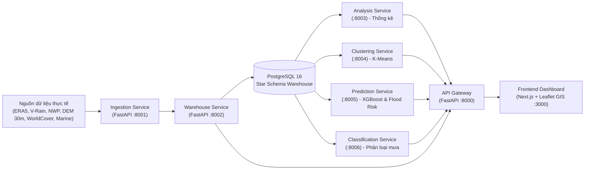

# BÁO CÁO TỔNG HỢP DỰ ÁN FLOODINSIGHT (DÙNG ĐỂ LÀM SLIDE THUYẾT TRÌNH)

> **Học phần**: Khai phá dữ liệu (Data Mining)  
> **Đề tài**: **FloodInsight** — Hệ thống Khai phá Dữ liệu Lịch sử & Dự báo Nguy cơ Ngập lụt Đô thị tại TP. Đà Nẵng (Trọng tâm Quận Hải Châu)  
> **Cấu trúc tài liệu**: Thiết kế sẵn **12 Slide** theo đúng mạch báo cáo khoa học (CRISP-DM), kèm bảng số liệu thật đã kiểm chứng, sơ đồ kiến trúc và kịch bản demo trực tiếp.

---

## SLIDE 1: TRANG BÌA

- **Tên đề tài**: **FloodInsight** — Hệ thống Khai phá Dữ liệu & Dự báo Nguy cơ Ngập lụt Đô thị tại TP. Đà Nẵng
- **Phạm vi trọng tâm**: 9 điểm quan trắc toàn TP. Đà Nẵng, phân tích chi tiết tuyến đường & vùng trũng tại **Quận Hải Châu**
- **Bản chất đề tài**: Khai phá dữ liệu lịch sử thực tế đã kiểm chứng giai đoạn **2020–2026** (khí tượng, địa hình vệ tinh, thủy văn, sự kiện ngập lịch sử) kết hợp Học máy để dự báo mưa và đánh giá nguy cơ ngập — **không sử dụng dữ liệu mô phỏng hay giả lập**.
- **Nhóm thực hiện / Giảng viên hướng dẫn**: *(Điền thông tin nhóm)*

---

## SLIDE 2: ĐẶT VẤN ĐỀ & MỤC TIÊU

### Thực trạng tại Đà Nẵng (đặc biệt Quận Hải Châu)
- Đô thị hóa nhanh (tỷ lệ bề mặt bê tông hóa tại Hải Châu đạt **68,6%** theo ảnh vệ tinh ESA WorldCover 10m), cao độ thấp, nhiều vùng trũng cục bộ thoát nước chậm.
- Liên tiếp xảy ra các đợt mưa cực đoan gây ngập nặng trong giai đoạn 2020–2024:
  - **14–15/10/2022 (Bão Sơn Ca)**: Mưa lịch sử >500 mm, ngập sâu toàn nội đô.
  - **14/10/2023**: Mưa lớn kéo dài gây ngập cục bộ Lê Duẩn, Hàm Nghi, Hùng Vương.
  - **27/10/2024 (Bão Trami)**: Mưa diện rộng kết hợp triều cường.
  - **05/11/2024 (Hòa Cường Nam)**: Mưa cực đoan **281 mm/ngày**, ngập sâu 0,5–1,0 m khu Núi Thành – Tiểu La.

### Mục tiêu đề tài
1. Xây dựng **Kho dữ liệu (Data Warehouse)** tích hợp đa nguồn thực tế liên tục 7 năm (**2020–2026**).
2. Áp dụng đầy đủ các kỹ thuật **Khai phá dữ liệu**: Thống kê khám phá, Hồi quy (XGBoost), Phân loại (XGBoost), Phân cụm (K-Means + PCA) và Đánh giá rủi ro đa yếu tố.
3. Trực quan hóa **Bản đồ phân đoạn ngập lụt theo tuyến đường** (4 cấp màu Đỏ → Cam → Vàng → Xanh lá) giúp người dân nhận diện đoạn đường ngập và lộ trình né ngập.

---

## SLIDE 3: QUY TRÌNH KHAI PHÁ DỮ LIỆU (CRISP-DM)

1. **Hiểu bài toán (Business Understanding)**: Dự báo lượng mưa ngày tới, phân loại cường độ mưa, phân nhóm đặc trưng địa hình và đánh giá nguy cơ ngập theo các khung giờ `6h / 12h / 24h`.
2. **Thu thập & Hiểu dữ liệu (Data Understanding)**: Tích hợp 6 nhóm dữ liệu thực tế từ vệ tinh, tái phân tích khí tượng, trạm thực đo V-Rain/WMO và mô hình dự báo số trị (NWP).
3. **Chuẩn bị dữ liệu (Data Preparation)**: Làm sạch, xử lý đồng bộ tọa độ 9 điểm quan trắc, ưu tiên số liệu thực đo Hải Châu, trích xuất đặc trưng trễ ngắn/dài hạn (`d1..d3`, `d8..d14`) và kiểm soát rò rỉ dữ liệu theo mốc thời gian.
4. **Mô hình hóa (Modeling)**:
   - Học có giám sát: **XGBoost Regressor** & **XGBoost Classifier**.
   - Học không giám sát: **K-Means Clustering** (mẫu thời tiết & hồ sơ địa hình).
   - Hệ thống tính điểm nguy cơ ngập đa yếu tố hiệu chỉnh theo ngưỡng lịch sử từng quận.
5. **Đánh giá (Evaluation)**: Kiểm định trên tập giữ lại theo thời gian (MAE, RMSE, Confusion Matrix, Silhouette Score).
6. **Triển khai (Deployment)**: Hệ thống Microservices (Docker + FastAPI + PostgreSQL + Next.js + Leaflet GIS).

---

## SLIDE 4: NGUỒN DỮ LIỆU THỰC TẾ ĐÃ KIỂM CHỨNG (2020–2026)

| Nhóm dữ liệu | Nguồn dữ liệu chính thức | Quy mô trong PostgreSQL | Vai trò trong mô hình |
| :--- | :--- | :--- | :--- |
| **Khí tượng lịch sử (2020–2026)** | Open-Meteo ERA5 Reanalysis | **516.591** bản ghi theo giờ (**2.515 ngày** liên tục, 9 trạm) | Tập huấn luyện chính cho Hồi quy, Phân loại & Phân cụm thời tiết |
| **Thực đo mặt đất (Ground Truth)** | V-Rain & Trạm Hải Châu (WMO 48855) | **312** bản ghi theo giờ (`216` V-Rain + `96` Hải Châu) | Hiệu chỉnh & ưu tiên thay thế số liệu lưới tại tâm điểm Hải Châu |
| **Dự báo thời tiết số trị (NWP)** | ECMWF IFS 0.25° & NOAA GFS Seamless | Cập nhật định kỳ hạn **48 giờ** | Đặc trưng đầu vào dự báo mưa & tính rủi ro ngập `6h / 12h / 24h` |
| **Địa hình & Đô thị hóa vệ tinh** | Copernicus DEM 30m & ESA WorldCover 10m | **45** đặc trưng cho đủ **9/9** trạm (cao độ, độ dốc, tỷ lệ bê tông hóa) | Phân cụm hồ sơ địa hình & trọng số địa hình gây ngập |
| **Thủy văn & Mực nước biển** | ERA5 Soil Moisture (`0–7cm`) & Open-Meteo Marine | **672** bản ghi (độ ẩm đất + mực nước biển ven bờ Đà Nẵng) | Đánh giá độ bão hòa đất & khả năng tiêu thoát nước |
| **Sự kiện ngập lịch sử** | Cổng TTĐT Chính phủ, Báo Đà Nẵng, Dân Trí | **6** sự kiện lớn, **14** nhãn `flood_confirmed` chất lượng cao | Hiệu chỉnh ngưỡng mưa kích hoạt ngập & đối chiếu trên bản đồ |

**9 điểm quan trắc tại TP. Đà Nẵng**: Hải Châu (trọng tâm), Thanh Khê, Liên Chiểu, Cẩm Lệ, Ngũ Hành Sơn, Sơn Trà, Hòa Vang, Hòa Bắc, Hòa Khương.

---

## SLIDE 5: KIẾN TRÚC HỆ THỐNG MICROSERVICES & DATA WAREHOUSE

- **Triển khai đồng bộ bằng Docker Compose** gồm 9 container độc lập, dễ mở rộng và kiểm thử.
- **Kho dữ liệu Star Schema**: Tách biệt bảng chiều (`dim_location`, `dim_date`, `dim_time`, `dim_weather_source`) và bảng sự kiện (`fact_weather_hourly`, `fact_weather_forecast_hourly`, `flood_events`, `flood_terrain_features`, `flood_hydrology_observations`).
- **Gắn nhãn nguồn gốc dữ liệu (Data Provenance)**: Phân tách rõ `verified_in_situ` (thực đo), `reanalysis_grid` (tái phân tích ERA5), và `nwp_forecast` (dự báo số trị).

---

## SLIDE 6: KỸ THUẬT ĐẶC TRƯNG (FEATURE ENGINEERING)

### Bộ 15 đặc trưng đầu vào cho mô hình dự báo mưa (`daily.py`)
- **Độ trễ ngắn hạn (Short-lag)**: `rain_d1`, `rain_d2`, `rain_d3` — nắm bắt chuỗi mưa kéo dài của bão/áp thấp.
- **Độ trễ trung hạn (Medium-lag)**: `rain_d8`, `rain_d9`, `rain_d10`, `rain_mean_d8_d14` — phản ánh nền ẩm kéo dài.
- **Khí tượng ngày liền trước**: `temperature_d1`, `humidity_d1`, `wind_d1`.
- **Tích hợp dự báo số trị NWP**: `ecmwf_forecast`, `gfs_forecast`, `has_nwp_forecast`.
- **Tính chu kỳ mùa mưa miền Trung**: `season_sin`, `season_cos`.

### Nguyên tắc đảm bảo tính khoa học
- **Ưu tiên dữ liệu thực đo**: Dùng `COALESCE(ground_truth_rain, era5_rain)` để giữ nguyên đỉnh mưa thực tế tại Hải Châu.
- **Chia tập theo trục thời gian (Temporal Split)**: Huấn luyện trên quá khứ, kiểm tra trên giai đoạn giữ lại (không trộn ngẫu nhiên gây rò rỉ tương lai).

---

## SLIDE 7: MÔ HÌNH HỌC MÁY 1 — HỒI QUY & PHÂN LOẠI (XGBOOST)

### 1. Dự báo lượng mưa ngày tiếp theo (XGBoost Regressor)
- **Tập dữ liệu 2020–2024**: `9.531` mẫu huấn luyện | `2.452` mẫu validation | `2.754` mẫu kiểm tra (test).
- **Kết quả trên tập kiểm tra giữ lại**:
  - **Test MAE**: **8,43 mm**
  - **Test RMSE**: **17,72 mm**
- **Hiệu chỉnh đầu ra (`calibrate_prediction`)**: Kết hợp tín hiệu NWP giúp ổn định biên độ dự báo vào các ngày mưa lớn.

### 2. Phân loại cường độ mưa (XGBoost Classifier)
- Phân loại 4 cấp cường độ theo **ngưỡng đặc thù ngập đô thị Quận Hải Châu**:
  - Không mưa (`< 0,1 mm`)
  - Mưa nhẹ (`0,1 – 15,0 mm`)
  - Mưa vừa (`15,0 – 50,0 mm`)
  - Mưa lớn / Nguy cơ ngập (`≥ 50,0 mm` — `395` mẫu huấn luyện mưa lớn trong tập lịch sử)

---

## SLIDE 8: MÔ HÌNH HỌC MÁY 2 — KHAI PHÁ PHÂN CỤM (K-MEANS)

### 1. Phân cụm mẫu thời tiết (Weather Pattern Clustering)
- Huấn luyện **K-Means** trên chuỗi thời tiết 5 năm (`2020–2024`), lưu trữ **14.933 bản ghi** phân cụm (`17.546` tổng bản ghi toàn hệ thống).
- Sử dụng **PCA (Principal Component Analysis)** để chiếu đa chiều xuống không gian 2D trực quan hóa các hình thái thời tiết đặc trưng (khô nóng, ẩm chuyển mùa, mưa vừa, mưa bão cực đoan).

### 2. Phân cụm hồ sơ địa hình ngập lụt (Terrain Profile Clustering)
- Phân cụm **9/9 trạm quan trắc Đà Nẵng** dựa trên **cao độ (Elevation)**, **độ dốc (Slope)** từ Copernicus DEM 30m và **tỷ lệ bê tông hóa (Built-up)** từ ESA WorldCover 10m.
- **Chỉ số đánh giá chất lượng phân cụm**: **Silhouette Score = 0,460** (phân tách rõ nhóm nội đô thấp trũng bê tông hóa cao như Hải Châu/Thanh Khê với nhóm đồi núi cao như Hòa Bắc/Hòa Vang).

---

## SLIDE 9: ĐÁNH GIÁ NGUY CƠ NGẬP ĐA YẾU TỐ & PHÂN RÃ `6H / 12H / 24H`

### Cơ chế tính Chỉ số Rủi ro Ngập (`0 – 100`)
Kết hợp đồng thời **5 nhóm yếu tố** với độ phủ trọng số đạt **100% (`weight_coverage = 1.0`)** cho cả 9/9 trạm:
1. **Lượng mưa dự báo** (`forecast_rainfall`)
2. **Mưa tích lũy 24h trước đó** (`recent_rainfall`)
3. **Cường suất mưa giờ cực đại** (`rainfall_intensity`)
4. **Địa hình & Đô thị hóa** (`terrain` — DEM 30m + WorldCover 10m)
5. **Độ ẩm đất tầng mặt** (`soil_wetness` — ERA5 Soil Moisture)

### Chi tiết đầu ra hỗ trợ ra quyết định
- **Phân rã theo 3 mốc thời gian**: `6 giờ tới` | `12 giờ tới` | `24 giờ tới` kèm thanh tiến độ so với ngưỡng kích hoạt ngập.
- **Ngưỡng mưa kích hoạt riêng theo địa bàn**: Riêng **Quận Hải Châu** áp dụng ngưỡng thực tế **`25 mm (6h)` / `35 mm (12h)` / `50 mm (24h)`**.
- **Tự động chỉ ra yếu tố gây ngập chính (`primary_driver`)** và **khuyến nghị hành động** bằng tiếng Việt.

---

## SLIDE 10: BẢN ĐỒ PHÂN ĐOẠN NGẬP LỤT & LỘ TRÌNH NÉ NGẬP (HẢI CHÂU)

### Thiết kế trực quan GIS theo từng đoạn giao lộ
Thay vì chỉ chấm 1 điểm đại diện cho cả quận, bản đồ chia các trục đường chính tại Hải Châu thành **các đoạn nối tiếp theo từng ngã tư** và đổi màu động theo cường độ mưa:

| Màu sắc | Mức độ ngập dự kiến | Ý nghĩa điều hướng | Ví dụ đoạn đường tại Hải Châu |
| :--- | :--- | :--- | :--- |
| 🔴 **Đỏ đậm** | Ngập sâu (`30–50+ cm`) | **Tránh đi qua** | Hàm Nghi (Tản Đà → Nguyễn Văn Linh), Lê Duẩn (Hoàng Hoa Thám → Lý Thái Tổ), Núi Thành (Tiểu La → Duy Tân) |
| 🟠 **Cam** | Ngập trung bình (`15–30 cm`) | **Hạn chế qua lại** | Nguyễn Văn Linh (Hàm Nghi → Phan Châu Trinh), Lê Duẩn (Lý Thái Tổ → Nguyễn Chí Thanh) |
| 🟡 **Vàng** | Ngập nhẹ (`5–15 cm`) | **Đi chậm, chú ý** | Nguyễn Văn Linh (Phan Châu Trinh → Cầu Rồng), Lê Duẩn (Nguyễn Chí Thanh → Bạch Đằng) |
| 🟢 **Xanh lá** | Cao ráo (`< 5 cm`) | **Lộ trình né ngập** | **Bạch Đằng**, **Trần Phú**, **Đường 2 Tháng 9** |

### Tính năng tương tác nổi bật trên bản đồ
- **Vùng trũng 2 lớp đồng tâm** (lõi trũng + vành lan tỏa) tại 5 rốn ngập lịch sử.
- **Chuyển đổi trực tiếp** giữa **Dự báo hiện tại (`6h / 12h / 24h`)** và **4 sự kiện mưa lịch sử đã kiểm chứng** (`14/10/2023`, `Trami 27/10/2024`, `05/11/2024`, `Sơn Ca 14/10/2022`).
- **Tương tác 2 chiều**: Bật/tắt từng lớp, mở rộng toàn bản đồ, click vào bất kỳ tuyến đường nào để zoom thẳng tới đoạn ngập kèm gợi ý đường né.

---

## SLIDE 11: KỊCH BẢN DEMO TRỰC TIẾP (3–5 PHÚT)

1. **Tab Tổng quan & Lịch sử mưa (30s)**:
   - Giới thiệu nhanh chỉ số rủi ro ngập hiện tại của 9 điểm Đà Nẵng và chuỗi mưa lịch sử 2020–2026 tại Hải Châu.
2. **Tab Dự báo nguy cơ ngập (1 phút)**:
   - Chọn **Quận Hải Châu** → chỉ rõ bảng phân rã `6h / 12h / 24h`, ngưỡng mưa kích hoạt (`25/35/50 mm`), yếu tố đóng góp và khuyến nghị.
3. **Tab Bản đồ ngập lụt (1,5 phút — điểm nhấn ăn điểm nhất)**:
   - Bấm **Mở rộng toàn bản đồ**.
   - Bấm chuyển sang sự kiện lịch sử **Đợt mưa 14/10/2023** và **Mưa cực đoan 05/11/2024** để giảng viên thấy rõ hiệu ứng màu chuyển tiếp **🔴 Đỏ → 🟠 Cam → 🟡 Vàng → 🟢 Xanh lá** trên các tuyến đường Hải Châu.
   - Click vào đoạn **Hàm Nghi (Tản Đà → Nguyễn Văn Linh)** để bản đồ tự zoom sát và hiện popup hướng dẫn rẽ sang **Trần Phú / Bạch Đằng** để né ngập.
4. **Tab Học máy (1 phút)**:
   - Trình bày kết quả thực tế của **XGBoost Regressor (MAE 8,43 mm)**, **XGBoost Classifier**, **Biểu đồ phân cụm thời tiết PCA (14.933 mẫu)** và **Phân cụm địa hình 9 trạm (Silhouette 0,460)**.
5. **Tab Quản lý dữ liệu (30s)**:
   - Cho thấy minh bạch kho dữ liệu 7 năm (ERA5, V-Rain, Copernicus DEM, WorldCover, Thủy văn) và nguồn gốc từng bản ghi.

---

## SLIDE 12: KẾT LUẬN, HƯỚNG PHÁT TRIỂN & GỢI Ý TRẢ LỜI Q&A

### Kết luận
- Hệ thống **FloodInsight** hoàn thiện khép kín từ **thu thập dữ liệu đa nguồn thật (2020–2026)** → **kho dữ liệu Star Schema** → **khai phá dữ liệu (Hồi quy, Phân loại, Phân cụm)** → **bản đồ cảnh báo phân đoạn trực quan**.
- Đảm bảo tính trung thực khoa học: toàn bộ mô hình huấn luyện và đối chiếu đều dựa trên dữ liệu đã kiểm chứng, không dùng dữ liệu giả lập.

### Hướng phát triển
- Tích hợp thêm trạm đo mực nước cảm biến IoT thời gian thực tại các cống thoát nước trung tâm Hải Châu.
- Thu thập bổ sung nhãn ngập nhị phân theo giờ (từ camera giao thông / cộng đồng) để huấn luyện mô hình xác suất ngập trực tiếp theo từng tuyến phố.

### Gợi ý trả lời nhanh các câu hỏi giảng viên hay hỏi (Q&A)
1. **Hỏi: Dữ liệu của nhóm lấy từ đâu, có phải tự tạo/giả lập không?**
   - *Trả lời*: Hoàn toàn là dữ liệu thật đã kiểm chứng trong PostgreSQL: `516.591` dòng ERA5 (2020–2026), `312` dòng thực đo V-Rain/WMO Hải Châu, địa hình vệ tinh Copernicus DEM 30m & ESA WorldCover 10m, thủy văn ERA5/Marine và 6 trận ngập lịch sử có link báo chí/chính phủ.
2. **Hỏi: Tại sao chọn XGBoost và K-Means?**
   - *Trả lời*: Dữ liệu khí tượng – địa hình dạng bảng có quan hệ phi tuyến mạnh và nhiều biến trễ (`d1..d3`, `d8..d14`, NWP), XGBoost xử lý vượt trội (đạt MAE `8,43 mm`). K-Means giúp khám phá cấu trúc tiềm ẩn của các hình thái mưa và phân nhóm rủi ro địa hình 9 trạm mà không cần gán nhãn thủ công (Silhouette `0,460`).
3. **Hỏi: Làm sao bản đồ biết đoạn đường nào ngập nặng, đoạn nào né được?**
   - *Trả lời*: Dựa trên tổng hợp hồ sơ các điểm ngập lịch sử tại Đà Nẵng kết hợp cao độ DEM 30m và ngưỡng mưa kích hoạt riêng của từng đoạn giao lộ. Khi lượng mưa dự báo (hoặc đợt mưa lịch sử) thay đổi, hệ thống tự tính tỷ lệ so với ngưỡng để chuyển màu 4 cấp Đỏ/Cam/Vàng/Xanh lá.
4. **Hỏi: Nếu hôm nay trời nắng thì làm sao kiểm chứng bản đồ hoạt động đúng khi mưa lớn?**
   - *Trả lời*: Hệ thống tích hợp sẵn chế độ **Đối chiếu sự kiện lịch sử** lấy đúng lượng mưa thực đo của các đợt bão 2022–2024 trong kho dữ liệu để tái hiện trực tiếp phản ứng của bản đồ.
