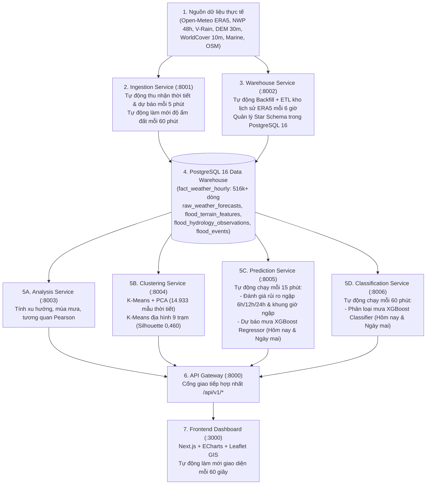

# CẨM NANG HIỂU SÂU & BẢO VỆ ĐỒ ÁN FLOODINSIGHT (DÀNH CHO THUYẾT TRÌNH & VẤN ĐÁP)

> **Mục đích tài liệu này**: Giúp bạn nắm vững **100% những gì đã làm trong dự án**, hiểu rõ **luồng hoạt động bên dưới**, **thuật toán tính toán**, **ý nghĩa từng con số**, **chức năng của từng nút bấm trên giao diện web (`http://localhost:3000`)**, và có sẵn **câu trả lời chuẩn xác cho mọi câu hỏi vấn đáp của giảng viên**.

---

## PHẦN 1: BẢN CHẤT ĐỀ TÀI & ĐIỂM ĂN ĐIỂM CỐT LÕI

### 1.1. Đề tài này làm về cái gì?
**FloodInsight** là hệ thống **Khai phá dữ liệu lịch sử (2020–2026) kết hợp Học máy và GIS** để:
1. **Dự báo lượng mưa và phân loại cường độ mưa** cho **9 điểm quan trắc tại TP. Đà Nẵng** (Hải Châu, Thanh Khê, Liên Chiểu, Cẩm Lệ, Ngũ Hành Sơn, Sơn Trà, Hòa Vang, Hòa Bắc, Hòa Khương).
2. **Đánh giá nguy cơ ngập đa yếu tố (`0–100`)** phân rã theo **6 giờ / 12 giờ / 24 giờ tới**.
3. **Dự báo chính xác khoảng thời gian ngập** (*bắt đầu ngập lúc mấy giờ, đỉnh ngập lúc mấy giờ, kéo dài bao nhiêu giờ đồng hồ, mấy giờ nước rút*).
4. **Hiển thị trực quan trên Bản đồ GIS Quận Hải Châu** theo từng phân đoạn giao lộ (4 màu: **Đỏ – Cam – Vàng – Xanh lá**) để người dân biết **đoạn đường nào ngập cần tránh** và **tuyến đường nào cao ráo để né ngập**.

### 1.2. Tại sao đề tài này đúng chuẩn học phần Khai phá dữ liệu?
- **100% Dữ liệu thật đã kiểm chứng (Không dùng dữ liệu giả lập / mô phỏng)**:
  - Lấy từ 7 nguồn thực tế: **516.591 dòng giờ ERA5 (2020–2026)**, **312 dòng thực đo V-Rain & Trạm Hải Châu**, **NWP dự báo số trị (ECMWF IFS + NOAA GFS)**, **địa hình vệ tinh Copernicus DEM 30m**, **độ phủ đô thị hóa ESA WorldCover 10m**, **mực triều biển Open-Meteo Marine**, **tim đường thật OpenStreetMap** và **6 sự kiện ngập lịch sử có báo chí/chính phủ kiểm chứng**.
- **Áp dụng đầy đủ 4 bài toán Khai phá dữ liệu**:
  1. **Khám phá thống kê (Statistical Mining)**: Phân tích xu hướng mưa, tính mùa vụ, tương quan Pearson.
  2. **Hồi quy có giám sát (Supervised Regression)**: **XGBoost Regressor** dự báo lượng mưa (`mm/ngày`).
  3. **Phân loại có giám sát (Supervised Classification)**: **XGBoost Classifier** phân 4 mức cường độ mưa.
  4. **Phân cụm không giám sát (Unsupervised Clustering)**: **K-Means + PCA** phân cụm 14.933 mẫu thời tiết và phân nhóm địa hình 9 trạm Đà Nẵng.

---

## PHẦN 2: LUỒNG HOẠT ĐỘNG TỔNG THỂ CỦA HỆ THỐNG (END-TO-END FLOW)

### 2.1. Sơ đồ luồng dữ liệu từ nguồn đến giao diện

### 2.2. Hệ thống có bao nhiêu luồng chạy tự động (Automation)?
Hệ thống có **5 luồng tự động hoàn toàn** (không cần người dùng bấm tay hệ thống vẫn luôn có số liệu mới nhất):
1. **`ingestion-service` (5 phút/lần)**: Tự động gọi API Open-Meteo kéo thời tiết hiện tại, chuỗi mưa 72h qua (`past_hours=72`) và dự báo từng giờ `48h` tới (`precipitation = rain + showers`) cho cả 9 điểm Đà Nẵng.
2. **`ingestion-service` → `warehouse-service` (60 phút/lần)**: Tự động kiểm tra và nạp bổ sung độ ẩm đất tầng mặt (`soil_moisture_0_to_7cm`).
3. **`warehouse-service` (6 giờ/lần)**: Tự động chạy `backfill` + `etl` đồng bộ kho lịch sử ERA5 đến ngày mới nhất hợp lệ (`hôm nay - 5 ngày`, do ERA5 quốc tế có độ trễ công bố 5 ngày).
4. **`prediction-service` (15 phút/lần + ngay khi khởi động 10 giây)**:
   - Tự động tính lại **Đánh giá rủi ro ngập (`flood_risk_assessments`)** và **Khoảng thời gian ngập (`flood_window`)** cho 9 trạm.
   - Tự động chạy mô hình **XGBoost Regressor** cập nhật lượng mưa dự báo cho **cả ngày hôm nay lẫn ngày mai**.
5. **`classification-service` (60 phút/lần + ngay khi khởi động 15 giây)**:
   - Tự động chạy mô hình **XGBoost Classifier** cập nhật nhãn phân loại mưa (`Không mưa / Mưa nhẹ / Mưa vừa / Mưa lớn`) cho cả ngày hôm nay lẫn ngày mai.

---

## PHẦN 3: GIẢI THÍCH CÁC THUẬT TOÁN & CÔNG THỨC BÊN TRONG (ĐỂ TRẢ LỜI GIẢNG VIÊN)

### 3.1. Bộ 15 đặc trưng (Features) đưa vào XGBoost là gì?
Khi dự báo cho ngày mục tiêu $T$, hệ thống trích xuất **15 biến đặc trưng** từ quá khứ và dự báo số trị (`services/ml-common/floodinsight_ml/daily.py`):
- **3 biến mưa trễ ngắn hạn (`rain_d1`, `rain_d2`, `rain_d3`)**: Tổng lượng mưa của 1, 2, 3 ngày liền trước — rất quan trọng vì mưa bão miền Trung thường kéo dài theo đợt 2–4 ngày.
- **4 biến mưa trễ trung hạn (`rain_d8`, `rain_d9`, `rain_d10`, `rain_mean_d8_d14`)**: Phản ánh độ ẩm nền của tuần trước đó.
- **3 biến khí tượng ngày hôm trước (`temperature_d1`, `humidity_d1`, `wind_d1`)**: Nhiệt độ giảm + độ ẩm cao + gió mạnh là dấu hiệu điển hình của không khí lạnh kết hợp nhiễu động gió đông gây mưa lớn tại Đà Nẵng.
- **3 biến dự báo khí tượng số trị NWP (`ecmwf_forecast`, `gfs_forecast`, `has_nwp_forecast`)**: Tín hiệu từ mô hình vật lý khí quyển châu Âu (ECMWF) và Mỹ (NOAA GFS).
- **2 biến chu kỳ mùa (`season_sin`, `season_cos`)**: Mã hóa ngày trong năm ($1..366$) bằng hàm lượng giác $\sin/\cos$ để mô hình nhận biết mùa mưa Đà Nẵng (tháng 9–12).

### 3.2. Mô hình Hồi quy XGBoost Regressor hoạt động thế nào?
- **Huấn luyện**: Dùng `XGBRegressor` (`600` cây, `learning_rate=0.04`, `max_depth=6`) trên dữ liệu thật 2020–2024:
  - Tập Train: **9.531 mẫu** | Validation: **2.452 mẫu** | Test: **2.754 mẫu**.
  - Sai số kiểm định trên tập Test: **MAE = 8,43 mm**, **RMSE = 17,72 mm** (tốt hơn rõ rệt so với baseline lấy mưa hôm trước đoán hôm sau).
- **Hiệu chỉnh dự báo thực tế (`calibrate_prediction`)**: Kết hợp đầu ra của XGBoost với tổng lượng giáng thủy dự báo mới nhất (`precipitation = rain + showers`) theo trọng số:
  $$\text{Mưa dự báo} = 0.65 \times \text{NWP}_{\text{live}} + 0.15 \times \text{NWP}_{\text{ECMWF/GFS}} + 0.20 \times \text{XGBoost}_{\text{raw}}$$
  Giúp dự báo vừa thừa hưởng quy luật lịch sử 7 năm của Học máy, vừa bắt kịp diễn biến bão/áp thấp thời gian thực.

### 3.3. Mô hình Phân loại XGBoost Classifier hoạt động thế nào?
- Phân ngày mục tiêu vào **4 lớp cường độ mưa** theo ngưỡng ngập đô thị Hải Châu:
  - **Không mưa (`No Rain`)**: $< 0,1\text{ mm}$
  - **Mưa nhẹ (`Light Rain`)**: $0,1 - 15,0\text{ mm}$
  - **Mưa vừa (`Moderate Rain`)**: $15,0 - 50,0\text{ mm}$
  - **Mưa lớn (`Heavy Rain`)**: $\ge 50,0\text{ mm}$ (ngưỡng bắt đầu gây ngập các tuyến phố Hải Châu).
- Khi huấn luyện có dùng **trọng số cân bằng lớp (`sample_weight`)** để mô hình không bị lệch về các ngày không mưa.
- Khi dự báo (`calibrate_classification`), nhãn phân loại được đồng bộ chặt với lượng mưa dự báo của mô hình Hồi quy và pha trộn $70\%$ tiên nghiệm NWP + $30\%$ xác suất `predict_proba` của `XGBClassifier` để mỗi trạm có độ tin cậy (confidence) chính xác riêng.

### 3.4. Mô hình Phân cụm K-Means hoạt động thế nào?
Hệ thống có **2 mô hình phân cụm K-Means**:
1. **Phân cụm mẫu thời tiết (`Weather Clusters`)**: Gom **14.933 ngày-trạm** (2020–2024) thành các cụm thời tiết đặc trưng rồi dùng **PCA (Principal Component Analysis)** giảm chiều xuống trục tọa độ 2D (`PC1`, `PC2`) để vẽ biểu đồ phân tán.
2. **Phân cụm hồ sơ địa hình ngập (`Flood Terrain Profiles`)**: Gom **9/9 trạm Đà Nẵng** dựa trên 3 đặc trưng vệ tinh: Cao độ (`elevation_m`), Độ dốc (`surface_slope_deg`) từ Copernicus DEM 30m và Tỷ lệ bê tông hóa (`built_up_fraction`) từ ESA WorldCover 10m. Đạt **Silhouette Score = 0,460**, tách biệt rõ nhóm nội đô thấp trũng bê tông hóa cao (Hải Châu `68,6%`, Thanh Khê) với nhóm đồi núi cao (Hòa Bắc, Hòa Vang).

### 3.5. Cách tính Chỉ số Rủi ro Ngập (`0–100`) và Khung giờ ngập (`mấy giờ đồng hồ`)
1. **Chỉ số Rủi ro Ngập (`Flood Risk Index` từ `0` đến `100`)**:
   - Tính từ **5 nhóm yếu tố** (tổng trọng số = `100%`):
     - Mưa dự báo 24h tới (`40%`) — chuẩn hóa theo ngưỡng ngập riêng của từng quận (Hải Châu là `50 mm`).
     - Mưa tích lũy 24h trước đó (`20%`).
     - Cường suất mưa giờ cực đại (`15%`).
     - Địa hình thấp & mật độ bê tông hóa (`15%`).
     - Độ ẩm đất tầng mặt (`10%`).
   - Chia làm 4 mức: **Thấp (`< 25`)**, **Trung bình (`25 – 50`)**, **Cao (`50 – 75`)**, **Rất cao (`≥ 75`)**.
2. **Thuật toán tính Khoảng thời gian ngập & Thời lượng ngập (`compute_flood_window`)**:
   - Duyệt trượt từng giờ $t = 1..36$ trên chuỗi mưa dự báo theo giờ $R_t$ (`mm/giờ`):
   - Mỗi giờ, lượng nước tích tụ trên mặt đường được cập nhật theo phương trình cân bằng nước:
     $$W_t = \max\left(0,\; W_{t-1} + R_t - D_{\text{cống}} \times k_{\text{triều}}\right)$$
     Trong đó:
     - $D_{\text{cống}}$ là tốc độ tiêu thoát nước chuẩn của tuyến/khu vực (`mm/giờ`).
     - $k_{\text{triều}}$ là hệ số cản thoát nước khi mực nước triều sông Hàn dâng cao (`sea_level_m > 0,6 m` thì cửa xả thoát chậm đi `15–18%`).
   - **Giờ bắt đầu ngập (`onset_at`)**: Giờ đầu tiên nước tích tụ $W_t$ hoặc tổng mưa 3 giờ liên tiếp vượt ngưỡng ngập của tuyến đường.
   - **Giờ đỉnh ngập (`peak_at`)**: Giờ có $W_t$ đạt cực đại (quy đổi ra độ sâu `cm`).
   - **Giờ nước rút (`recede_at`)**: Giờ đầu tiên sau đỉnh ngập mà mưa giảm và $W_t$ rút xuống dưới ngưỡng an toàn.
   - **Thời lượng ngập (`duration_hours` — mấy giờ đồng hồ)**: $\text{recede\_at} - \text{onset\_at}$, đồng thời phân hóa theo ngưỡng từng đoạn đường (rốn trũng như *Hàm Nghi, Lê Duẩn, Núi Thành* ngập lâu hơn `~3,0 giờ đồng hồ`; đoạn nối tiếp ngập `~1,5 – 2,5 giờ đồng hồ`).

---

## PHẦN 4: CHỨC NĂNG TỪNG TAB & TỪNG NÚT BẤM TRÊN GIAO DIỆN WEB (`http://localhost:3000`)

### 4.1. Thanh trên cùng (Topbar) & Thanh bộ lọc (Filter Bar)
- **Nút `VI / EN`**: Chuyển đổi ngôn ngữ Tiếng Việt / Tiếng Anh toàn bộ giao diện.
- **Trạng thái `Đang hoạt động` (StatePill màu xanh)**: Báo hiệu toàn bộ 8 microservice + PostgreSQL đang khỏe mạnh (`HTTP 200`).
- **Nút biểu tượng Mặt trăng / Mặt trời**: Chuyển đổi giao diện Tối (Dark Mode) / Sáng (Light Mode).
- **Ô chọn `Địa điểm`**: Chọn 1 trong 9 điểm quan trắc Đà Nẵng (mặc định nên chọn **Quận Hải Châu** khi thuyết trình).
- **Ô `Từ ngày` – `Đến ngày` & các nút mốc thời gian nhanh**: Lọc khoảng ngày lịch sử cho biểu đồ mưa và phân tích thống kê; nút **`Áp dụng`** để cập nhật bộ lọc.

---

### 4.2. Tab 1 — Tổng quan (`Flood Overview`)
- **Khung 1: `Nguy cơ dự báo cao nhất hiện tại`**: Hiển thị trạm đang có điểm rủi ro ngập cao nhất Đà Nẵng trên thang `0–100` kèm thanh đo màu (gauge meter) và thời gian hiệu lực.
- **Khung 2: `Độ phủ quan trắc`**: Đếm số lượng trạm đang ở mức *Thấp*, *Trung bình*, *Cao*, *Rất cao*.
- **Khung 3: `Dữ liệu mưa tham chiếu`**: Tóm tắt nhanh cho địa điểm đang chọn: Tổng mưa lịch sử trong khoảng ngày đã chọn, mưa 24h qua, và mưa dự báo `6h / 12h / 24h` tới.
- **Khung 4: `Thời tiết hiện tại`**: Hiển thị nhiệt độ (`°C`), độ ẩm (`%`) và lượng mưa hiện tại vừa thu nhận từ Open-Meteo.
- **Khung 5: `Lịch sử lượng mưa`**: Biểu đồ cột chuỗi mưa lịch sử theo ngày và biểu đồ tần suất mưa.

---

### 4.3. Tab 2 — Dự báo nguy cơ ngập (`Flood Risk Forecast`)
- **Bảng `So sánh địa điểm`**:
  - Liệt kê toàn bộ 9 điểm quan trắc Đà Nẵng với: Tọa độ, Chỉ số rủi ro ngập (`/100`), Mức nguy cơ, Hạn dự báo (`24h`), Độ phủ đầu vào (`100%`).
  - **Các tiêu đề cột có biểu tượng mũi tên**: Bấm vào để sắp xếp tăng/giảm theo điểm rủi ro hoặc tên trạm.
  - **Nút `Tạo đánh giá` (góc phải trên bảng)**: Khi bấm vào sẽ tự động kích hoạt thu nhận thời tiết mới nhất từ Open-Meteo (`/api/v1/weather/ingestion/run`) rồi tính lại đánh giá rủi ro ngập mới nhất (`/api/v1/flood-risk/generate`) cho cả 9 trạm.
  - **Bấm vào tên một địa điểm (ví dụ `Quận Hải Châu`)**: Sẽ nạp toàn bộ bằng chứng chi tiết của địa điểm đó ở khung bên dưới.
- **Khung `Yếu tố đóng góp và bằng chứng` (bên dưới bảng)**:
  - **3 chip tóm tắt**: *Yếu tố chi phối chính*, *Mức độ tin cậy (`Cao`)*, *Ngưỡng mưa gây ngập (`50 mm / 24h` cho Hải Châu)*.
  - **3 thẻ `Lượng mưa và rủi ro theo hạn dự báo (6 giờ / 12 giờ / 24 giờ)`**: Hiển thị lượng mưa dự báo từng khung giờ, thanh tiến độ `%` so với ngưỡng ngập của quận và nhãn mức rủi ro riêng cho từng khung giờ.
  - **Khung `Khoảng thời gian ngập dự kiến (phân tích trượt theo giờ)`**:
    - Hiển thị nổi bật **`Thời gian ngập kéo dài: Khoảng X giờ đồng hồ`**, **`Bắt đầu ngập`**, **`Đỉnh ngập (~cm)`**, **`Dự kiến nước rút`**, kèm **`Mưa cực đại 1 giờ`**, **`Mưa trượt 3 giờ`** và **`Mực triều ven biển`**.
  - **Khung `Khuyến nghị hành động`**: Đưa ra hướng dẫn ứng phó cụ thể theo mức rủi ro hiện tại.
  - **Bảng 5 yếu tố đóng góp**: Điểm đóng góp của từng yếu tố (*Lượng mưa dự báo, Mưa gần đây, Cường suất mưa, Địa hình, Độ ẩm đất*).
  - **Mục mở rộng `Nguồn, thời gian hiệu lực và giới hạn độ phủ`**: Bấm vào để xem link nguồn dữ liệu chính thức và mốc thời gian cập nhật của từng biến.

---

### 4.4. Tab 3 — Mẫu thống kê (`Rainfall Analytics`)
- **Nút `Tạo mẫu thống kê`**: Chạy phân tích thống kê trên kho dữ liệu ERA5 cho địa điểm và khoảng ngày đang chọn.
- **6 Biểu đồ khai phá thống kê**:
  1. *Mưa và độ ẩm* (Scatter plot)
  2. *Mưa và nhiệt độ* (Scatter plot)
  3. *Phân bố lượng mưa* (Histogram theo nhóm cường độ)
  4. *Xu hướng mưa tháng* (Đường xu hướng hồi quy tuyến tính)
  5. *Mưa theo mùa* (Trung bình lượng mưa 12 tháng trong năm — thấy rõ đỉnh mưa tháng 10–11)
  6. *Tương quan thời tiết* (Hệ số tương quan Pearson giữa các biến khí tượng).

---

### 4.5. Tab 4 — Học máy (`Machine Learning`)
Hiển thị trực tiếp kết quả của 4 mô hình Học máy đã huấn luyện:
1. **`Đánh giá hồi quy (Regression evaluation)`**: Hiển thị sai số kiểm định trên tập Test của **XGBoost Regressor** (**MAE = 8,43 mm**, **RMSE = 17,72 mm**) so sánh trực tiếp với mô hình đối chứng (`Persistence baseline`), kèm số mẫu Train (`9.531`), Validation (`2.452`), Test (`2.754`).
2. **`Lượng mưa ngày kế tiếp (Next-day rainfall)`**: Bảng kết quả dự báo lượng mưa (`mm`) của XGBoost cho 9 trạm Đà Nẵng (cho cả ngày hôm nay và ngày mai, đã loại bỏ trùng lặp).
3. **`Đánh giá phân loại (Classification evaluation)` & `Ma trận nhầm lẫn`**: Hiển thị Precision, Recall, F1 và biểu đồ Heatmap Ma trận nhầm lẫn 4 lớp mưa của **XGBoost Classifier**.
4. **`Phân loại mưa (Rainfall classification)`**: Bảng dự báo nhãn cường độ mưa (`Không mưa / Mưa nhẹ / Mưa vừa / Mưa lớn`) kèm độ tin cậy cho 9 trạm.
5. **`Cụm thời tiết (Weather clusters)`**: Biểu đồ phân tán 2D (PCA) của mô hình **K-Means** trên `14.933` mẫu thời tiết.
6. **`Phân cụm đặc trưng địa hình ngập lụt`**: Biểu đồ phân cụm **9/9 điểm Đà Nẵng** theo Cao độ (m) và Độ dốc (°) với **`Silhouette = 0,460`**.

---

### 4.6. Tab 5 — Bản đồ ngập lụt (`Da Nang Flood Map`) — *Phần trọng tâm khi Demo*
- **Thanh 5 nút kịch bản phía trên cùng bản đồ**:
  - Nút 1 — **`Dự báo hiện tại (Thời gian thực)`**: Hiển thị nguy cơ ngập thực tế từ dữ liệu dự báo hiện hành.
    - *Cơ chế thông minh*: Nếu dự báo hiện tại mưa nhỏ không vượt ngưỡng ngập, bản đồ **tự ẩn các vạch đường** để giao diện sạch sẽ; nếu dự báo có đợt mưa lớn vượt ngưỡng (như đợt mưa rạng sáng `28/11` đạt `51,5 mm/24h`), bản đồ **tự động bật các đoạn đường ngập + thời gian ngập (mấy giờ đồng hồ) + tuyến né ngập**.
  - Nút 2, 3, 4, 5 — **`Đợt mưa 14/10/2023`**, **`Bão Trami (27/10/2024)`**, **`Mưa cực đoan 05/11/2024 (281mm)`**, **`Bão Sơn Ca (14/10/2022)`**: Chuyển sang chế độ đối chiếu các trận ngập lịch sử đã kiểm chứng trong kho dữ liệu kèm link báo chí chính thống.
- **Thanh 4 nút khung giờ (`Tổng hợp 24 giờ` | `6 giờ tới` | `12 giờ tới` | `24 giờ tới`)**: Xuất hiện khi ở chế độ *Dự báo hiện tại*, giúp xem diễn biến ngập theo từng khung giờ.
- **Thanh công cụ bản đồ (Toolbar)**:
  - **Ô tích `Tuyến ngập`**: Bật/tắt các đoạn đường có nguy cơ ngập (Đỏ / Cam / Vàng).
  - **Ô tích `Tuyến né ngập`**: Bật/tắt các trục đường cao ráo gợi ý di chuyển tránh ngập (Xanh lá nét đứt: *Bạch Đằng, Trần Phú, Đường 2 Tháng 9*).
  - **Ô tích `Vùng trũng lan tỏa`**: Bật/tắt 2 vòng tròn đồng tâm (lõi trũng + vành lan tỏa) tại 5 rốn ngập chính.
  - **Nút `Xem toàn Đà Nẵng`**: Thu phóng bản đồ bao quát toàn bộ 9 điểm quan trắc Đà Nẵng.
  - **Nút `Mở rộng toàn bản đồ / Thu gọn bản đồ`**: Phóng lớn khung bản đồ lên `78%` chiều cao màn hình để trình chiếu rõ từng con đường tại Quận Hải Châu.
- **Tương tác trên bản đồ & 2 bảng danh sách bên dưới**:
  - Các tuyến đường tại Hải Châu được vẽ bằng **tọa độ tim đường thật từ OpenStreetMap** (`6–39` điểm/đoạn) nối liền từ giao lộ này sang giao lộ khác theo 4 màu:
    - 🔴 **Đỏ (`30–50+ cm`)**: Ngập sâu — Tránh đi qua
    - 🟠 **Cam (`15–30 cm`)**: Ngập trung bình — Hạn chế
    - 🟡 **Vàng (`5–15 cm`)**: Ngập nhẹ — Đi chậm
    - 🟢 **Xanh lá (`< 5 cm`)**: Cao ráo — Gợi ý lộ trình né ngập
  - Khi bấm vào **bất kỳ đoạn đường nào trên bản đồ** hoặc **bấm vào nút tên đường ở 2 danh sách bên dưới**:
    - Bản đồ **tự động zoom sát (`fitBounds`)** tới đúng đoạn đường đó.
    - Mở **Popup trên bản đồ** và **Thẻ "Chi tiết tuyến đường đang chọn"** ngay dưới bản đồ, hiển thị rõ:
      1. **Trạng thái & Độ sâu dự kiến (`cm`)**
      2. **Thời gian ngập dự đoán (`Kéo dài khoảng X giờ đồng hồ · từ mấy giờ → mấy giờ ICT · Đỉnh lúc mấy giờ`)**
      3. **Phạm vi đoạn đường (`Từ ngã tư A → Đến ngã tư B`)**
      4. **Cao độ địa hình DEM (`m`)**
      5. **Gợi ý di chuyển / đoạn nối tiếp & đường né ngập gần nhất**.

---

### 4.7. Tab 6 — Quản lý dữ liệu (`Data Management`)
- **`Độ phủ dữ liệu ngập`**: Hiển thị số lượng bản ghi thật trong kho (`6` sự kiện ngập, `14` nhãn xác nhận, `45` đặc trưng địa hình, `672` quan trắc thủy văn) và độ phủ liên tục `2.517 ngày` (`2020-01-01` → `2026-11-21`) không đứt quãng của ERA5 cùng link bằng chứng từng trận ngập.
- **`Lịch sử thu nhận (Ingestion history)`**: Có nút **`Chạy thu nhận`** để kéo dữ liệu Open-Meteo thủ công bất cứ lúc nào và xem lịch sử các lượt chạy tự động 5 phút/lần.
- **`ETL kho dữ liệu` & `Chất lượng dữ liệu`**: Theo dõi các lô nạp lịch sử ERA5 và kiểm tra tỷ lệ độ phủ `100%`.

---

## PHẦN 5: BỘ CÂU HỎI PHẢN BIỆN (Q&A) GIẢNG VIÊN HAY HỎI NHẤT & CÁCH TRẢ LỜI

### Câu 1: "Dữ liệu trong dự án lấy từ đâu? Có tự sinh dữ liệu giả lập (mock/simulated data) để huấn luyện không?"
- **Trả lời**: Dạ tuyệt đối không dùng dữ liệu giả lập. Toàn bộ dữ liệu huấn luyện và vận hành đều từ nguồn thực tế đã kiểm chứng lưu trong PostgreSQL:
  - Chuỗi khí tượng theo giờ 7 năm (**2020–2026**) từ **ECMWF ERA5 Reanalysis** (`516.591` dòng, `2.517` ngày liên tục cho 9 trạm Đà Nẵng).
  - Số liệu mưa thực đo tại mặt đất từ hệ thống **V-Rain & Trạm khí tượng Hải Châu** cho các đợt mưa ngập lịch sử.
  - Địa hình từ vệ tinh **Copernicus DEM 30m** (cao độ, độ dốc) và **ESA WorldCover 10m** (tỷ lệ bê tông hóa Hải Châu đạt `68,6%`).
  - Độ ẩm đất tầng mặt ERA5 và mực nước triều ven biển Đà Nẵng từ **Open-Meteo Marine**.
  - Tọa độ tim đường từ **OpenStreetMap** và 6 đợt ngập lịch sử có trích dẫn từ Cổng TTĐT Chính phủ & Báo Đà Nẵng.

### Câu 2: "Tại sao nhóm chọn mô hình XGBoost và K-Means cho đề tài này?"
- **Trả lời**:
  - Với bài toán dự báo lượng mưa và phân loại cường độ mưa (dữ liệu dạng bảng có tính phi tuyến mạnh giữa mưa các ngày trước `d1..d3`, độ ẩm, nhiệt độ, gió, chu kỳ mùa và dự báo NWP), **XGBoost (Extreme Gradient Boosting)** là thuật toán mạnh nhất hiện nay trên dữ liệu bảng, chống overfitting tốt nhờ regularization (`reg_alpha`, `reg_lambda`) và xử lý tốt phân phối mưa lệch phải. Thực tế mô hình đạt **MAE = 8,43 mm** trên tập Test (2.754 mẫu), vượt trội hơn baseline.
  - Với bài toán khám phá cấu trúc dữ liệu khi chưa có nhãn phân nhóm địa hình, **K-Means kết hợp PCA** giúp tự động gom nhóm 14.933 bản ghi thời tiết và phân tách 9 trạm Đà Nẵng thành các cụm địa hình ngập lụt rõ rệt với **Silhouette Score = 0,460**.

### Câu 3: "Làm sao hệ thống biết được đoạn đường nào ngập, ngập lúc mấy giờ và kéo dài mấy giờ đồng hồ?"
- **Trả lời**: Hệ thống kết hợp 3 yếu tố:
  1. **Ngưỡng mưa kích hoạt ngập và cao độ DEM riêng của từng đoạn giao lộ** (ví dụ rốn trũng *Hàm Nghi – Hồ Thạc Gián* ngưỡng `36 mm`, *Lê Duẩn* `38 mm`, *Núi Thành* `40 mm`, trong khi trục ven sông *Bạch Đằng* cao độ `13 m` có cửa xả trực tiếp ra sông Hàn nên ngưỡng tới `180 mm`).
  2. **Chuỗi mưa dự báo từng giờ (`precipitation = rain + showers`)** kết hợp với **mực nước triều sông Hàn (`sea_level_height_msl`)**.
  3. **Thuật toán cân bằng nước trượt theo từng giờ (`compute_flood_window`)**: Tính lượng nước tích tụ trên mặt đường mỗi giờ bằng *Lượng mưa đổ xuống trừ đi khả năng tiêu thoát cống (đã nhân hệ số cản thoát nước khi triều cao)*. Từ đó xác định chính xác giờ bắt đầu vượt ngưỡng ngập (`onset_at`), giờ đạt đỉnh (`peak_at`), giờ nước rút (`recede_at`) và tổng số giờ ngập (`duration_hours`).

### Câu 4: "Tại sao khi không có mưa lớn thì bản đồ không hiện các vạch đường lên?"
- **Trả lời**: Nhóm thiết kế bản đồ theo đúng thực tế hệ thống cảnh báo giao thông: khi lượng mưa dự báo nằm dưới ngưỡng gây ngập của tất cả các tuyến đường, bản đồ tự động ẩn các vạch cảnh báo để người dùng thấy ngay thành phố đang lưu thông bình thường, không gây nhiễu thị giác. Chỉ khi có đoạn đường vượt ngưỡng ngập (hoặc khi bật chế độ đối chiếu các trận ngập lịch sử), bản đồ mới tô màu các đoạn ngập (Đỏ/Cam/Vàng) kèm theo các tuyến đường xanh lá lân cận để gợi ý lộ trình né ngập.

### Câu 5: "Làm sao nhóm chống rò rỉ dữ liệu (Data Leakage) khi huấn luyện Học máy?"
- **Trả lời**: Nhóm áp dụng 2 cơ chế nghiêm ngặt trong `daily.py`:
  1. **Chia tập tuần tự theo thời gian (Chronological Split 60% Train – 20% Validation – 20% Test)**, tuyệt đối không xáo trộn ngẫu nhiên (random shuffle) để không dùng dữ liệu tương lai dự đoán quá khứ.
  2. **Kiểm soát thời điểm sẵn sàng của dữ liệu (`available_at <= issued_at`)**: Tại thời điểm phát hành dự báo, mô hình chỉ được phép nhìn thấy những bản ghi đã thực sự được thu nhận vào kho trước thời điểm đó.
