# Warehouse star schema

The warehouse service owns 16 schema tables and two historical pipeline metadata tables in the default schema. The table layers establish boundaries for raw ingestion, conformed dimensions, dimensional facts, and analytics outputs. Alembic revision `0001` creates the schema without seeding data. Revision `0002` adds run outcomes and supports raw snapshots from providers that omit individual issue times. See the [ingestion guide](ingestion.md) for those snapshots. Revision `0003` adds run/checkpoint tracking and aggregate views. See the [historical ETL guide](historical-etl.md) for its data and processing contracts.

## Table grains and replay keys

The replay keys are unique constraints or primary keys. Fact keys are also foreign keys to the relevant dimensions. The raw run and model-version relationships use composite foreign keys so a raw record cannot be attached to another provider's run and a result cannot reference a model for a different task.

| Layer and table | One row per | Replay key |
| --- | --- | --- |
| Raw · `data_sources` | Provider dataset or independently keyed feed | `code` |
| Raw · `ingestion_runs` | Logical collection run for a feed | `source_id, run_key` |
| Raw · `raw_weather_observations` | Provider payload for a station or grid cell and an observation instant | `source_id, source_location_key, valid_at` |
| Raw · `raw_weather_forecasts` | Provider payload for a station or grid cell, valid instant, and issuance | Observation key plus `issued_at` for issued runs, or plus `snapshot_hash` for unissued snapshots |
| Dimension · `dim_date` | Vietnam local calendar date | `local_date` |
| Dimension · `dim_time` | UTC hour with its generated Vietnam date and hour-of-day | `hour_start_utc` |
| Dimension · `dim_location` | Canonical station, grid cell, or other point mapped by the loader | `code` |
| Dimension · `dim_weather_source` | Conformed representation of a registered feed | `data_source_id` |
| Fact · `fact_weather_hourly` | Observed weather for one canonical location, source, and UTC hour | `location_id, weather_source_id, hour_start_utc` |
| Fact · `fact_weather_forecast_hourly` | Provider forecast for one location, source, target UTC hour, and issuance | Hourly observation fact key plus `issued_at` |
| Fact · `fact_rainfall_daily` | Observed rainfall aggregate for one location, source, and Vietnam local calendar date | `location_id, weather_source_id, local_date` |
| Analytics · `analysis_results` | Versioned analysis configuration and location/source scope for a half-open time window | `analysis_key, location_id, weather_source_id, window_start_utc, window_end_utc` |
| Analytics · `model_versions` | Version of a named model for a particular task | `kind, model_name, version` |
| Analytics · `clustering_results` | Cluster assignment for a model version and location/source scope over a half-open time window | `model_version_id, location_id, weather_source_id, window_start_utc, window_end_utc` |
| Analytics · `prediction_results` | Model-generated rainfall prediction for a location/source scope, target UTC hour, and logical issuance | `model_version_id, location_id, weather_source_id, target_hour_utc, issued_at` |
| Analytics · `classification_results` | Class and optional confidence for a model version, location/source scope, target UTC hour, and logical issuance | Same key as prediction in its own table |

## Time, measurements, and replay

- All instants use PostgreSQL `timestamptz`, and the warehouse connection sets its session time zone to UTC. Send offset-aware inputs. Normalize provider timestamps to interval start according to the provider's metadata before mapping them to facts. For display, use `hour_start_utc AT TIME ZONE 'Asia/Ho_Chi_Minh'`. [PostgreSQL date and time types](https://www.postgresql.org/docs/16/datatype-datetime.html)
- Populate `dim_date` before `dim_time`. PostgreSQL computes the local date and hour from the UTC instant. Aggregate daily observations by joining hourly observations to `dim_time` and grouping by location, source, and `dim_time.local_date`. The local day runs from inclusive local midnight to exclusive following midnight. For contemporary Vietnamese dates, midnight occurs at 17:00 UTC on the previous calendar date.
- Hourly rainfall represents millimetres in the hour starting at `hour_start_utc`. Convert rates and cumulative forecasts to interval amounts before loading. Other units are degrees Celsius, percent relative humidity, and metres per second. A missing hourly value is NULL. Measured zero is retained as a value. `hours_with_rainfall` counts hours with a non-NULL measurement, including zero. Sum only those values, omit daily rows with no measurements, and expose coverage when a day is partial. Daily totals and coverage must be recomputed together when hourly data changes. The loader owns this cross-table aggregation invariant.
- For a replay, reuse the same feed code, station or grid key, and logical run key. An observation that arrives in multiple runs still has one raw row. Insert exact raw replays with `ON CONFLICT DO NOTHING` on the natural key. If a provider corrects a payload at the same key, the loader must choose an explicit correction policy. Resolve dimension keys before using `ON CONFLICT DO UPDATE` to replace changed canonical fact measures and recomputed daily totals in a transaction. Facts retain the source dimension link. Raw rows retain their ingestion run; hourly facts can be derived from multiple raw records and have no single raw-record pointer.
- Use stable station and grid identifiers within a feed. Treat independent ensemble members or products as distinct feeds if they would otherwise share a source, location, valid time, and issue time. Forecasts with a known issue time remain distinct by issuance, and their issue times cannot follow their targets. Unissued raw snapshots use a content digest. They retain provider valid time and retrieval time, with NULL issue time. Provider forecasts and internal model predictions have separate tables.
- Fact primary keys support time ranges for a location/source pair. Date/hour indexes support regional time slices, and the forecast hour index includes the issue time for issue filtering. Raw run indexes support lineage lookups. Result indexes support location and target/window lookups. JSONB is used for provider payloads and analysis output, with object-shape checks.

The following query produces the daily fact grain from observations. Apply the intended date and location filters when using it for incremental loads.

~~~sql
SELECT w.location_id,
       w.weather_source_id,
       t.local_date,
       SUM(w.rainfall_mm) AS rainfall_total_mm,
       COUNT(w.rainfall_mm) AS hours_with_rainfall
FROM fact_weather_hourly AS w
JOIN dim_time AS t USING (hour_start_utc)
GROUP BY w.location_id, w.weather_source_id, t.local_date
HAVING COUNT(w.rainfall_mm) > 0;
~~~


## Entity relationships

```mermaid
erDiagram
    DATA_SOURCES ||..o{ INGESTION_RUNS : starts
    DATA_SOURCES ||..o| DIM_WEATHER_SOURCE : maps_to
    INGESTION_RUNS ||..o{ RAW_WEATHER_OBSERVATIONS : ingests
    INGESTION_RUNS ||..o{ RAW_WEATHER_FORECASTS : ingests
    DIM_DATE ||..o{ DIM_TIME : contains
    DIM_DATE ||--o{ FACT_RAINFALL_DAILY : groups
    DIM_TIME ||--o{ FACT_WEATHER_HOURLY : timestamps
    DIM_TIME ||--o{ FACT_WEATHER_FORECAST_HOURLY : targets
    DIM_LOCATION ||--o{ FACT_WEATHER_HOURLY : locates
    DIM_LOCATION ||--o{ FACT_WEATHER_FORECAST_HOURLY : locates
    DIM_LOCATION ||--o{ FACT_RAINFALL_DAILY : locates
    DIM_WEATHER_SOURCE ||--o{ FACT_WEATHER_HOURLY : supplies
    DIM_WEATHER_SOURCE ||--o{ FACT_WEATHER_FORECAST_HOURLY : supplies
    DIM_WEATHER_SOURCE ||--o{ FACT_RAINFALL_DAILY : supplies
    DIM_LOCATION ||..o{ ANALYSIS_RESULTS : scopes
    DIM_LOCATION ||..o{ CLUSTERING_RESULTS : scopes
    DIM_LOCATION ||..o{ PREDICTION_RESULTS : scopes
    DIM_LOCATION ||..o{ CLASSIFICATION_RESULTS : scopes
    DIM_WEATHER_SOURCE ||..o{ ANALYSIS_RESULTS : scopes
    DIM_WEATHER_SOURCE ||..o{ CLUSTERING_RESULTS : scopes
    DIM_WEATHER_SOURCE ||..o{ PREDICTION_RESULTS : scopes
    DIM_WEATHER_SOURCE ||..o{ CLASSIFICATION_RESULTS : scopes
    DIM_TIME ||..o{ PREDICTION_RESULTS : targets
    DIM_TIME ||..o{ CLASSIFICATION_RESULTS : targets
    MODEL_VERSIONS ||..o{ CLUSTERING_RESULTS : produces
    MODEL_VERSIONS ||..o{ PREDICTION_RESULTS : produces
    MODEL_VERSIONS ||..o{ CLASSIFICATION_RESULTS : produces

    DATA_SOURCES {
        bigint id PK
        string code UK
        string provider
        string dataset
    }
    INGESTION_RUNS {
        bigint id PK
        bigint source_id FK
        string run_key
        string status
    }
    RAW_WEATHER_OBSERVATIONS {
        bigint id PK
        bigint ingestion_run_id FK
        bigint source_id FK
        string source_location_key
        timestamptz valid_at
        jsonb payload
    }
    RAW_WEATHER_FORECASTS {
        bigint id PK
        bigint ingestion_run_id FK
        bigint source_id FK
        string source_location_key
        timestamptz valid_at
        timestamptz issued_at
        string snapshot_hash
        jsonb payload
    }
    DIM_LOCATION {
        bigint id PK
        string code UK
        numeric latitude
        numeric longitude
    }
    DIM_WEATHER_SOURCE {
        bigint id PK
        bigint data_source_id FK, UK
        string name
    }
    ANALYSIS_RESULTS {
        bigint id PK
        bigint location_id FK
        bigint weather_source_id FK
        string analysis_key
        timestamptz window_start_utc
        timestamptz window_end_utc
        jsonb result
    }
    MODEL_VERSIONS {
        bigint id PK
        string kind
        string model_name
        string version
    }
    CLUSTERING_RESULTS {
        bigint id PK
        bigint location_id FK
        bigint weather_source_id FK
        bigint model_version_id FK
        string model_kind FK
        timestamptz window_start_utc
        timestamptz window_end_utc
        int cluster_label
    }
    PREDICTION_RESULTS {
        bigint id PK
        bigint location_id FK
        bigint weather_source_id FK
        bigint model_version_id FK
        string model_kind FK
        timestamptz target_hour_utc FK
        timestamptz issued_at
        numeric rainfall_mm
    }
    CLASSIFICATION_RESULTS {
        bigint id PK
        bigint location_id FK
        bigint weather_source_id FK
        bigint model_version_id FK
        string model_kind FK
        timestamptz target_hour_utc FK
        timestamptz issued_at
        string label
        numeric confidence
    }
    DIM_DATE {
        date local_date PK
    }
    DIM_TIME {
        timestamptz hour_start_utc PK
        date local_date FK
        smallint local_hour
    }
    FACT_WEATHER_HOURLY {
        bigint location_id PK, FK
        bigint weather_source_id PK, FK
        timestamptz hour_start_utc PK, FK
        numeric rainfall_mm
    }
    FACT_WEATHER_FORECAST_HOURLY {
        bigint location_id PK, FK
        bigint weather_source_id PK, FK
        timestamptz hour_start_utc PK, FK
        timestamptz issued_at PK
        numeric rainfall_mm
    }
    FACT_RAINFALL_DAILY {
        bigint location_id PK, FK
        bigint weather_source_id PK, FK
        date local_date PK, FK
        numeric rainfall_total_mm
        smallint hours_with_rainfall
    }
```



## Applying and verifying the schema

From the running Docker environment:

```sh
docker compose exec warehouse-service alembic upgrade head
docker compose exec warehouse-service alembic current
docker compose exec warehouse-service alembic check
```

The downgrade `alembic downgrade base` drops the warehouse tables and their data. Run the downgrade test only against a disposable database.

The constraint suite is opt-in. Point the warehouse service environment variables at an isolated, migrated database named `floodinsight_warehouse_test`. From `services/warehouse-service`, install `requirements-dev.txt` and run `python -m pytest` with `FLOODINSIGHT_RUN_WAREHOUSE_DB_TESTS=1`. Test records are rolled back within each test. The suite checks cross-feed references, retry keys, distinct forecast issues, invalid measurements, model task references, and local-date rainfall aggregation across Vietnam midnight.

